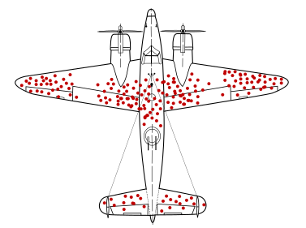
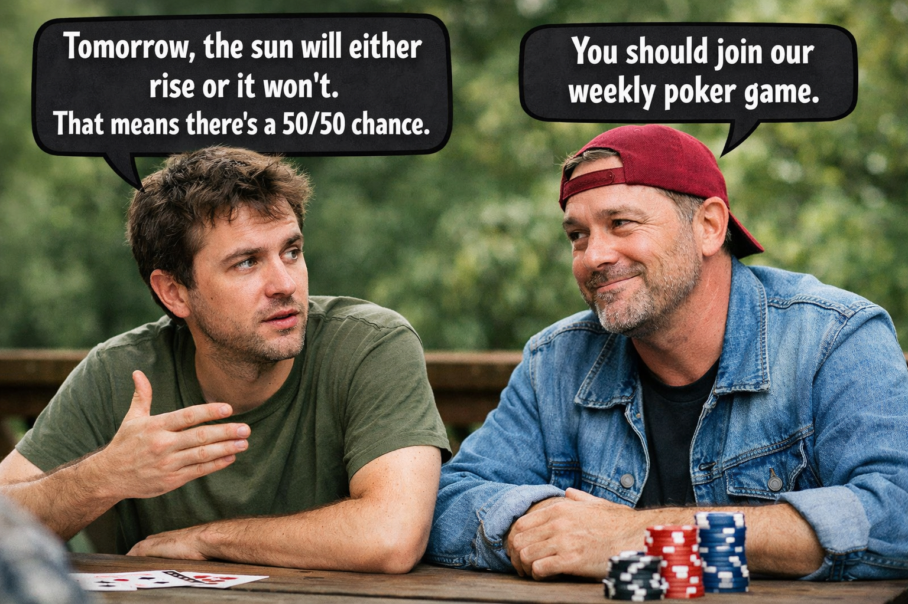
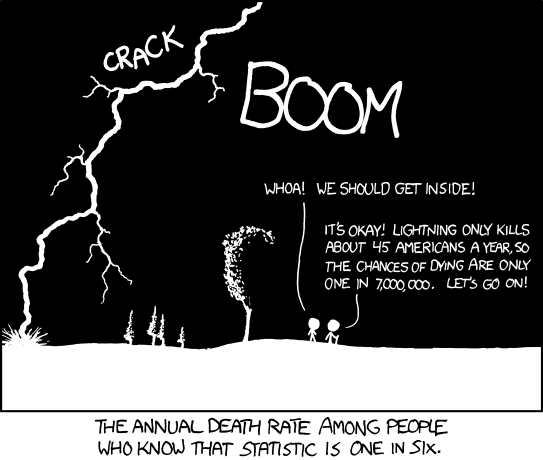
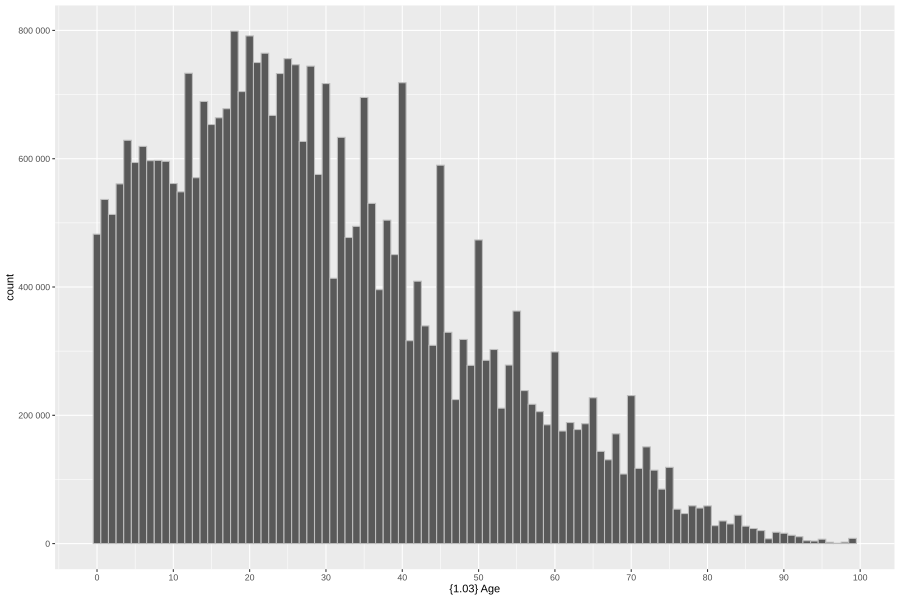

---
format:
  revealjs:
    self-contained: false
    include-in-header:
      - text: |
          <script src="js/dagitty.js"></script>
          <script src="js/graph.js" type="module"></script>
          <script src="https://cdn.jsdelivr.net/npm/jspreadsheet-ce@5/dist/index.js"></script>
          <link rel="stylesheet" href="https://cdn.jsdelivr.net/npm/jspreadsheet-ce@5/dist/jspreadsheet.css">
          <script src="https://cdn.jsdelivr.net/npm/jsuites@5/dist/jsuites.js"></script>
          <link rel="stylesheet" href="https://cdn.jsdelivr.net/npm/jsuites@5/dist/jsuites.css">
---


# Removed slides {.center}

Slides cut from the main decks, kept here for reference and possible reuse.

# From Week 1 (cut 2026-10-18) {.center}

The "Bayes 2" section (distributions come in Week 2, model assumptions in Week 3), and
the long version of "Most studies are wrong. Is that a problem?" with the "Hard data?"
slides on objectivity.

## Every number rests on assumptions

::: {.fragment}
| The number | The assumption behind it |
|---|---|
| 31% chance of rain | This year will be like the last five |
| 3.2% after a positive test | The person was tested at random |
| 14% of discoveries are true | About 1 in 100 tested ideas is true |
:::

::: {.fragment}
Once the assumptions are made, the number follows.
[The assumptions are the part that needs work.]{.red}
:::

::: {.notes}
- Go back through three numbers from today and name the assumption each one needed.
- The 31% chance of rain is a count of past days. Using it as a prediction assumes this year will be like the last five.
- The 3.2% assumes the person was tested at random from the whole population. Among people who come to a clinic with symptoms, the chance is very different.
- The 14% assumes about 1 in 100 tested ideas is true. Nobody can measure that directly.
- The arithmetic in each case is objective: same assumptions, same number, for anyone. The assumptions are where the judgment is, and where the work is.
:::

## Updating improves our assumptions

::: {.incremental}
- A [**prior**]{.red} is an assumption, written down where others can see it and argue
  with it.
- New [**data**]{.blue} test it: does what we saw fit what we assumed?
- The [**posterior**]{.green} is a better assumption, and the starting point next time.
:::

::: {.fragment}
::: {.big-statement}
Assume, look, update. Repeat.
:::
:::

::: {.notes}
- This is the core of the week, and it isn't technical.
- A prior is an assumption we write down, so others can see it and argue with it. That's a strength, not a weakness: assumptions we hide can't be checked.
- New data test the assumption. If what we saw fits what we assumed, our confidence grows. If it doesn't, the assumption moves.
- The posterior is our improved assumption, and tomorrow it's the prior. No single step has to be right. The process gets better.
- "Assume, look, update. Repeat." is the whole method, and it's what good researchers in any field already do. Bayesian statistics just makes it explicit and careful.
:::

## Most studies are wrong. Is that a problem?

_Most studies are wrong._ [...and that's okay.]{.fragment .blue}

::: {.fragment}
- A study was never supposed to be the answer.
- We interpret each study as part of a **larger scientific process**: replication, critique,
  competing explanations, theory, more data.
- That process is what gets things right. Not any single study.
:::

::: {.fragment}
Science doesn't work because individual studies are right. It works because
the field [keeps looking]{.green}.
:::

::: {.notes}
- Back to the capybara: most published research is wrong, and that's okay.
- It's okay because nobody (should) read a study as a verdict. A study is a contribution to an ongoing conversation.
- The process around the study is what does the work: other labs try it again, critics poke holes, someone proposes a better explanation, theory says whether it even makes sense.
- Each study joins an existing body of knowledge. It nudges what we believe, a little or a lot. It doesn't define it.
- Science works really well. It just doesn't work one study at a time.
:::

## Statistics is observation, not answers

::: {.fragment}
- The real problem isn't that studies are wrong. It's that we [expect them to be right]{.red}.
- The HIV scare, the false discoveries, p-hacking: they all come from believing
  statistics is [more powerful than it is]{.red}.
:::

::: {.fragment}
- In ethnography, everyone knows **one interview isn't the answer**. It's one observation,
  weighed against others and argued over.
- We just need to treat a statistical result the same way.
:::

::: {.fragment}
::: {.big-statement}
The science always comes first.
:::
:::

::: {.notes}
- So where do the problems come from? Not from statistics being wrong. The math is fine.
- They come from expecting too much of it. We treat a p-value as an answer to "is this true?" It isn't. It's an observation.
- Go back through today: the person terrified by one positive HIV screen, the 86% of "discoveries" that are false, the analyst trying forks until p < 0.05. Every one of those is someone believing statistics is more powerful than it is.
- Ethnographers already know how to handle this. Nobody writes an ethnography from one interview, or treats one informant as the truth. One interview is an observation. You weigh it against others, think about context, argue about what it means.
- We just need to do the same thing with statistics. A regression, a survey, a significant result: one observation, to be weighed and argued about.
- The science always comes first. The question, the theory, the knowledge of the context. Statistics serves that. It never replaces it.
:::

## Hard data?

> _"Ethnography is subjective. Statistics is objective. It's hard data."_

You've probably heard this. Maybe you've said it.

::: {.fragment}
Let's test it against what we've seen today.
:::

::: {.notes}
- Put the claim up plainly, and don't mock it. Many students have heard it from supervisors, reviewers or funders, and some believe it.
- Ask for a show of hands: who has heard this? Who has said it? It's a fair question to test, and we now have the tools to test it.
:::

## What's true about it

- **The arithmetic is objective.** Same data, same model: same number, every time, for
  anyone.
- **Numbers are easy to share and check.** Anyone can recompute them.
- **Large samples average out some kinds of noise.** Not all of them.

::: {.fragment}
But the arithmetic is the [smallest part of the work]{.red}.
:::

::: {.notes}
- Be fair to the claim first. The arithmetic really is objective: give two people the same data and the same model, and they get the same number.
- Numbers are also easy to share and recompute, which is a real strength.
- The catch: the arithmetic is the last and smallest step. Everything before it (what to measure, who to ask, which model) involves judgment.
:::

## Every number today rested on a choice {.smaller}

| The number | The choice behind it |
|---|---|
| P( rain ) = 31% | Which station, which years, what counts as "rain" (≥ 1 mm), and how to fill gaps in the record |
| P( HIV+ \| test+ ) = 3.2% | Who gets tested. Among people who come to a clinic with symptoms, it's very different. |
| p &lt; 0.05 | Why 5%? A convention. Plus which test, which controls, when to stop collecting data. |
| 14% of "discoveries" are true | A base rate that nobody can measure directly |
| The mayor at about 45% | Who we surveyed, who answered, and the prior we drew |

::: {.fragment}
Once the choices are made, the number is objective. [The choices aren't.]{.red}
:::

::: {.notes}
- Walk down the table. Every number came from earlier in today's lecture, and each one moved when a choice changed.
- Rain: a different station, a different decade or a 0.1 mm threshold gives a different number.
- HIV: the 3.2% is for a random person from the general population. For people tested at a clinic because they have symptoms, the base rate is far higher, and so is the answer.
- p < 0.05: the 5% is a convention from the 1920s, not a law of nature. Choosing the test, the controls and the stopping point are all researcher decisions.
- 14%: depends on a base rate nobody can observe.
- The mayor: depends on who we reached, who answered and what prior we drew.
- None of these choices is wrong. The point is that they are choices, made by people, just like an ethnographer's choices about whom to interview and how to read what they said.
:::

## Objective and subjective

_Statistics and ethnography have the same structure._

::: {.fragment}

|                 | Observation                    | Interesting inferences assume…                     |
|-----------------|--------------------------------|----------------------------------------------------|
| **Ethnography** | interviews, field notes        | what people meant; whose voices stand for others   |
| **Statistics**  | surveys, measurements, records | what causes what; how the data were generated      |

:::

::: {.fragment}
Call the observation "objective" if you like. But interesting inferences rest on [strong assumptions]{.red}, and choosing assumptions is [subjective]{.red}, in both.
:::

::: {.notes}
Updating is the foundation of our statistics: We believed something, we saw something, and we now believe something slightliy or significantly different from what we believed before.

What does that mean?

It's why it's okay that most published research is false.

Observation is messy. We love the mess. We live in the mess. Observation doesn't give us simple answers, but it continuously challenges and reshapes our assumptions.

Science is not the experiments we do. Rather, it's the debates we have about the experiments we do. Over time, we can become less, and less, and less, and less, and less, and less wrong.

This is why I'm always confused when people say statistics is "objective" or "more concrete", and ethnography is "subjective". I don't know what that means. Both have an observational part and an inferential part. We can call the observation part "objective" if we want: the survey responses are what they are, just like the interview transcript is what it is. Inference isn't necessarily subjective. Some inferences are almost mechanical. But the interesting ones, the ones that say something about causes, about people we didn't observe, about what would happen if, are always built on strong assumptions. What causes what, how the data were generated, which priors are reasonable: those assumptions are subjective, just like the ethnographer's assumptions about what people meant are subjective. The difference isn't between objective and subjective fields. The job in both is to state our assumptions openly so others can challenge them.
:::

## The same standard for both

- Both have an **observational** part and an **inferential** part. Neither is "hard" or
  "soft" by nature.
- Trust is **earned** the same way in both: show how the observation was made, state
  your assumptions, let others challenge them, and look again.
- Ethnographers have long practice at this: reflexivity, positionality, thick
  description. Statistics can learn from it.

::: {.fragment}
"Hard data" isn't a property of numbers. It's a claim about how much to trust them.
:::

::: {.fragment}
[Treating it as a property of the numbers is how so much published research ends up
wrong while looking right.]{.red}
:::

::: {.notes}
- The useful distinction isn't objective vs. subjective fields. It's transparent vs. hidden choices.
- Ethnography has spent decades building habits for this: reflexivity (how did I shape what I saw?), positionality (who am I to the people I studied?), thick description (show enough that readers can judge for themselves). Statistics talks less about these habits, and is worse for it.
- Tie it back to Ioannidis: "hard data" is exactly the belief that lets a single significant result pass as truth. Drop the belief, and the problem of most research being wrong becomes manageable. That's the next section.
:::

## Observations add up

_Back to where we started: a study is one observation._

::: {.incremental}
- Bayesian updating is how observations add up: each one moves what we believe, a little or a lot.
- No single study defines what we know. Each one joins an existing body of knowledge and
  nudges it.
- Ethnography works the same way. Understanding comes from many observations, debated over time.
:::

## Doing science

_So what does it mean to put the science first?_

::: {.fragment}
- [**Question every observation.**]{.blue} How was it made? Who's missing? What else could
  have produced it? A positive test, a significant result and an interview can all
  mislead.
:::

::: {.fragment}
- [**Look from different perspectives.**]{.blue} Other methods, other places, other
  people's readings. Surveys, experiments, ethnography and history each see what the
  others miss. When they agree, believe more. When they disagree, look closer.
:::

::: {.fragment}
- [**Think in likelihood, not proof.**]{.blue} Nothing is ever proved. Ask: _how likely is
  what I saw if this were true, compared with if it weren't?_ Beliefs move by degrees,
  and never quite reach 100%.
:::

::: {.fragment}
Statistics doesn't replace any of this. At its best, it's a careful way of doing the
third one. That question is the [likelihood]{.blue}, and updating is how we use it.
:::

::: {.notes}
- "Science first" can sound like a slogan. Make it concrete: these are three habits, and none of them needs math.
- Question every observation. We've already done this today: a positive HIV test turned out to be wrong most of the time, and so did a significant result. Ask how the observation was made and what else could explain it. That's what an ethnographer does with an interview, too.
- Look from different perspectives. No method sees everything. A survey sees breadth, an interview sees meaning, an experiment sees cause in one place, history sees change over time. Agreement across perspectives is strong evidence; disagreement tells you where to look next.
- Think in likelihood, not proof. Science never proves anything for good. We hold beliefs with more or less confidence and move them as evidence comes in. One study nudges a belief; it doesn't settle it.
- That last habit is exactly what Bayesian updating formalizes, which is where we're heading.
:::

## Summary

1. [**Probability is counting.**]{.blue} Count the ways the world could be.
2. [**Direction matters.**]{.blue} P( A | B ) ≠ P( B | A ). A p-value asks about the data in a
   world where nothing is going on. When true hypotheses are rare, most significant
   findings are false.
3. [**That's okay.**]{.blue} A study is one observation, not an answer. It joins what we
   already know and nudges it, but doesn't define it.
4. [**Bayesian updating is one rule**]{.blue} for learning from observation:
   prior × likelihood → posterior.
5. [**Numbers aren't "hard data."**]{.blue} Statistics rests on choices, just like
   ethnography. Trust comes from stating them, not from the numbers.

::: {.fragment}
::: {.big-statement}
The science always comes first.
:::
:::

::: {.notes}
- Four ideas, one per part of the lecture. Read them out slowly.
- If students remember one line, it's the last one: the science always comes first.
- Check for questions here, before the course preview and the appendix.
:::

## Bayesian Updating: Why one rule helps {.mechanics}

::: {.incremental}
- **One rule for everything.** Prior × likelihood → posterior. No flowchart of tests to choose from.
- **No fixed sample size.** Look at the data whenever you like and stop when you've learned enough. The posterior means the same thing either way.\
  [_A p-value depends on the stopping rule you planned in advance. Unplanned peeking breaks it._]{.fragment .blue}
- **Today's posterior is tomorrow's prior.** Updating survey by survey gives the same answer as analyzing all the surveys at once.
- **You build the model to fit your data.** Counts, proportions, skewed incomes: describe the data as they are, instead of picking whichever test's assumptions come closest.
- **Small samples are still valid.** No large-sample approximations. Fewer data mean more uncertainty, and the prior carries more of the weight.
- **It answers the question we actually ask:** P( [hypothesis]{.red} \| [data]{.blue} ).
:::

::: {.notes}
The nice thing about having one process is that a lot of the rules you may have learned for tests simply go away.

Tests need a stopping rule fixed in advance: if you peek at the data and stop when p dips below 0.05, your false positive rate quietly balloons. (Sequential designs can plan for interim looks, but the looks have to be planned and paid for.) Bayesian updating doesn't care when you stop. The posterior is just what you believe given what you've seen so far.

Updating is also cumulative. Last week's posterior becomes this week's prior, and you end up in the same place as if you'd analyzed everything at once.

We still make assumptions, but we choose them to fit the data and we write them down, instead of inheriting them from whichever test we picked. (This is really a contrast between picking tests and building models; frequentist GLMs build models too.) And small samples don't break anything; they leave us more uncertain, and the prior matters more, so it deserves more scrutiny.

Most importantly, it answers the question we actually care about: how plausible is the hypothesis, given the data?
:::

## Isn't the prior subjective?

_Yes. That's a feature, not a bug._

- Every analysis makes assumptions. A p-value hides them: which test, which controls,
  when to stop collecting data.
- A prior puts an assumption **on the table**, written down where anyone can see it and
  argue with it.
- With enough data, people who start from different reasonable priors end up in nearly
  the same place.
- When they don't, the data are weak. That's worth knowing too.

::: {.fragment}
Subjective doesn't mean arbitrary. It means someone made a choice, and has to
[defend it]{.blue}.
:::

::: {.notes}
- Someone will ask. Better to raise it ourselves.
- Yes, priors are a choice. But every method makes choices: which test, which variables to control for, when to stop collecting data, which outcome to report. Frequentist methods make those choices too; they're just less visible.
- A prior is visible. It's written down, so it can be criticized, and we can check how much the answer depends on it (sensitivity analysis, later in the course).
- With plenty of data, reasonable priors converge. With few data, the prior matters, and that is honest: the data alone can't tell us much.
- Lead into the next slide: this isn't special to statistics. Every field that learns from observation makes assumptions.
:::

## You've already done this {.smaller}

|  | [Prior]{.red} | [Likelihood]{.blue} | [Posterior]{.green} |
|---|---|---|---|
| **Means** | What I believed before | How likely what I saw is, under each possibility | What I believe now |
| **Asks** | _"What did I think?"_ | _"If this were true, how likely is what I saw?"_ | _"What do I think now?"_ |
| **Written** | P( belief ) | P( data \| belief ) | P( belief \| data ) |
| **HIV test** | 0.1% of people have HIV | A positive test: 99% likely if HIV+, 3% if HIV– | After a positive test: **3.2%** |
| **Published research** | 1% of tested hypotheses are true | Significant: 80% likely if true, 5% if false | After a significant result: **14%** |
| **Mayor poll** | About 60%, from the last election | 6 of 20 for the mayor: likely if support is ~30%, unlikely if 60% | About **45%** |

::: {.fragment}
The likelihood alone runs the same direction as a p-value: P( data \| belief ). Bayes
doesn't stop there. It combines the likelihood with the prior to answer the question
we actually care about: P( belief \| data ).
:::

::: {.notes}
- Read the definitions row first, then go down the examples. The point: the HIV test and the published-research table were Bayesian updates all along. We just didn't use the names.
- In the HIV row, the prior is prevalence, the likelihood is sensitivity and the false-positive rate, and the posterior is P(HIV+ | test+).
- In the research row, the prior is the base rate, the likelihood is power and α, and the posterior is P(true | significant).
- The mayor poll is the same thing with many possible answers (every vote share from 0 to 100%) instead of two. We'll do it live in the demonstration.
- Address the obvious question head on: "Isn't the likelihood backwards too, like a p-value?" Yes. On its own, it's P(data | belief). A p-value stops there, and only for one imagined world. Bayes computes it for every possibility and combines it with the prior, which turns it around into P(belief | data).
:::

## From two possibilities to many

_The HIV test and published research had **two** possibilities: true or false._

::: {.fragment}
Most questions have many:

- How many of 9 stones in a bag are blue? **10** possibilities, 0 to 9.
- What share of voters support the mayor? **Every** value from 0% to 100%.
:::

::: {.fragment}
Same rule, done once for each possibility:

- [**Prior**]{.red}: how plausible was each possibility before?
- [**Likelihood**]{.blue}: if this possibility were true, how likely is what we saw? For the
  bag, just count the ways it could happen. _(Counting ways)_
- [**Posterior**]{.green}: multiply the two, and compare across possibilities.
:::

::: {.fragment}
The answer is a **distribution**: a plausibility for every possible answer, not a single
yes or no. Let's try it with the bag.
:::

::: {.notes}
- This is the bridge from the HIV and research examples to real models. Those had two possibilities. Most questions have many.
- Nothing about the rule changes. We just do it once for each possibility and compare.
- For the bag of stones, the likelihood is literally counting: for a bag with 3 blue stones, how many ways could we draw blue, black, blue? Compare with a bag with 6 blue. This is the "Counting ways" slide again.
- The output is a distribution, which is why the bag app shows a bar chart rather than a single number. Everything from Week 2 on is about distributions like this.
:::

# From Week 2 (cut 2026-10-03) {.center}

Bayes theorem, priors/posteriors and likelihood: now covered by Week 1.

# Airplanes return from battle
<!-- TODO: turn this into an animation of some sort -->
:::{.r-stack}
{width="80%" style="text-align:center;"}
:::

# Goals this week
- Get more specific about "beliefs"
  - Concept: Parameters
  - Concept: Probability Distributions
- Learn how to use Bayes Theorem
  - Concept: Priors and posteriors
  - Concept: Likelihood
- Design a real analysis


# Parameters: What is a "belief"?

- Beliefs _about what?_
  - "parameters": unknown numerical quantities in the world
  - "estimand": what we want to find out (often a parameter)

- Refined Definition:
  - P(belief): P(belief about the possible values of a parameter)
  - Shorthand: P(params) or P(Θ)


# Parameters: Examples

A parameter is a numerical fact about the world that we don't know (but want to find out)

- The average height of adults in Pokhara
- The number of cars driven in Kathmandu on a typical Saturday
- The average exam results in a particular school
- The difference between men's and women's salaries
- The effect of socioeconomic status on college admissions
- The effect of education level on moral judgments


# Practical: Who will win the election?
- Last election: the current candidate got 60% of the votes.
- We have the resources to conduct a survey.
- (Many non-statistical problems to solve when we design a survey.)
- What do we need to provide a meaningful statistical answer?

# Practical: Bayes Theorem

$$
\color{green}{P(\text{belief} \mid \text{data})}
=
\frac{
\color{#1b91ff}{P(\text{data} \mid \text{belief})}
\;\color{#ff2c2d}{P(\text{belief})}
}{
\color{#999}{P(\text{data})}
}
$$

:::{.nonincremental}
- [**P(belief)**]{.red}: prior 
- [**P(belief | data)**]{.green}: posterior
- [**P(data | belief)**]{.blue}: likelihood
- [**P(data)**]{.gray}: marginal likelihood (not interesting)
:::

prior ⨉ likelihood → posterior


# Priors and Posteriors: Updating
P(belief) → P(belief | data)

::: {.columns}

::: {.column}
::: {.r-stack}
::: {.fragment}
```{r}
curve(
  dnorm(x, mean = 60, sd = 10),
  from = 0,
  to = 100,
  ylim = c(0, 0.1),
  col = "red",
  xlab = "",
  lwd = 2,
  ylab = ""
)
legend(
  "topright",
  legend = c("Prior", "Posterior"),
  col = c("red", "blue"),
  lwd = 2
)
```
:::
::: {.fragment}
```{r}
# plot(y ~ rnorm(0, 1))
curve(
  dnorm(x, mean = 60, sd = 10),
  from = 0,
  to = 100,
  ylim = c(0, 0.1),
  col = "red",
  lwd = 2,
  xlab = "",
  ylab = ""
)
curve(
  dnorm(x, mean = 40, sd = 10),
  from = 0,
  to = 100,
  col = "blue",
  lwd = 2,
  add = TRUE
)
legend(
  "topright",
  legend = c("Prior", "Posterior"),
  col = c("red", "blue"),
  lwd = 2
)
```
:::
:::
:::

::: {.column}
::: {.r-stack}
::: {.fragment}
```{r}
curve(
  dnorm(x, mean = 40, sd = 10),
  from = 0,
  to = 100,
  ylim = c(0, 0.1),
  col = "red",
  xlab = "",
  ylab = "",
  lwd = 2
)
legend(
  "topright",
  legend = c("Prior", "Posterior"),
  col = c("red", "blue"),
  lwd = 2
)
```
:::
::: {.fragment}
```{r}
# plot(y ~ rnorm(0, 1))
curve(
  dnorm(x, mean = 40, sd = 10),
  from = 0,
  to = 100,
  ylim = c(0, 0.1),
  col = "red",
  lwd = 2,
  xlab = "",
  ylab = ""
)
curve(
  dnorm(x, mean = 40, sd = 5),
  from = 0,
  to = 100,
  col = "blue",
  lwd = 2,
  add = TRUE
)
legend(
  "topright",
  legend = c("Prior", "Posterior"),
  col = c("red", "blue"),
  lwd = 2
)
```
:::
:::
:::
:::


::: {.columns}
::: {.column}
::: {.r-stack}
::: {.fragment}
```{r}
curve(
  dnorm(x, mean = 40, sd = 5),
  from = 0,
  to = 100,
  ylim = c(0, 0.1),
  col = "red",
  lwd = 2,
  xlab = "",
  ylab = ""
)
legend(
  "topright",
  legend = c("Prior", "Posterior"),
  col = c("red", "blue"),
  lwd = 2
)
```
:::
::: {.fragment}
```{r}
# plot(y ~ rnorm(0, 1))
curve(
  dnorm(x, mean = 40, sd = 5),
  from = 0,
  to = 100,
  ylim = c(0, 0.1),
  col = "red",
  lwd = 2,
  xlab = "",
  ylab = ""
)
curve(
  dnorm(x, mean = 35, sd = 4),
  from = 0,
  to = 100,
  col = "blue",
  lwd = 2,
  add = TRUE
)
legend(
  "topright",
  legend = c("Prior", "Posterior"),
  col = c("red", "blue"),
  lwd = 2
)
```
:::
:::
:::

::: {.column}
::: {.r-stack}
::: {.fragment}
```{r}
curve(
  dnorm(x, mean = 35, sd = 4),
  from = 0,
  to = 100,
  ylim = c(0, 0.1),
  col = "red",
  lwd = 2,
  xlab = "",
  ylab = ""
)
legend(
  "topright",
  legend = c("Prior", "Posterior"),
  col = c("red", "blue"),
  lwd = 2
)
```
:::
::: {.fragment}
```{r}
# plot(y ~ rnorm(0, 1))
curve(
  dnorm(x, mean = 35, sd = 4),
  from = 0,
  to = 100,
  ylim = c(0, 0.1),
  col = "red",
  lwd = 2,
  xlab = "",
  ylab = ""
)
curve(
  dnorm(x, mean = 50, sd = 10),
  from = 0,
  to = 100,
  col = "blue",
  lwd = 2,
  add = TRUE
)
legend(
  "topright",
  legend = c("Prior", "Posterior"),
  col = c("red", "blue"),
  lwd = 2
)
```
:::
:::
:::
:::


# Priors and Posteriors: DIY Prior

<style>
  .prior-layout{
    display: flex;
    gap: 16px;
    align-items: flex-start;
    width: 100%;
  }
  #graph-wrapper{
    flex: 0 0 70%;
    aspect-ratio: 3/2;
  }
  #sheet-wrapper{
    flex: 1 1 auto;
    min-width: 260px;
    font-size: 16pt;
  }
  .sheet-controls{
    margin-top: 8px;
    text-align: right;
  }
  #sheet-reset{
    font-size: 12pt;
    padding: 6px 10px;
  }
  .jss_about {
    display: none;
  }
  .jss_textarea{
    position: absolute !important;
    left: -10000px !important;
    top: 0 !important;
    width: 1px !important;
    height: 1px !important;
    opacity: 0 !important;
    pointer-events: none !important;
  }
</style>

```{=html}
<div class="prior-layout">
  <div id="graph-wrapper"></div>
  <div>
    <div id="sheet-wrapper"></div>
    <div class="sheet-controls">
      <button id="sheet-reset" type="button">Reset</button>
    </div>
  </div>
</div>
```

<script type="module">
  import { LineGraphWidget } from './js/graph.js';

  const graphEl = document.getElementById('graph-wrapper');
  const sheetEl = document.getElementById('sheet-wrapper');
  const resetBtn = document.getElementById('sheet-reset');
  const STORAGE_KEY = 'diy-prior-values-v1';

  if (!graphEl || !sheetEl) {
    console.warn('DIY Prior: missing graph or sheet container.');
  } else if (!graphEl.dataset.initialized) {
    graphEl.dataset.initialized = 'true';

    let widget = null;
    let ws = null;

    function loadStoredValues() {
      try {
        const raw = localStorage.getItem(STORAGE_KEY);
        if (!raw) return null;
        const parsed = JSON.parse(raw);
        if (!Array.isArray(parsed)) return null;
        return parsed.map((v) => Number(v));
      } catch {
        return null;
      }
    }

    function saveStoredValues(values) {
      try {
        localStorage.setItem(STORAGE_KEY, JSON.stringify(values));
      } catch {
        // ignore storage errors
      }
    }

    function pointsToTable(points) {
      const ys = points.map(p => Number(p.y) || 0);
      const sum = ys.reduce((a, b) => a + b, 0);
      return ys.map((v,i) => [i*0.05, v, sum > 0 ? v / sum : 0]);
    }

    function getWorksheetHandle(obj) {
      if (!obj) return null;

      if (typeof obj.setData === 'function' ||
          typeof obj.loadData === 'function' ||
          typeof obj.setValueFromCoords === 'function' ||
          typeof obj.setValue === 'function') {
        return obj;
      }

      if (Array.isArray(obj)) return getWorksheetHandle(obj[0]);
      if (Array.isArray(obj.worksheets)) return getWorksheetHandle(obj.worksheets[0]);
      if (typeof obj.getWorksheet === 'function') return getWorksheetHandle(obj.getWorksheet(0));

      return null;
    }

    function updateSheet(points) {
      if (!ws) return;
      const data = pointsToTable(points);

      if (typeof ws.setData === 'function') {
        ws.setData(data);
        return;
      }
      if (typeof ws.loadData === 'function') {
        ws.loadData(data, true);
        return;
      }
      if (typeof ws.setValueFromCoords === 'function') {
        for (let r = 0; r < 21; r++) {
          ws.setValueFromCoords(0, r, data[r][0], true);
          ws.setValueFromCoords(1, r, data[r][1], true);
        }
        return;
      }
      if (typeof ws.setValue === 'function') {
        for (let r = 0; r < 21; r++) {
          ws.setValue(`A${r + 1}`, data[r][0], true);
          ws.setValue(`B${r + 1}`, data[r][1], true);
        }
      }
    }

    function ensureReadyThenInit() {
      const rect = graphEl.getBoundingClientRect();
      const visible = rect.width > 0 && rect.height > 0;
      if (!visible) return false;

      if (window.Reveal?.getCurrentSlide) {
        const cur = window.Reveal.getCurrentSlide();
        if (!cur?.querySelector('#graph-wrapper')) return false;
      }

      if (!widget) {
        graphEl.innerHTML = '';
        sheetEl.innerHTML = '';

        const stored = loadStoredValues();
        const initialValues = Array.isArray(stored) && stored.length === 21
          ? stored
          : Array.from({ length: 21 }, () => 50);

        widget = new LineGraphWidget({
          container: graphEl,
          yValues: initialValues,
          onChange: (points) => {
            updateSheet(points);
            saveStoredValues(points.map((p) => p.y));
          },
        });

        const initData = pointsToTable(widget.getPoints());
        const created = window.jspreadsheet(sheetEl, {
          tabs: false,
          worksheets: [{
            data: initData,
            editable: false,
            minDimensions: [2, 21],
            rowHeaders: (rowIndex) => (rowIndex * 0.05).toFixed(2),
            allowInsertRow: false,
            allowDeleteRow: false,
            allowInsertColumn: false,
            allowDeleteColumn: false,
            columnSorting: false,
            columns: [
              { type: 'numeric', title: 'Voters', width: 90, mask: '0%' },
              { type: 'numeric', title: 'Score', width: 90, mask:'0.00' },
              { type: 'numeric', title: 'Probability', width: 120, mask: '0.0000' },
            ],
            selectionCopy: true,   // enables copying selected range
            selection: true,       // ensures range selection is on (harmless if default)
          }],
        });

        Promise.resolve(created).then((spreadsheet) => {
          ws = getWorksheetHandle(spreadsheet);
          if (!ws) {
            console.log('jspreadsheet return value:', spreadsheet);
            throw new Error('Could not find a worksheet handle. See console log for returned object.');
          }
          updateSheet(widget.getPoints());
        });

        if (resetBtn) {
          resetBtn.addEventListener('click', () => {
            const resetValues = Array.from({ length: 21 }, () => 50);
            widget.setYValues(resetValues);
            saveStoredValues(resetValues);
          });
        }
      }

      return true;
    }

    const observer = new ResizeObserver(() => {
      if (ensureReadyThenInit()) observer.disconnect();
    });
    observer.observe(graphEl);

    const runWhenReady = () => {
      if (!ensureReadyThenInit()) requestAnimationFrame(runWhenReady);
    };

    if (window.Reveal?.on) {
      Reveal.on('ready', runWhenReady);
      Reveal.on('slidechanged', runWhenReady);
    } else {
      window.addEventListener('load', runWhenReady);
      runWhenReady();
    }
  }
</script>


# Likelihood: Probability in the World
:::{.r-stack}

:::{.fragment .fade-in-then-out}
{width="900px"}
:::

:::{.fragment}
{width="900px"}
:::

:::

::: {.fragment}
Probability isn't just in our heads. Sometimes, it's generated by a process in the world.
:::


# Likelihood: Building Models
- From Bayes theorem, we know that likelihood is: P( data | parameters )
- But what does this mean?

::: {.fragment .callout-tip}
## Instead of starting with our beliefs, likelihood starts with what we *saw*.
We surveyed 15 people and 4 said that they will vote for the current mayor.
:::

- Now, we need to ask, "How consistent is this observation with different possible values of our parameter?"
- Given a particular parameter value, how likely are the data we saw?
  - If our parameter is _actually_ 50%, what are the chances of seeing 4 out of 15?
  - If our parameter is _actually_ 30%, what are the chances of seeing 4 out of 15?
  - If our parameter is _actually_ 80%, what are the chances of seeing 4 out of 15?

::: {.fragment}
These are questions that any calculator can answer.
:::

# Likelihood: So what it is
<!-- TODO: Expand this to include a better comparison -->
- For priors and posteriors, randomness is about our uncertainty (a subjective experience).
- For likelihood, randomness is generated by specific processes in the world.
- Our job is to describe how patterns of variation (including randomness) occur.

# Grid approximation worksheet
<!-- TODO: Implement worksheet -->

<div id="sheet1" style="width:100%; font-size: 14pt;"></div>

<script>
(() => {
  const el = document.getElementById("sheet1");

  const rows = 21, cols = 8;
  const data = Array.from({ length: rows }, () => Array(cols).fill(0));

  const columns = Array.from({ length: cols }, (_, i) => ({
    type: "numeric",
    title: `Col ${i + 1}`,
    width: 150
  }));

  // Newer API: worksheets is required
  window.sheet1 = jspreadsheet(el, {
    plugins: [
      // clipboard plugin is typically exposed as `jspreadsheet.plugins.clipboard`
      // jspreadsheet.plugins.clipboard
    ],
    worksheets: [{
      data,
      columns,
      minDimensions: [cols, rows]
    }],
    tableOverflow: true,
    tableWidth: "100%",
    tableHeight: "420px"
  });
})();
</script>

# From Week 2 (cut 2026-10-25) {.center}

The old opening (the three kinds as data, belief and relationships), the admissions
framing of "Randomness has patterns" (now a Galton board), and the spurious-correlation
section (ice cream and temperature; confounding now waits for Weeks 3 and 4). The
pure-noise slides stayed in the deck. Card classes were renamed since: .kind-data,
.kind-belief and .kind-relationship are now .kind-population, .kind-certainty and
.kind-correlative. The average pilot, then Nepal's LDC graduation, opened the reworked deck briefly,
before the scanner puzzle replaced them. (The graduation is still in the deck, as the
scanner puzzle's real-world case. Its opener needs `u5_shift`, each group's average under-5 mortality with and
without the graduates (`before`/`after`, `ldc`/`other`), and `nepal_u5`, computed from
`ldc_countries()` in r/week2.R.)

The new-scanner puzzle (made-up hospital, both stages' survival falls), with its seesaw
explanation, and Nepal's LDC graduation as the real-world case (widget:
js/ldc-shift.js, _includes/week2/ldc-shift.md). Replaced by the village of ten
households. Their R helpers were removed from r/week2.R; here they are:

```{r eval = FALSE}
# ---- The opening puzzle: Nepal leaves the least developed countries -----------------

# The UN's least developed countries (44, as of 19 December 2024), by World Bank code
LDC_CODES <- c(
  "AFG", "AGO", "BGD", "BEN", "BFA", "BDI", "KHM", "CAF", "TCD", "COM", "COD", "DJI",
  "ERI", "ETH", "GMB", "GIN", "GNB", "HTI", "KIR", "LAO", "LSO", "LBR", "MDG", "MWI",
  "MLI", "MRT", "MOZ", "MMR", "NPL", "NER", "RWA", "SEN", "SLE", "SLB", "SOM", "SSD",
  "SDN", "TLS", "TGO", "TUV", "UGA", "TZA", "YEM", "ZMB"
)

# Scheduled to graduate together on 24 November 2026 (A/RES/76/8). Nepal has since
# asked to defer to 2029.
LDC_GRADUATES <- c(BGD = "Bangladesh", LAO = "Laos", NPL = "Nepal")

# Every developing country, 2022: the LDCs, and every other low- or middle-income
# economy. Under-5 mortality (deaths per 1,000 children) and GNI per person (US$).
# Membership of the LDCs comes from the UN list, not the World Bank's income groups
# (which leave some countries, Ethiopia among them, unclassified).
ldc_countries <- function() {
  indicators <- load_wb(c("SH.DYN.MORT", "NY.GNP.PCAP.CD")) |>
    rename(u5 = SH.DYN.MORT, gni = NY.GNP.PCAP.CD)
  load_wb_countries() |>
    select(code = Code, name = Economy, income = `Income group`) |>
    filter(
      code %in% LDC_CODES |
        income %in% c("Low income", "Lower middle income", "Upper middle income")
    ) |>
    left_join(indicators, by = "code") |>
    mutate(ldc = code %in% LDC_CODES, graduate = code %in% names(LDC_GRADUATES))
}

# For the widget on "The same puzzle, in Nepal" (js/ldc-shift.js)
ldc_widget_data <- function(countries) {
  json_script("ldc-data", countries |>
    filter(!is.na(u5) | !is.na(gni)) |>
    transmute(name = if_else(graduate, LDC_GRADUATES[code], name), ldc, graduate, u5, gni))
}

# ---- The opening puzzle: the new scanner -------------------------------------------

# A made-up cancer hospital: how many years each patient lives after diagnosis, by
# stage. The old scanner read Ram's swollen lymph node as spread, so he's counted in
# stage 2. The new scanner shows his cancer hasn't spread, and moves him to stage 1.
SCANNER <- list(
  stage1 = c(7, 8, 9, 10, 11),
  stage2 = c(1, 1.5, 2, 2.5, 5),
  mover = 5,
  name = "Ram"
)

# Each stage's average years of survival, with the old scanner and the new:
# before[["stage1"]], after[["stage2"]], ...
scanner_averages <- function(s = SCANNER) {
  list(
    before = c(stage1 = mean(s$stage1), stage2 = mean(s$stage2)),
    after = c(stage1 = mean(c(s$stage1, s$mover)), stage2 = mean(setdiff(s$stage2, s$mover)))
  )
}

# "The new scanner": the puzzle as a slope chart, old scanner to new. Step 1: each
# stage's average years lived, with the old scanner. 2: with the new one, both averages
# fall. 3: every patient's own years behind them, as thin lines, all flat.
knitr::opts_template$set(slope = list(fig.width = 8.5, fig.height = 6.6, out.width = "100%"))

scanner_slope_plot <- function(step, s = SCANNER) {
  avg <- scanner_averages(s)
  stages <- tibble(
    stage = c("Stage 1", "Stage 2"),
    before = avg$before,
    after = avg$after,
    color = c(BLUE, INK)
  )
  patients <- tibble(years = c(s$stage1, s$stage2))

  p <- ggplot() +
    scale_x_continuous(
      breaks = 1:2, labels = c("Old scanner", "New scanner"),
      limits = c(0.45, 2.55), position = "top"
    ) +
    scale_y_continuous(limits = c(0, 12), breaks = seq(0, 12, 2)) +
    labs(x = NULL, y = "Years lived after diagnosis") +
    theme(
      panel.grid.major.x = element_blank(),
      axis.text.x.top = element_text(size = 24, face = "bold", color = INK)
    )
  if (step >= 3) {
    p <- p +
      geom_segment(
        data = patients, aes(x = 1, xend = 2, y = years, yend = years),
        color = tint(GRAY, 0.55), linewidth = 1
      ) +
      geom_point(data = patients, aes(1, years), color = tint(GRAY, 0.55), size = 3) +
      geom_point(data = patients, aes(2, years), color = tint(GRAY, 0.55), size = 3)
  }
  if (step >= 2) {
    p <- p +
      geom_segment(
        data = stages, aes(x = 1, xend = 2, y = before, yend = after, color = I(color)),
        linewidth = 2.5
      ) +
      geom_point(data = stages, aes(2, after, color = I(color)), size = 7) +
      geom_text(
        data = stages, aes(2, after, label = paste0(fmt(after), "  ▼")),
        hjust = -0.25, size = 9, fontface = "bold", color = RED
      )
  }
  p +
    geom_point(data = stages, aes(1, before, color = I(color)), size = 7) +
    geom_text(
      data = stages, aes(1, before, label = paste0(stage, "  ", fmt(before)), color = I(color)),
      hjust = 1.12, size = 8, fontface = "bold"
    )
}

# "Why both averages fall": the scanner puzzle as two seesaws. Each stage's patients
# sit on a beam that balances at the stage's average. Step 1: the two stages. 2: Ram is
# on the long-lived side of stage 2's balance point, and would be on the short-lived
# side of stage 1's. 3: the new scanner moves him, and both beams tip the same way.
# 4: both balance points move toward shorter lives.
knitr::opts_template$set(balance = list(fig.width = 10, fig.height = 6.2, out.width = "100%"))

balance_plot <- function(step, s = SCANNER) {
  num <- function(x) fmt(x, 1) # as the opening slide writes them: 9.0, 2.4
  xmax <- 12.5
  moved <- step >= 3
  avg <- scanner_averages(s)
  rows <- tibble(
    group = c("stage1", "stage2"),
    y = c(2.2, 0),
    label = c("Stage 1: cancer only where it started", "Stage 2: cancer that has spread"),
    before = avg$before,
    after = avg$after
  )
  rows$pivot <- if (step >= 4) rows$after else rows$before
  rows$slope <- if (step == 3) 0.05 else 0 # tipped toward the short-lived end
  dots <- bind_rows(
    tibble(group = "stage1", x = if (moved) c(s$stage1, s$mover) else s$stage1),
    tibble(group = "stage2", x = if (moved) setdiff(s$stage2, s$mover) else s$stage2)
  ) |>
    left_join(rows, by = "group") |>
    mutate(
      mover = x == s$mover & ((group == "stage2") != moved),
      yb = y + slope * (x - pivot) + 0.17
    )
  beams <- rows |>
    mutate(x0 = 0, x1 = xmax, y0 = y + slope * (x0 - pivot), y1 = y + slope * (x1 - pivot))
  w <- 0.027 * xmax # half the fulcrum's width
  fulcrums <- rows |>
    rowwise() |>
    reframe(group, x = pivot + c(0, -w, w), yy = y + c(-0.03, -0.45, -0.45))

  p <- ggplot() +
    theme_void() +
    coord_cartesian(xlim = c(-0.2, xmax + 0.2), ylim = c(-1.45, 3.1), clip = "off")
  if (step == 2) {
    p <- p +
      annotate(
        "rect",
        xmin = avg$before[["stage2"]], xmax = avg$before[["stage1"]],
        ymin = -0.7, ymax = 2.6, fill = tint(RED, 0.12)
      ) +
      annotate(
        "text",
        x = mean(avg$before), y = 1.1, label = "between the two averages",
        color = RED, size = 7, fontface = "italic"
      )
  }
  if (step >= 4) {
    p <- p +
      geom_segment(
        data = rows, aes(x = before, xend = before, y = y - 0.1, yend = y + 0.55),
        color = GRAY, linetype = "dashed", linewidth = 1
      ) +
      geom_segment(
        data = rows, aes(x = before, xend = after, y = y - 0.95, yend = y - 0.95),
        color = RED, linewidth = 1.3,
        arrow = arrow(length = unit(0.12, "inches"), type = "closed")
      ) +
      geom_text(
        data = rows, aes(x = after, y = y - 0.95, label = paste0("−", num(before - after))),
        color = RED, size = 7, hjust = 1.25, fontface = "bold"
      )
  }
  p <- p +
    geom_segment(data = beams, aes(x = x0, xend = x1, y = y0, yend = y1), color = INK, linewidth = 2) +
    geom_polygon(data = fulcrums, aes(x, yy, group = group), fill = INK) +
    geom_text(
      data = rows, aes(x = pivot, y = y - 0.62, label = paste("average", num(pivot), "years")),
      size = 6.5, color = INK
    ) +
    geom_text(
      data = rows, aes(x = 0, y = y + 0.72, label = label),
      hjust = 0, size = 8, fontface = "bold", color = INK
    ) +
    geom_point(
      data = dots, aes(x, yb),
      color = if_else(dots$mover, RED, if_else(dots$group == "stage1", BLUE, GRAY)),
      size = 9
    ) +
    geom_text(
      data = filter(dots, mover), aes(x, yb + 0.32), label = s$name,
      color = RED, size = 7, fontface = "bold"
    )
  if (step == 2) {
    p <- p +
      annotate("point", x = s$mover, y = 2.37, shape = 21, size = 9, stroke = 1.5, color = RED, fill = "white") +
      annotate("text", x = s$mover, y = 1.8, label = "if the scanner rules out spread", color = RED, size = 6.5)
  }
  p + annotate(
    "text",
    x = xmax, y = -1.4, label = "Years each patient lives after diagnosis (made-up)  →  longer",
    hjust = 1, size = 6, color = GRAY
  )
}
```

# The new scanner

_A cancer hospital buys a sharper scanner. A year later, it checks its numbers._

::: {.columns}
::: {.column width="58%"}
::: {.r-stack}
::: {.fragment .fade-out fragment-index=1}
```{r slope-1, opts.label = "slope"}
scanner_slope_plot(1)
```
:::

::: {.fragment .fade-in-then-out fragment-index=1}
```{r slope-2, opts.label = "slope"}
scanner_slope_plot(2)
```
:::

::: {.fragment fragment-index=2}
```{r slope-3, opts.label = "slope"}
scanner_slope_plot(3)
```
:::
:::
:::

::: {.column width="42%"}
Average years lived after diagnosis, by stage.

- [**Stage 1**, cancer only where it started: [down]{.red}, from
  `r fmt(scan$before[["stage1"]])` to `r fmt(scan$after[["stage1"]])`.]{.fragment fragment-index=1}
- [**Stage 2**, cancer that has spread: [down]{.red} too, from
  `r fmt(scan$before[["stage2"]])` to `r fmt(scan$after[["stage2"]])`.]{.fragment fragment-index=1}
- [Each gray line is one patient. Every line is flat: [nobody lives a day
  less]{.blue}.]{.fragment fragment-index=2}

::: {.fragment fragment-index=3 .big-statement}
Both averages fall.\
Nobody's line does.\
How?
:::
:::
:::

[A made-up hospital. Real hospitals have seen this effect, usually in the opposite direction
(scans that find more spread make both stages look better): Feinstein, Sosin and Wells, "The
Will Rogers phenomenon," *New England Journal of Medicine* (1985).]{.source}

::: {.notes}
- Week 1 opened with a claim that sounded wrong and turned out true. This week opens with a puzzle. Don't solve it here: leave it open, and come back to it in Part 1, after "One hump or two?".
- Set it up. A cancer hospital sorts its patients into two stages: stage 1, where the cancer is only where it started, and stage 2, where it has spread. Stage 1 patients live much longer. The hospital buys a sharper scanner, and a year later checks how long its patients live.
- The chart: years lived after diagnosis, with the old scanner on the left and the new one on the right. First, each stage's average with the old scanner: stage 1 patients live 9 years on average, stage 2 patients 2.4.
- Click: the new scanner. Both lines slope down: stage 1 to 8.3 years, stage 2 to 1.8.
- Click: the gray lines behind are the patients, one line each, from their years with the old scanner to their years with the new. Every one is flat. A scanner doesn't treat anyone; it only changes what the hospital sees. Not one patient lives a day less.
- Click: so how can both averages fall when every line is flat? Let the room argue. Someone may suspect the scanner is faulty, or that sicker patients started coming. Neither: same patients, same lives, a better picture.
- Why it matters: hospitals, health ministries and donors compare survival by stage, between hospitals and over time. A hospital that buys better equipment can look worse on paper. One that has none can look better. The numbers are made up, but the effect is real and documented.
- If someone knows the classic version: it usually runs the other way. Scans that find hidden spread move the sickest stage 1 patients into stage 2, and both stages look better. Feinstein and colleagues named it the Will Rogers phenomenon in 1985, after his joke that when Oklahomans moved to California, they raised the average intelligence of both states. Here the scanner rules spread out, so patients move the other way, and both stages look worse. Same mechanism.
:::

## Why both averages fall

_Back to the hospital. An average is where a distribution balances._

::: {.columns}
::: {.column width="62%"}
::: {.r-stack}
::: {.fragment .fade-out fragment-index=1}
```{r balance-1, opts.label = "balance"}
balance_plot(1)
```
:::

::: {.fragment .fade-in-then-out fragment-index=1}
```{r balance-2, opts.label = "balance"}
balance_plot(2)
```
:::

::: {.fragment .fade-in-then-out fragment-index=2}
```{r balance-3, opts.label = "balance"}
balance_plot(3)
```
:::

::: {.fragment fragment-index=3}
```{r balance-4, opts.label = "balance"}
balance_plot(4)
```
:::
:::
:::

::: {.column width="38%"}
Each stage's patients sit on a seesaw. Its average is the balance point.

- [The old scanner read Ram's swollen lymph node as spread. He's the longest-lived
  patient in stage 2…]{.fragment fragment-index=1}
- […and would be the shortest-lived in stage 1.]{.fragment fragment-index=1}
- [The new scanner rules out spread, and moves him. Both seesaws tip the same
  way.]{.fragment fragment-index=2}
- [Both balance points move toward [shorter lives]{.red}. Ram lives exactly as long as
  before.]{.fragment fragment-index=3}
:::
:::

::: {.fragment fragment-index=4 .big-statement}
Change who's in the crowd, and the average changes, even when nobody does.
:::

::: {.notes}
- The opening puzzle, solved. The picture: each stage's patients sit on a seesaw. The average is the balance point, the one spot where the seesaw balances. That's a good way to think of any average: the center of a distribution.
- Click: Ram (red) is in stage 2, because the old scanner read his swollen lymph node as spread. He sits right of stage 2's balance point: he lives longer than any other stage 2 patient. The shaded band is everything between the two averages. Ram is in it: in stage 1 (the hollow circle), he'd sit left of the balance point, the shortest-lived patient there.
- Click: the new scanner shows the node is harmless, and Ram moves to stage 1. Stage 1 gains weight at its short-lived end, so it tips that way. Stage 2 loses its longest-lived patient, so it tips the same way. Both tip left.
- Click: each seesaw finds its new balance point, further left. The dashed lines show where they were; the arrows show how far they moved. Both averages are worse, and every patient lives exactly as long as before.
- The rule: a case between the two averages makes both averages worse when it moves up to the better group, and both better when it moves down. Ask: what would make both look better? (A scanner that finds hidden spread, moving patients down. That's the classic version.)
- Click: the lesson. An average is a property of a group, so it changes when the group's membership changes, even if no member changes. That's why we look at the whole distribution, not just the average: it shows who's in the group, and where.
:::

## The same puzzle, in Nepal

_Nepal, Bangladesh and Laos are due to leave the UN's list of Least Developed Countries.
Predict: what happens to each group's average child mortality?_

```{r ldc-data}
ldc_widget_data(ldc)
```



[UN Committee for Development Policy, list of LDCs (as of 19 December 2024); World Bank,
World Development Indicators, 2022. Averages across countries. Graduation was set for
24 November 2026; Nepal has asked to defer it to 2029.]{.source}

::: {.notes}
- Now the real thing. Since 1971 the UN has kept a list of Least Developed Countries (LDCs), based on income, health and education, and on how exposed an economy is to shocks. Being on the list brings trade preferences, cheaper loans and aid. Nepal has been on it since the list began. It now meets the criteria to leave, and was due to graduate on 24 November 2026, together with Bangladesh and Laos.
- Every developing country is a dot: the LDCs on top, the rest underneath. Each row's average child mortality is the black line.
- Before clicking, ask the room to predict, using the seesaw. Where are Nepal, Bangladesh and Laos (red) in the top row? Near the healthy end: Nepal loses 27.5 children per 1,000, against an LDC average of about 66. Where would they sit in the bottom row? Above its average of 22: less healthy than the typical country they're joining. So they're between the two averages, like Ram. What happens when they move up?
- Click "Graduate". Both averages get worse: the LDCs lose three of their healthiest members, and the others gain three below their average. The LDC average rises from about 66 to 69 deaths per 1,000; the others' from 22.1 to 22.5. No child's chances changed.
- Switch to "Income per person" and graduate again. Same story: both averages get poorer. (Income is on a log scale, so the long right tail of richer countries fits on the screen.)
- Why it matters: "Progress stalls in the least developed countries" is exactly the headline this produces, and aid, debt relief and UN reviews lean on group averages like these. One country's success can make its old group look worse.
- The off-scale country on the right is the Central African Republic: 387 deaths per 1,000 in the World Bank's 2022 figure, a crisis-year spike (other years are closer to 100). One extreme value pulls an average a long way. The result doesn't depend on it.
- If someone asks about the date: in May 2026 Nepal asked the UN to defer graduation to November 2029, citing remittances, supply chains and global uncertainty. In July the UN's Committee for Development Policy recommended granting the extension. Nepal still meets the criteria. Whether it should leave the list, and when, is a live debate. The averages behave the same whenever it happens.
- The numbers are averages across countries, each country counting once (the "average LDC"). Population-weighted, Bangladesh would dominate. The data are 2022, the latest year in the course's World Bank file.
:::

# The day Nepal graduates

_Nepal, Bangladesh and Laos are due to leave the UN's list of Least Developed Countries._

::: {.ideas}
::: {.idea .fragment}
[Least developed countries]{.idea-label}

[`r fmt(u5_shift$after[["ldc"]])`]{.idea-number .red}

Average child deaths per 1,000 born: **up**, from `r fmt(u5_shift$before[["ldc"]])`
:::

::: {.idea .fragment}
[The rest of the developing world]{.idea-label}

[`r fmt(u5_shift$after[["other"]])`]{.idea-number .red}

Average child deaths per 1,000 born: **up** too, from `r fmt(u5_shift$before[["other"]])`
:::

::: {.idea .fragment}
[Nepal]{.idea-label}

[`r fmt(nepal_u5)`]{.idea-number .blue}

Nepal's own child deaths per 1,000: **unchanged**. So is every other country's.
:::
:::

::: {.fragment .big-statement}
Both averages get worse. Not one country does.\
How?
:::

[UN Committee for Development Policy, list of LDCs (as of 19 December 2024); World Bank,
World Development Indicators, 2022. Averages across countries. Graduation was set for
24 November 2026; Nepal has asked to defer it to 2029.]{.source}

::: {.notes}
- Week 1 opened with a claim that sounded wrong and turned out true. This week opens with a puzzle. Don't solve it here: leave it open, and come back to it in Part 1, after "One hump or two?".
- Set it up. Since 1971 the UN has kept a list of Least Developed Countries (LDCs), based on income, health and education, and on how exposed an economy is to shocks. Being on the list brings trade preferences, cheaper loans and aid. Nepal has been on it since the list began. It now meets the criteria to leave, and was due to graduate on 24 November 2026, together with Bangladesh and Laos.
- Click: on that day, the average child mortality of the LDCs goes up, from about 66 to 69 deaths per 1,000 children born.
- Click: and the average for the rest of the developing world goes up too, from 22.1 to 22.5.
- Click: but Nepal's own number doesn't move, and neither does any other country's. Graduation is a change of label, on one day. Nobody's child is any more at risk.
- Click: so how can both averages get worse when nothing got worse? Let the room argue. Someone may suspect a trick with the numbers. There isn't one: the averages are calculated correctly from the same World Bank data.
- Why it matters: reports compare group averages all the time. "Progress stalls in the least developed countries" is exactly the headline this produces, and aid, debt relief and UN reviews lean on numbers like these. One country's success can make its old group look worse.
- If someone asks about the date: in May 2026 Nepal asked the UN to defer graduation to November 2029, citing remittances, supply chains and global uncertainty. In July the UN's Committee for Development Policy recommended granting the extension. Nepal still meets the criteria. Whether it should leave the list, and when, is a live debate. The puzzle works the same whenever it happens.
- The numbers are averages across countries, each country counting once (the "average LDC"). Population-weighted, Bangladesh would dominate. The data are 2022, the latest year in the course's World Bank file.
:::

# The average pilot

_Around 1950, US Air Force pilots kept losing control of their planes._

- [The cockpits had been designed in 1926 to fit the **average pilot**.]{.fragment}
- [So the Air Force measured 4,063 pilots on the ten body sizes that matter most in a
  cockpit: height, chest, arm length…]{.fragment}
- [How many were close to average (the middle 30%) on all ten?]{.fragment}

::: {.fragment .stat-reveal}
[0]{.stat-number} [[out of 4,063 pilots]{.stat-caption}]{.stat-captions .fragment}
:::

::: {.fragment .big-statement}
The fix: adjustable seats.\
Design for the distribution, not the average.
:::

[Gilbert S. Daniels, *The "Average Man"?* (Wright Air Development Center, 1952); retold
in Todd Rose, *The End of Average* (2016).]{.source}

::: {.notes}
- Tell it as a story. Around 1950, US Air Force pilots kept losing control of their planes. It wasn't pilot error, and it wasn't the machines.
- Click: the cockpits had been designed in 1926, to fit the average pilot of the time. The first theory was that pilots had grown since then.
- Click: so a young lieutenant, Gilbert Daniels, measured 4,063 pilots on 140 body dimensions, and picked the ten that mattered most for a cockpit. The plan was to find the new average and rebuild for it.
- Click: ask the room before the reveal. How many pilots were within the middle 30% on all ten? Take guesses. Most people say a few hundred, or ten percent.
- Click, click: zero. Not one of 4,063. Even on just three dimensions, fewer than 3.5% were average on all three.
- The cockpit for the average pilot fit nobody. The average describes the crowd, but nobody in the crowd has to match it.
- Click: the fix. The Air Force made the manufacturers build cockpits that fit the range of pilots, not the middle: adjustable seats, pedals and helmet straps. That's thinking in distributions instead of averages. Every car has an adjustable seat now.
- If someone asks how "average" was defined: Daniels counted a pilot as average on a dimension if they fell in the middle 30% of the range. The story is from his 1952 technical note, and Todd Rose tells it at the start of *The End of Average* (2016).
:::

# Think in distributions

_"The average !Kung adult is `r fmt(h_mean, 0)` cm tall."_

::: {.fragment}
True. But that one number hides three things.
:::

::: {.kinds}
::: {.kind .kind-data .fragment}
[A population]{.kind-title}

Not everyone is `r fmt(h_mean, 0)` cm. The adults range from `r fmt(min(howell$height), 0)`
to `r fmt(max(howell$height), 0)` cm.

How do heights **vary across people**? That's a **distribution of data**.
:::

::: {.kind .kind-belief .fragment}
[Uncertainty]{.kind-title}

We measured `r nrow(howell)` adults, not every one. The true average could be a little
higher or lower.

How **sure** are we about the average? That's a **distribution of belief**.
:::

::: {.kind .kind-relationship .fragment}
[A relationship]{.kind-title}

Height doesn't vary on its own. Taller adults tend to be heavier, but not always.

How do height and weight **vary together**? That's a **distribution of a
relationship**.
:::
:::

::: {.fragment}
::: {.big-statement}
This week: think in distributions, not single numbers.
:::
:::

::: {.notes}
- Read the sentence. It's true, and it's the kind of number a report would print.
- Then ask what it leaves out. Let students find answers before the cards appear.
- First, a population: real adults differ, from about 137 to 179 cm. "Average" describes the middle of a spread, not a person. How the heights vary is a distribution of data.
- Second, uncertainty: we measured 352 people. A different 352 would give a slightly different average. How sure we are about the true average is a distribution of belief.
- Third, a relationship: height doesn't vary on its own. Taller people tend to be heavier, but with plenty of exceptions. How the two vary together is the third kind.
- These are the three parts of today, in order. The big statement is the week in one line.
:::


# Last week → this week

- Last week: a number is one observation, read through what we already assume.
  This week: a single number also hides how much things vary, and how sure we are.
- Last week, our answer to "will the mayor win?" was not a number.
- It was a **distribution**: a whole curve of more and less plausible values.
- That's this week's key word. A distribution describes a number by **every value it
  could take**, and how common or plausible each one is.
- We'll meet three kinds: distributions of [data]{.blue} (how values vary across
  cases), of [belief]{.green} (how sure we are about something we don't know), and of
  [relationships]{.orange} (how two variables vary together).

::: {.notes}
- Start from Week 1's thesis: a study is one observation, and a number means nothing without the assumptions we read it through. This week adds that a single number also hides variation and uncertainty, which is what the opening slide showed.
- The bridge from Week 1: the mayor's answer wasn't a number, it was a curve. Students already drew one when they made their prior.
- Name the key word and give the plain definition: every value a number could take, and how common or plausible each one is.
- Then name the three kinds, one per part. Distributions of data come first. Belief, the kind they met with the mayor, is second. Relationships are third.
:::


# Goals this week: three kinds of distribution



Appendix: What makes a house expensive? All three kinds at work on real data, with the
TA in our second session.

::: {.notes}
- Three parts, one per card. Parts 1 and 2 are the two basic kinds: data and belief. Part 3 puts two variables together and uses both: the pattern is in the data, and β gets a distribution of belief. Part 3 ends with how relationships mislead.
- These cards come back at every part break, with the current part highlighted.
- The house-price exercise is the appendix. They'll do it with the TA in the second session, using all three kinds.
:::


# Randomness has patterns

Problem: we want to understand how the admissions process works at a university. 

::: {.fragment .callout-note title="Population: This isn't about one individual case but rather a group of cases"}
- "Applications to this university last year"
- "Applications to this university in the last ten years"
- "Applications to all state-run universities in this country last year"
:::

::: {.fragment .callout-tip title="Variation: These cases are different from each other in ways that interest us"}
- "Exam results"
- "Family wealth"
- "Gender"
- "Department"
:::

::: {.fragment .callout-important title="Randomness: Reality is messy, and we'll never predict admission perfectly. But, randomness has patterns. We can describe how it was generated."}
- If I flip a coin 1 time, I can't say what will happen. 
- If I flip a coin 1000 times, I can say a lot more. 
- Random individuals → Predictable populations
:::

::: {.notes}
- The admissions example is a framing device, not a dataset we'll analyze. It names three ideas every statistical question has.
- Population: we're never asking about one application. We're asking about a group, and we have to say which group.
- Variation: the cases differ in ways we care about. Without variation there's nothing to explain.
- Randomness: we will never predict one admission decision perfectly. But a coin flipped 1,000 times is very predictable in aggregate. Random individuals, predictable populations. That's why distributions work.
:::


# When patterns mislead: two headlines

```{r icecream-sim}
# Simulated beach town: hot days bring both ice cream sales and swimmers
set.seed(11)
beach <- tibble(day = 1:365) |>
  mutate(
    temp = 18 + 8 * sin(2 * pi * (day - 100) / 365) + rnorm(n(), 0, 2.5),
    ice_cream = 40 * temp + rnorm(n(), 0, 120),
    drownings = rpois(n(), exp(-3 + 0.13 * temp))
  )
r_ice <- cor(beach$ice_cream, beach$drownings)
```

```{r noise-sim}
# 50 made-up "indicators" for 20 made-up "countries", all pure random noise
set.seed(3)
n_vars <- 50
noise_small <- matrix(rnorm(20 * n_vars), nrow = 20)
r_small <- cor(noise_small)
r_small[lower.tri(r_small, diag = TRUE)] <- NA
best <- which(abs(r_small) == max(abs(r_small), na.rm = TRUE), arr.ind = TRUE)
r_best <- r_small[best]
```

::: {.fragment}
> _"Ice cream sales linked to drownings"_ (*r* = `r fmt(r_ice, 2)`, one year of daily data)
:::

::: {.fragment}
> _"Countries that spend more on [one thing] have `r if (r_best > 0) "more" else "less"` [another]"_ (*r* = `r fmt(r_best, 2)`,
> 20 countries)
:::

::: {.fragment .nonincremental}
- Both patterns are really there in the data.
- Neither one means what the headline says.
:::

::: {.fragment}
Let's see why, and how to tell the two apart.
:::

::: {.notes}
- Everything so far describes relationships accurately. That's exactly the danger: an accurate description can still be read the wrong way.
- Read both headlines out loud, like a news anchor. Ask: do you believe them? Would you act on them?
- Both numbers are real: they come straight from the data in the next few slides. Nobody made an arithmetic mistake.
- If someone already spots the ice cream answer (hot weather), great. Ask about the second one instead. Nobody will have an answer for that one yet.
- By the end of Part 3, students should be able to say exactly why each one misleads.
:::


## Spurious correlations

A **spurious correlation** is a real pattern in the data that does *not* mean one
variable affects the other. There are two common ways to get one:

::: {.columns}
::: {.column}
::: {.fragment .callout-important .nonincremental title="1. Confounding"}
A **third variable** drives both. The pattern is real and will show up again in new
data, but it isn't about the two variables themselves.
:::
:::

::: {.column}
::: {.fragment .callout-warning .nonincremental title="2. Chance"}
**Random noise** happens to line up. The pattern is a fluke of this particular sample
and will disappear in new data.
:::
:::
:::

::: {.notes}
- Definition: a real pattern in the data that does not mean one variable affects the other.
- Two ways to get one. Confounding: a third variable drives both. Chance: noise happens to line up.
- They behave very differently, and they have different fixes. That difference is the core of today.
:::


## Kind 1: Does ice cream cause drowning?

::: {.columns}
::: {.column width="55%"}
```{r icecream-scatter, fig.width = 7, fig.height = 6}
ggplot(beach, aes(ice_cream, drownings)) +
  geom_jitter(color = BLUE, alpha = 0.6, size = 2.5, width = 0, height = 0.15) +
  geom_smooth(method = "lm", se = FALSE, color = RED, linewidth = 1.5) +
  labs(x = "Ice cream sales (cones per day)", y = "Drownings per day")
```
:::

::: {.column width="45%"}
- One year of (simulated) daily data from a beach town.
- *r* = `r fmt(r_ice, 2)`: days with more ice cream sales have more drownings.
- Should the town ban ice cream?
:::
:::

::: {.notes}
- First headline. One year of simulated daily data. More ice cream sales go with more drownings.
- Ask: should the town ban ice cream? Let them laugh, then ask what's really going on.
:::


## The confounder: temperature

```{r icecream-strata, fig.height = 5}
# "The confounder: temperature": ice cream and drownings within temperature bands
icecream_strata_plot <- function(beach) {
  beach_bands <- beach |>
    mutate(
      band = cut(
        temp,
        c(-Inf, 14, 22, Inf),
        labels = c(
          "Cool days (< 14°C)",
          "Mild days (14–22°C)",
          "Hot days (> 22°C)"
        )
      )
    ) |>
    group_by(band) |>
    mutate(band = paste0(band, ":  r = ", fmt(cor(ice_cream, drownings), 2))) |>
    ungroup() |>
    arrange(temp) |>
    mutate(band = fct_inorder(band))

  ggplot(beach_bands, aes(ice_cream, drownings)) +
    geom_jitter(color = BLUE, alpha = 0.6, size = 2, width = 0, height = 0.15) +
    geom_smooth(method = "lm", se = FALSE, color = RED, linewidth = 1.5) +
    facet_wrap(~band, scales = "free_x") +
    labs(x = "Ice cream sales", y = "Drownings") +
    theme(strip.text = element_text(size = 18))
}
icecream_strata_plot(beach)
```

- [ice cream]{.blue} ← **temperature** → [drownings]{.blue}
- Compare days with **similar temperatures**, and the relationship mostly disappears.
- More data would not help: a million days would show the same strong *r*.
- A confounder can hide a relationship, invent one, or even flip its sign. You'll see
  a sign flip in the house-price exercise.

::: {.notes}
- Hot days bring both ice cream and swimmers. Temperature is the confounder.
- Split the days by temperature and the relationship mostly disappears. Comparing like with like is the basic move against confounding.
- The key line: more data would not help. A million days would show the same strong r. The pattern is stable; it's just not about ice cream.
- Mention that a confounder can also hide or flip a relationship. They'll see a flip in the house exercise.
:::


## Telling the two apart {.smaller}

| | Confounding | Chance |
|------|-------|-------|
| What's going on? | A third variable drives both | Noise happened to line up |
| Shows up in new data? | Yes | No |
| Would more data help? | **No** | **Yes** |
| What helps? | Thinking about causes; comparing like with like | Bigger samples; deciding what to test *before* looking; replication |

::: {.fragment}
- The posterior for β already protects us a little against chance: with 20 adults it
  was wide, saying "I'm not sure."
- Nothing in the data alone protects us against confounding. For that we need a
  **causal model**.
- Week 1 ended with more fundamental ways to question our assumptions. This is the
  first: more data won't save you from a confounder.
:::

::: {.notes}
- Walk the table row by row. The most important row: would more data help? For chance, yes. For confounding, no.
- What helps against chance: bigger samples, deciding what to test before looking, replication. All things from Week 1.
- What helps against confounding: thinking about causes. Nothing in the data alone can do it. That's why next week is about causal models.
- The last bullet picks up how Week 1 ended: there are more fundamental ways to question our assumptions than the base rate paradox. Chance is Week 1's problem, and more data helps. Confounding is the first of the deeper ones, and more data doesn't.
- Week 5 comes back to this hard: more data won't save you from a confounder.
:::

# From Week 3 (cut 2026-10-03) {.center}

Priors, likelihood and model-writing slides (now covered by Weeks 1–2), the original
weight models and the World Bank fertility walkthrough. The R code is kept for reference
but not run (`eval = FALSE`).

```{r week3-archive-setup, include=FALSE}
knitr::opts_chunk$set(eval = FALSE)
```

# Models impose order on randomness

```{=html}
<iframe
  id="dag-frame-1"
  data-external="1"
  style="width:100%; aspect-ratio: 2 / 1; border:1px solid black;"
  src="https://dagitty.net/dags.html"
></iframe>
<!-- <iframe
  id="dag-frame-1"
  data-external="1"
  style="width:100%; aspect-ratio: 2 / 1; border:1px solid black;"
  src="js/dag-embed.html"></iframe> -->

<!-- <script>
(() => {
  const dag = `dag {
    Admitted [outcome,pos="-0.619,0.077"]
    Department [exposure,pos="-0.858,0.192"]
    Sex [exposure,pos="-1.059,-0.272"]
    UNKNOWN [latent,pos="-0.414,0.077"]
    Department -> Admitted  
    Sex -> Admitted
    Sex -> Department
    UNKNOWN -> Admitted
  }`;

  const frame = document.getElementById("dag-frame-1");

  function send() {
    if (!frame?.contentWindow) return;
    frame.contentWindow.postMessage({ type: "dagitty", dag }, "*");
  }

  frame.addEventListener("load", send);

  // Optional: re-send when returning to the slide (Reveal may not exist in non-reveal contexts)
  window.addEventListener("load", () => {
    if (window.Reveal?.on) {
      Reveal.on("ready", send);
      Reveal.on("slidechanged", (e) => {
        if (e.currentSlide?.querySelector("#dag-frame-1")) send();
      });
    }
  });
})();
</script> -->
```


# What have we done so far?
- We chose a parameter.
- We stated our *prior* belief.
- We made observations.
- We calculated the *likelihood* of the things we observed.
- We combined our prior and likelihood to produce an updated *posterior* belief.

# Goals for this week
- Concept: models
- Model definition language
- Explore two types of models:
  - Parameter estimates
  - Regressions


# What is a model?

- Our **data** are the observations we made [(# of Surveys, # of Votes)]{.fragment .green}
- Our **model** is a theoretical description of how these data were generated, combining:
  - Our *prior* belief about our parameter(s) [(Popularity)]{.fragment .blue}
  - A method of calculating our *likelihood* from data

<!-- # What is "fitting"?

- We "fit" our model to our data using Bayes' Theorem.
- This updates our prior -> posterior.
- We can use different techniques for this process:
  - Stones in a bag: we counted all possibilities
  - Election polling: we used "grid approximation" to estimate the parameter every 5%
  - Going forward: we'll use software (Markov Chain Montey Carlo, or MCMC)
 -->


# Writing Priors
We need a way to *describe* our prior belief for all values of our parameter (Popularity)

::: {.columns}

::: {.column width="33%"}
::: {.fragment}

```{r prior1, echo=FALSE, warning=FALSE, message=FALSE}
x <- seq(0, 100, length.out = 1001)
y <- dunif(x, min = 0, max = 100)

plot(
  x,
  y,
  type = "l",
  lwd = 2,
  col = "red",
  xlim = c(0, 100),
  xlab = "Votes",
  ylab = "Density",
  main = "Popularity ~ Uniform(0,100)",
  cex.main = 3
)
```

:::

::: {.fragment}

```{r prior2, echo=FALSE, warning=FALSE, message=FALSE}
x <- seq(0, 100, length.out = 1001)
y <- dunif(x, min = 20, max = 80)

plot(
  x,
  y,
  type = "l",
  lwd = 2,
  col = "red",
  xlim = c(0, 100),
  xlab = "Votes",
  ylab = "Density",
  main = "Popularity ~ Uniform(20,80)",
  cex.main = 3
)
```

:::
:::

::: {.column width="33%"}
::: {.fragment}

```{r prior3, echo=FALSE, warning=FALSE, message=FALSE}
x <- seq(0, 100, length.out = 1001)
y <- dnorm(x, mean = 50, sd = 20)

plot(
  x,
  y,
  type = "l",
  lwd = 2,
  col = "red",
  xlim = c(0, 100),
  xlab = "Votes",
  ylab = "Density",
  main = "Popularity ~ Normal(50,20)",
  cex.main = 3
)
```

:::

::: {.fragment}

```{r prior4, echo=FALSE, warning=FALSE, message=FALSE}
x <- seq(0, 100, length.out = 1001)
y <- dnorm(x, mean = 40, sd = 5)

plot(
  x,
  y,
  type = "l",
  lwd = 2,
  col = "red",
  xlim = c(0, 100),
  xlab = "Votes",
  ylab = "Density",
  main = "Popularity ~ Normal(40,5)",
  cex.main = 3
)
```

:::
:::

::: {.column width="33%"}
::: {.fragment}

```{r prior5, echo=FALSE, warning=FALSE, message=FALSE}
x <- seq(0, 100, length.out = 1001)
y <- dnorm(x, mean = 60, sd = 15)
plot(
  x,
  y,
  type = "l",
  lwd = 2,
  col = "red",
  xlim = c(0, 100),
  xlab = "Votes",
  ylab = "Density",
  main = "Popularity ~ Normal(60,15)",
  cex.main = 3
)
```

:::

::: {.fragment}

```{r prior6, echo=FALSE, warning=FALSE, message=FALSE}
x <- seq(0, 100, length.out = 1001)
y <- dnorm(x, mean = 80, sd = 3)

plot(
  x,
  y,
  type = "l",
  lwd = 2,
  col = "red",
  xlim = c(0, 100),
  xlab = "Votes",
  ylab = "Density",
  main = "Popularity ~ Normal(80,3)",
  cex.main = 3
)
```

:::
:::

:::

# Distributions Demo {.no-title}

```{shinylive-r}
#| standalone: true

``` 


# Writing likelihood functions

We need a way to describe how our data got made, linking our parameter (Popularity) to our observed data (Surveys and Votes)

$$
{\color{green}{Votes}} \sim \mathrm{Binomial}({\color{green}{Surveys}}, {\color{blue}{Popularity}})
$$

[Observed Data]{.green}

[Parameter(s)]{.blue}

# Writing complete models

$$
\begin{align}
\color{green}{Votes} &\sim \color{green}{\mathrm{Binomial}(Surveys, Popularity)} \\
\color{red}{Popularity} &\sim \color{red}{\mathrm{Normal}(60\%, 15\%)}
\end{align}
$$

[Likelihood function]{.green}

[Prior Belief]{.red}

<!-- # Two major types of models:

- Understanding the distribution of variables (parameter estimation)
  - Based on limited survey data, who do we think will win an election?
  - Based on social network analysis, how many Nepali citizens currently live abroad?

- Understanding relationships between variables (regression)
  - Does yoga lead to longer, healthier lives?
  - Does education make people happy?
  - What interventions can change national birth rates? -->


<!-- # Cause is super weird
- it's always a theoretical attribution, simplifying arbitrary complexity
- in the social science, we tend to think about cause as sites of intervention -->

# Modeling individual weight

```{r weight, echo=FALSE, warning=FALSE, message=FALSE}
df_weight <- read_csv("datasets/kungsan.csv") |>
  filter(age >= 18) |>
  mutate(
    height_std = scale(height) |> as.numeric(),
    age_std = scale(age) |> as.numeric(),
    sex = ifelse((male == 0), "female", "male") |> as_factor()
  )

ggplot(df_weight, aes(x=weight)) +
  geom_histogram(bins=32, color="gray") + 
  geom_vline(
    xintercept = mean(df_weight$weight),
    color = "red",
    linetype = "dashed"
  )
```


# Model definition (Weight)

$$
\begin{align}
\text{weight}_i &\sim \text{Normal}(\mu, \sigma) \\
\mu &\sim \text{Normal}(50, 10) \\
\sigma &\sim \text{Normal}(0, 10), \quad \sigma > 0
\end{align}
$$

```{r model_weight1, message=FALSE, results="hide"}
model_weight1 <- cmdstan_model("models/weight1.stan", dir=".stancache")
fit_weight1 <- df_weight |>
  compose_data() |>
  model_weight1$sample()
```
```{r summary_weight1}
fit_weight1$summary()
```


# Vertical plot 
```{r weight_vert, echo=FALSE, warning=FALSE, message=FALSE}
ggplot(df_weight) +
  geom_jitter(
    data = df_weight,
    aes(x = 0, y = weight, color=sex),
    shape = "cross",
    color = "purple"
  ) +
  geom_hline(
    yintercept = mean(df_weight$weight),
    color = "red",
    linetype = "dashed"
  ) +
  xlim(-2, 2)
```

# Vertical plot (sex differentiated)

```{r weight_sex, echo=FALSE, warning=FALSE, message=FALSE}
ggplot(df_weight) +
  geom_jitter(
    data = df_weight,
    aes(x = ifelse(sex == "male", -1, 1), y = weight, color=sex),
    shape = "cross",
  ) +
  geom_hline(
    yintercept = mean((df_weight |> filter(sex == "male"))$weight),
    color = "red",
    linetype = "dashed"
  ) +
  geom_hline(
    yintercept = mean((df_weight |> filter(sex == "female"))$weight),
    color = "blue",
    linetype = "dashed"
  ) +
  xlim(-2, 2)
```


# Model (Weight ~ Sex)
$$
\begin{align}
\text{weight}_i &\sim \text{Normal}(\mu_i, \sigma) \\
\mu_i &= \alpha_{\text{sex}[i]} \\
\alpha_j &\sim \text{Normal}(50, 10) \\
\sigma &\sim \text{Normal}(0, 10), \quad \sigma > 0
\end{align}
$$

```{r model_weight2, message=FALSE, results="hide"}
model_weight2 <- cmdstan_model("models/weight_sex.stan", dir=".stancache")
fit_weight2 <- df_weight |>
  compose_data() |>
  model_weight2$sample()
```

```{r summary_weight2}
fit_weight2$summary() |>
  replace_indexes(df_weight, alpha[sex])
```


# Scatter plot (with height)

:::{.r-stack width="1605"}
:::{.fragment width="1605"}
```{r weight_height1, echo=FALSE, warning=FALSE, message=FALSE, out.width="1605"}
df_weight |>
  ggplot(aes(x = height, y = weight)) +
  geom_point(color = "purple", shape = "plus") +
  labs(x = "Height (cm)", y = "Weight (kg)")

```
:::

:::{.fragment width="1605"}
```{r weight_height2, echo=FALSE, warning=FALSE, message=FALSE, out.width="1605"}
df_weight |>
  ggplot(aes(x = height, y = weight)) +
  geom_point(color = "purple", shape = "plus") +
  geom_smooth(method="lm", se=FALSE) +
  labs(x = "Height (cm)", y = "Weight (kg)")

```
:::

:::{.fragment width="1605"}
```{r weight_height3, echo=FALSE, warning=FALSE, message=FALSE, out.width="1605"}
df_weight |>
  ggplot(aes(x = height / 2.56, y = weight)) +
  geom_point(color = "purple", shape = "plus") +
  geom_smooth(method="lm", se=FALSE) +
  labs(x = "Height (inches)", y = "Weight (kg)")

```
:::

:::{.fragment width="1605"}
```{r weight_height4, echo=FALSE, warning=FALSE, message=FALSE, out.width="1605"}
df_weight |>
  ggplot(aes(x = scale(height), y = weight)) +
  geom_point(color = "purple", shape = "plus") +
  geom_smooth(method="lm", se=FALSE) +
  labs(x = "Height (standardized)", y = "Weight (kg)")

```
:::

:::

# Model (Weight ~ Height)

$$
\begin{align}
\text{weight}_i &\sim \text{Normal}(\mu_i, \sigma) \\
\mu_i &= \alpha + \beta\times \text{height}_i \\
\alpha &\sim \text{Normal}(50, 10) \\
\beta &\sim \text{Normal}(0, 10) \\
\sigma &\sim \text{Normal}(0, 10), \quad \sigma > 0
\end{align}
$$

```{r model_weight3, message=FALSE, results="hide"}
model_weight3 <- cmdstan_model("models/weight3.stan", dir=".stancache")
fit_weight3 <- df_weight |>
  compose_data() |>
  model_weight3$sample()
```
```{r summary_weight3}
fit_weight3$summary()
```

# Models tell stories

```{=html}
<iframe
  id="dag-frame-1"
  data-external="1"
  style="width:100%; aspect-ratio: 2 / 1; border:1px solid black;"
  src="https://dagitty.net/dags.html"
></iframe>
```


# Model (Weight ~ Sex + Height)

$$
\begin{align}
\text{weight}_i &\sim \text{Normal}(\mu_i, \sigma) \\
\mu_i &= \alpha_{\text{sex}[i]} + \beta\times \text{height}_i \\
\alpha_j &\sim \text{Normal}(50, 10) \\
\beta &\sim \text{Normal}(0, 10) \\
\sigma &\sim \text{Normal}(0, 10), \quad \sigma > 0
\end{align}
$$

```{r model_weight4, message=FALSE, results="hide"}
model_weight4 <- cmdstan_model("models/weight_sex_height.stan", dir=".stancache")
fit_weight4 <- df_weight |>
  compose_data() |>
  model_weight4$sample()
```
```{r summary_weight4}
fit_weight4$summary() |>
  replace_indexes(df_weight, alpha[sex])
```


# Understanding global birth rates

```{r wb_setup, echo=FALSE, warning=FALSE, message=FALSE}
filename <- "datasets/wb2022.csv"

# build a variable label vector for better labelling of df
label_vec <- read_csv(filename) |>
  distinct(`Series Code`, `Series Name`) |>
  filter(!is.na(`Series Code`), !is.na(`Series Name`)) |>
  group_by(`Series Code`) |> # in case of duplicates
  summarise(label = first(`Series Name`), .groups = "drop") |>
  with(setNames(label, `Series Code`))

# compose dataframe
df <- read_csv(filename) |>
  select(-c(`Series Name`)) |>
  slice(1:(n() - 5)) |>
  pivot_longer(
    cols = matches("^\\d{4} \\[YR\\d{4}\\]$"),
    names_to = "year",
    values_to = "value",
    names_transform = list(year = ~ str_extract(.x, "^\\d{4}"))
  ) |>
  pivot_wider(names_from = `Series Code`, values_from = value) |>
  mutate(across(
    any_of(names(label_vec)),
    ~ {
      attr(.x, "label") <- unname(label_vec[cur_column()])
      .x
    }
  )) |>
  left_join(
    read_csv("datasets/wb_country.csv"),
    join_by(`Country Code` == Code)
  )

# build variable summary showing only eligible variables
label_df <- df |>
  summarise(across(everything(), ~ sum(is.na(.x)))) |>
  pivot_longer(everything(), names_to = "column", values_to = "n_NA") |>
  # filter(n_NA < 50) |>
  rowwise() |>
  filter(
    !any(is.na(df[df$`Country Name` == "Nepal", .data$column, drop = TRUE]))
  ) |>
  ungroup() |>
  transmute(
    `Series Code` = column,
    label = unname(label_vec[column])
  ) |>
  filter(!is.na(label))
```

:::{.r-stack }

:::{.fragment width="1605"}
```{r wb_fertility1, echo=FALSE, warning=FALSE, message=FALSE, out.width="1605"}
ggplot(df, aes(x = SP.DYN.TFRT.IN)) +
  geom_histogram(bins = 11, colour = "darkgray") +
  scale_fill_discrete(
    labels = scales::label_wrap(20)
  ) +
  theme(legend.key.spacing.y = unit(0.2, 'cm'), legend.key = element_blank())
```


:::

:::{.fragment width="1605"}
```{r wb_fertility2, echo=FALSE, warning=FALSE, message=FALSE, out.width="1605"}
ggplot(df, aes(x = SP.DYN.TFRT.IN, fill = Region)) +
  geom_histogram(bins = 11, colour = "darkgray", position = "stack") +
  scale_fill_discrete(
    labels = scales::label_wrap(20)
  ) +
  theme(legend.key.spacing.y = unit(0.2, 'cm'), legend.key = element_blank())
```
:::


:::


# Birthrate ~ Women's College Enrollment

```{r wb_college, echo=FALSE, warning=FALSE, message=FALSE}
ggplot(df, aes(x = SE.TER.ENRR.FE, y = SP.DYN.TFRT.IN)) +
  geom_point(aes(color = Region)) +
  stat_smooth(method = "lm") +
  scale_color_discrete(
    labels = scales::label_wrap(20)
  ) +
  theme(legend.key.spacing.y = unit(0.2, 'cm'), legend.key = element_blank())
```


# Birthrate ~ Infant Mortality

:::{.r-stack}

:::{.fragment width="1605"}
```{r wb_infant1, echo=FALSE, warning=FALSE, message=FALSE, out.width="1605"}
ggplot(df, aes(x = SP.DYN.IMRT.IN, y = SP.DYN.TFRT.IN)) +
  geom_point(aes(color = Region)) +
  stat_smooth(method = "lm") +
  scale_color_discrete(
    labels = scales::label_wrap(20)
  ) +
  scale_x_continuous(limits = c(0, 100)) +
  theme(legend.key.spacing.y = unit(0.2, 'cm'), legend.key = element_blank())

```

:::

:::{.fragment width="100%"}

```{r wb_infant2, echo=FALSE, warning=FALSE, message=FALSE, out.width="1605"}
ggplot(df, aes(x = log(SP.DYN.IMRT.IN), y = SP.DYN.TFRT.IN)) +
  geom_point(aes(color = Region)) +
  stat_smooth(method = "lm") +
  scale_color_discrete(
    labels = scales::label_wrap(20)
  ) +
  # scale_x_continuous(limits=c(0,100)) +
  theme(legend.key.spacing.y = unit(0.2, 'cm'), legend.key = element_blank())

```

:::
:::

# Data: no meaning without a story

```{=html}
<iframe
  id="dag-frame-1"
  data-external="1"
  style="width:100%; aspect-ratio: 2 / 1; border:1px solid black;"
  src="https://dagitty.net/dags.html"
></iframe>
```


# Model (Fertility ~ Women in College)
```{r model1a, message=FALSE, results="hide"}
model1a <- cmdstan_model("models/fertility_college.stan", dir=".stancache")
fit1a <- df |>
  transmute(
    fertility_rate = SP.DYN.TFRT.IN,
    women_in_college = scale(SE.TER.ENRR.FE) |> as.numeric()
  ) |>
  drop_na() |>
  compose_data() |>
  model1a$sample()
```

```{r model1a_output}
fit1a |>
  spread_draws(alpha, beta, sigma) |>
  ggplot(aes(x = beta)) +
  stat_halfeye()

fit1a$summary()
```


# Model (Fertility ~ Infant Mortality)
```{r model1b, message=FALSE, results="hide"}
model1b <- cmdstan_model("models/fertility1b.stan", dir=".stancache")
fit1b <- df |>
  transmute(
    fertility_rate = SP.DYN.TFRT.IN,
    infant_mortality = scale(SP.DYN.IMRT.IN) |> as.numeric()
  ) |>
  drop_na() |>
  compose_data() |>
  model1b$sample(chains=1)
```

```{r model1b_output}
fit1b |>
  spread_draws(alpha, beta, sigma) |>
  ggplot(aes(x = beta)) +
  stat_halfeye()

fit1b$summary()
```


# Model (Fertility ~ Women in College + Infant Mortality)
```{r model2, message=FALSE, results="hide"}
model2 <- cmdstan_model("models/fertility_college_mortality.stan", dir=".stancache")
fit2 <- df |>
  transmute(
    fertility_rate = SP.DYN.TFRT.IN,
    women_in_college = scale(SE.TER.ENRR.FE) |> as.numeric(),
    infant_mortality = scale(SP.DYN.IMRT.IN) |> as.numeric()
  ) |>
  drop_na() |>
  compose_data() |>
  model2$sample(chains=1)

```

:::{.columns}
:::{.column}

```{r model2_output1, message=FALSE, results="hide"}
fit2 |>
  spread_draws(alpha, beta_college, beta_mortality, sigma) |>
  ggplot() +
  stat_halfeye(aes(x = beta_college))
```


:::
:::{.column}

```{r model2_output2, message=FALSE, results="hide"}
fit2 |>
  spread_draws(alpha, beta_college, beta_mortality, sigma) |>
  ggplot() +
  stat_halfeye(aes(x = beta_mortality))
```

:::
:::


```{r model2_output3}
fit2$summary()
```

# From Week 2 (cut 2026-10-20) {.center}

The mid-deck recap, cut when the old Part 4 (spurious correlations) was folded into
Part 3. The three-card summary at the end covers it.

# Distributions so far

- A **distribution** describes a number by all the values it could take, not just one.
- **Distributions of data**: how values vary across a population. Center, spread,
  shape. A z-score says where one case sits.
- **Distributions of belief**: how plausible each value of an unknown is. Wide when we
  know little.
- **Correlation** (*r*) and **regression** (β) describe how two variables vary
  together. With standardized data and one predictor, β = *r*.
- β is unknown, so it has a distribution of belief too.

::: {.notes}
- Quick recap before Part 4. Check for questions.
- The thread: every tool so far either describes a distribution (center, spread, shape, r, β) or places a case in one (z-scores), and unknowns get distributions of belief.
- Pivot: these descriptions are real patterns. Next, how real patterns can still mislead.
:::

# From Week 2 (cut 2026-10-26) {.center}

The made-up district opener ("The poor got poorer?": remittances lift families over the
poverty line, and both group averages fall), and two slides that followed the Nepal
earnings puzzle: the 2008 dot plot by education level, and "Counted the same way both
years". The animated reclassification slide replaced them. The R below was in
r/week2.R: to reuse these slides, source it after r/week2.R, and add
`district <- district_summary()` to the setup chunk.

```{r week2-parked-code, eval = FALSE}
# ---- The opening puzzle: the poor got poorer? --------------------------------------

# A made-up district of 10,000 households. Monthly incomes (thousand rupees) follow a
# smooth, right-skewed distribution, split by a poverty line. This year, remittances
# lift the families just under the line (from `from` up to the line) over it: they
# land spread evenly across `land`, depending on how much is sent. Nobody else's
# income changes.
DISTRICT <- list(meanlog = log(30), sdlog = 0.55, line = 20, from = 18, land = c(21, 39))

# The share of households remittances lift over the line
lifted_share <- function(d = DISTRICT) {
  plnorm(d$line, d$meanlog, d$sdlog) - plnorm(d$from, d$meanlog, d$sdlog)
}

# The distribution of income, last year and this year, on a fine grid: the share of
# households per thousand rupees of income
district_curves <- function(d = DISTRICT, to = 400) {
  tibble(x = seq(0.005, to, by = 0.01)) |>
    mutate(
      before = dlnorm(x, d$meanlog, d$sdlog),
      moved = if_else(x >= d$land[1] & x < d$land[2], lifted_share(d) / diff(d$land), 0),
      after = if_else(x >= d$from & x < d$line, 0, before) + moved
    )
}

# Each group's average income and the share of households that are poor, last year and
# this year: before[["poor"]], after[["rich"]], after[["share"]], ...
district_summary <- function(d = DISTRICT) {
  g <- district_curves(d)
  summarize <- function(dens) {
    poor <- g$x < d$line
    c(
      poor = sum(g$x[poor] * dens[poor]) / sum(dens[poor]),
      rich = sum(g$x[!poor] * dens[!poor]) / sum(dens[!poor]),
      all = sum(g$x * dens) / sum(dens),
      share = sum(dens[poor]) / sum(dens)
    )
  }
  list(before = summarize(g$before), after = summarize(g$after))
}

# "The poor got poorer?": a slope chart, last year to this year. Step 1: each group's
# average income last year. 2: this year, both averages fall. 3: fourteen households
# behind them, evenly spread through the distribution, a line each: flat, except the
# ones remittances lifted over the line.
district_slope_plot <- function(step, d = DISTRICT) {
  sm <- district_summary(d)
  groups <- tibble(
    group = c("Not poor", "Poor"),
    before = sm$before[c("rich", "poor")],
    after = sm$after[c("rich", "poor")],
    color = c(BLUE, INK)
  )
  households <- tibble(before = qlnorm((1:14) / 15, d$meanlog, d$sdlog)) |>
    mutate(
      lifted = before >= d$from & before < d$line,
      # where in the landing range: as far along it as they were along the lifted slice
      after = if_else(lifted, d$land[1] + (before - d$from) / (d$line - d$from) * diff(d$land), before)
    ) |>
    filter(before < 70) # the richest few would stretch the axis

  p <- ggplot() +
    scale_x_continuous(
      breaks = 1:2, labels = c("Last year", "This year"),
      limits = c(0.25, 2.55), position = "top"
    ) +
    scale_y_continuous(limits = c(0, 70), breaks = seq(0, 60, 20)) +
    labs(x = NULL, y = "Monthly income (thousand rupees)") +
    theme(
      panel.grid.major.x = element_blank(),
      axis.text.x.top = element_text(size = 24, face = "bold", color = INK)
    )
  if (step >= 3) {
    p <- p +
      geom_segment(
        data = households,
        aes(x = 1, xend = 2, y = before, yend = after, color = I(if_else(lifted, GREEN, tint(GRAY, 0.55)))),
        linewidth = 0.9
      )
  }
  if (step >= 2) {
    p <- p +
      geom_segment(
        data = groups, aes(x = 1, xend = 2, y = before, yend = after, color = I(color)),
        linewidth = 2.5
      ) +
      geom_point(data = groups, aes(2, after, color = I(color)), size = 7) +
      geom_text(
        data = groups, aes(2, after, label = paste0(fmt(after), "  ▼")),
        hjust = -0.25, size = 9, fontface = "bold", color = RED
      )
  }
  p +
    geom_point(data = groups, aes(1, before, color = I(color)), size = 7) +
    geom_text(
      data = groups,
      aes(1, before, label = paste0(group, "  ", fmt(before)), color = I(color)),
      hjust = 1.12, size = 8, fontface = "bold"
    )
}

# "Why both averages fell": the distribution of income, split at the poverty line into
# the poor and everyone else, with each group's average marked underneath. Step 1: last
# year. 2: the families just under the line, the richest of the poor, get remittances.
# 3: they land just over it, at the bottom of the other group: both averages fall.
poverty_curves_plot <- function(step, d = DISTRICT) {
  g <- district_curves(d, to = 80)
  sm <- district_summary(d)
  now <- if (step >= 3) sm$after else sm$before
  g$y <- if (step >= 3) g$after else g$before
  top <- max(g$before)
  base <- -0.16 * top # room under the axis for the averages

  marks <- tibble(
    x = now[c("poor", "rich")],
    was = sm$before[c("poor", "rich")],
    label = paste("average", fmt(now[c("poor", "rich")])),
    color = c(INK, BLUE)
  )
  w <- 1.4 # half a triangle's width
  triangles <- marks |>
    mutate(id = row_number()) |>
    rowwise() |>
    reframe(id, color, x = x + c(0, -w, w), y = c(-0.012, 0.42, 0.42) * base / 0.42 * 0.5)

  p <- ggplot(g, aes(x)) +
    geom_area(data = filter(g, x < d$line), aes(y = y), fill = tint(INK, 0.45)) +
    geom_area(data = filter(g, x >= d$line), aes(y = y), fill = tint(BLUE, 0.5)) +
    geom_line(aes(y = y), color = INK, linewidth = 0.8)
  if (step == 2) {
    slice <- filter(g, x >= d$from, x < d$line)
    landing <- filter(g, x >= d$land[1], x < d$land[2])
    p <- p +
      geom_area(data = slice, aes(y = before), fill = GREEN) +
      geom_ribbon(data = landing, aes(ymin = before, ymax = before + moved), fill = NA, color = GREEN, linetype = "dashed", linewidth = 1) +
      annotate(
        "curve", x = (d$from + d$line) / 2, xend = mean(d$land), y = top * 0.75, yend = top * 1.1,
        curvature = -0.35, color = GREEN, linewidth = 1.3, arrow = arrow(length = unit(0.12, "inches"), type = "closed")
      ) +
      annotate("text", x = (d$from + d$line) / 2, y = top * 0.82, label = "remittances", color = GREEN, size = 7, fontface = "bold", hjust = 1.05)
  }
  if (step >= 3) {
    p <- p +
      geom_ribbon(
        data = filter(g, moved > 0), aes(ymin = before, ymax = after),
        fill = GREEN
      ) +
      geom_segment(
        data = marks, aes(x = was, xend = x, y = base * 1.6, yend = base * 1.6),
        color = RED, linewidth = 1.3, arrow = arrow(length = unit(0.1, "inches"), type = "closed")
      ) +
      geom_text(
        data = marks, aes(x = x, y = base * 1.6, label = paste0("−", fmt(was - x))),
        hjust = 1.3, color = RED, size = 6.5, fontface = "bold"
      ) +
      geom_segment(data = marks, aes(x = was, xend = was, y = 0, yend = base * 0.5), color = GRAY, linetype = "dashed")
  }
  share <- now[["share"]]
  p +
    geom_polygon(data = triangles, aes(x, y, group = id, fill = I(color))) +
    geom_text(data = marks, aes(x, base * 1.05, label = label, color = I(color)), size = 6, fontface = "bold") +
    annotate("segment", x = d$line, xend = d$line, y = base * 0.3, yend = top * 1.25, color = RED, linetype = "dashed", linewidth = 1.1) +
    annotate("text", x = d$line, y = top * 1.31, label = "poverty line", color = RED, size = 6.5) +
    annotate("text", x = 2, y = top * 1.2, label = paste0("Poor: ", round(100 * share), "%"), hjust = 0, size = 7, fontface = "bold", color = INK) +
    annotate("text", x = 79, y = top * 1.2, label = paste0("Not poor: ", round(100 * (1 - share)), "%"), hjust = 1, size = 7, fontface = "bold", color = BLUE) +
    scale_x_continuous(limits = c(0, 80), breaks = seq(0, 80, 10)) +
    coord_cartesian(ylim = c(base * 1.85, top * 1.33), clip = "off") +
    labs(x = "Monthly household income (thousand rupees, made-up)", y = NULL) +
    theme(axis.text.y = element_blank(), panel.grid = element_blank())
}

# "Move one group, raise both averages": 2008's paid employees by education level, a
# dot each at its average earnings, sized by how many there are, in two groups with
# each group's average as a line. Step 1: grouped as the ILO's 2008 tables group them.
# 2: grades 11–12, between the two averages. 3: counted as secondary, as in 2017/18.
# Both averages rise (the old ones stay, dashed); all employees' doesn't move.
edu_move_plot <- function(step, levels = nlfs_levels(), groups = nlfs_groups()) {
  coding <- if (step >= 3) "same" else "ilo"
  dots <- levels |>
    filter(year == 2008) |>
    mutate(row = as.integer(level), group = if_else(is_post(isced, year, coding), "post", "secondary"))
  means <- groups |> filter(year == 2008)
  was <- filter(means, coding == "ilo")
  now <- filter(means, coding == !!coding) |>
    left_join(summarize(dots, lo = min(row), hi = max(row), .by = group), by = "group") |>
    mutate(was = was$earnings[match(group, was$group)], color = EDU_COLORS[group])
  everyone <- means$earnings[means$coding == "all"]
  movers <- filter(dots, isced == "5")
  dot_color <- if_else(step >= 2 & dots$isced == "5", GREEN, EDU_COLORS[dots$group])

  p <- ggplot() +
    geom_rect(
      data = now, aes(xmin = -Inf, xmax = Inf, ymin = lo - 0.5, ymax = hi + 0.5, fill = I(tint(color, 0.08)))
    ) +
    geom_hline(yintercept = now$lo[now$group == "post"] - 0.5, color = GRAY, linetype = "dashed")
  if (step >= 3) {
    p <- p +
      geom_segment(
        data = now, aes(x = was, xend = was, y = lo - 0.4, yend = hi + 0.4),
        color = GRAY, linetype = "dashed", linewidth = 1
      )
  }
  p <- p +
    geom_segment(
      data = now, aes(x = earnings, xend = earnings, y = lo - 0.4, yend = hi + 0.4, color = I(color)),
      linewidth = 2.5
    ) +
    geom_point(data = dots, aes(earnings, row, size = employees, color = I(dot_color)), alpha = 0.85) +
    scale_size_area(max_size = 17, guide = "none")
  if (step == 2) {
    p <- p + annotate(
      "text", x = movers$earnings - 1.6, y = movers$row,
      label = paste0(fmt(round(movers$employees, 0) * 1000, 0), "\nemployees"),
      hjust = 1, lineheight = 0.9, size = 6, color = GREEN, fontface = "bold"
    )
  }
  # Each group's name and average, in its band's free corner: post-secondary top left,
  # secondary or less on the right
  tags <- now |>
    mutate(
      post = group == "post",
      x = if_else(post, 9.8, 49.2),
      y = if_else(post, hi + 0.4, (lo + hi) / 2 + 1),
      hjust = if_else(post, 0, 1),
      label = paste0(if_else(post, "Post-secondary", "Secondary or less"), "\naverage ", fmt(earnings))
    )
  p <- p +
    geom_text(
      data = tags, aes(x, y, label = label, hjust = hjust, color = I(color)),
      vjust = 1, lineheight = 0.95, size = 6.5, fontface = "bold"
    ) +
    annotate(
      "text", x = 49.2, y = 1, label = paste("All employees:", fmt(everyone), "either way"),
      hjust = 1, size = 6, color = GRAY
    )
  if (step >= 3) {
    p <- p + geom_text(
      data = tags, aes(x, y - 1, label = paste("▲", fmt(earnings - was)), hjust = hjust),
      vjust = 1, size = 6.5, fontface = "bold", color = GREEN
    )
  }
  p +
    scale_x_continuous(limits = c(9.5, 49.5), breaks = seq(10, 50, 10), expand = expansion(0)) +
    scale_y_continuous(breaks = seq_along(levels(dots$level)), labels = levels(dots$level), expand = expansion(add = 0.1)) +
    coord_cartesian(clip = "off") +
    labs(x = "Monthly earnings in 2008 (thousand rupees)", y = NULL) +
    theme(panel.grid.major.y = element_blank(), panel.grid.minor = element_blank())
}
```

# The poor got poorer?

_A district of 10,000 households, a year apart._

::: {.columns}
::: {.column width="58%"}
::: {.r-stack}
::: {.fragment .fade-out fragment-index=1}
```{r district-1, opts.label = "puzzle"}
district_slope_plot(1)
```
:::

::: {.fragment .fade-in-then-out fragment-index=1}
```{r district-2, opts.label = "puzzle"}
district_slope_plot(2)
```
:::

::: {.fragment fragment-index=2}
```{r district-3, opts.label = "puzzle"}
district_slope_plot(3)
```
:::
:::
:::

::: {.column width="42%"}
Average monthly income, by group (thousand rupees).

- [**Poor households**: [down]{.red}, from `r fmt(district$before[["poor"]])` to
  `r fmt(district$after[["poor"]])`.]{.fragment fragment-index=1}
- [**Everyone else**: [down]{.red} too, from `r fmt(district$before[["rich"]])` to
  `r fmt(district$after[["rich"]])`.]{.fragment fragment-index=1}
- [Each gray line is a household, picked from across the district. None fell. The
  green one rose.]{.fragment fragment-index=2}

::: {.fragment fragment-index=3 .big-statement}
Both averages fell.\
No family got poorer.\
Good news or bad?
:::
:::
:::

[A made-up district.]{.source}

::: {.notes}
- Week 1 opened with a claim that sounded wrong and turned out true. This week opens with a puzzle, solved on the next slide.
- Set it up. A district of 10,000 households, one year apart. The government counts a household as poor if its income is below a poverty line. The chart shows each group's average monthly income, in thousands of rupees.
- Click: this year, the average poor household earns less than last year, about 13.8 thousand instead of 15.0. And the average household that isn't poor also earns less: 40.1 instead of 40.9.
- Ask what a newspaper would write. "The poor are getting poorer, and so is everyone else." A minister would be asked to explain.
- Click: the gray lines are households picked from across the district, one line each, from last year's income to this year's. They're flat: their income didn't change at all. One, in green, went up.
- Click: so both averages fell, and no family got poorer. Is this good news or bad? Let the room argue before moving on. Some will guess it's a trick of the numbers. It is, sort of, and the trick is in the groups.
- The district is made up, to keep the mechanism visible. The same thing happens with real data whenever cases cross a line between groups. Two slides on, Nepal's own earnings data does it. Another real example, if asked: from 2000 to 2013, the median US wage fell within every education group (dropouts, high-school graduates, some college, degree holders) while the overall median rose, because millions of people moved up into the better-paid groups (Floyd Norris, New York Times, 2013).
:::

## Why both averages fell

_The district's incomes as a distribution, split at the poverty line._

::: {.columns}
::: {.column width="58%"}
::: {.r-stack}
::: {.fragment .fade-out fragment-index=1}
```{r curves-1, opts.label = "puzzle"}
poverty_curves_plot(1)
```
:::

::: {.fragment .fade-in-then-out fragment-index=1}
```{r curves-2, opts.label = "puzzle"}
poverty_curves_plot(2)
```
:::

::: {.fragment fragment-index=2}
```{r curves-3, opts.label = "puzzle"}
poverty_curves_plot(3)
```
:::
:::
:::

::: {.column width="42%"}
- [Remittances lift the families just under the line, the richest of the poor, across
  it.]{.fragment fragment-index=1}
- [The poor lose their right edge: their average falls.]{.fragment fragment-index=2}
- [Everyone else gains households below their average: theirs falls
  too.]{.fragment fragment-index=2}
- [Poverty: [`r pct(district$before[["share"]])` → `r pct(district$after[["share"]])`]{.green}.
  Average income: [up]{.green}.]{.fragment fragment-index=3}

::: {.fragment fragment-index=4 .big-statement}
Both fell because families escaped poverty.
:::
:::
:::

::: {.notes}
- The puzzle, solved, and our first look at this week's subject: a distribution. The curve shows how the district's incomes spread out: how many households earn each amount. Most earn around 20 to 30 thousand; a long tail earns much more. The dashed red line is the poverty line. Everything to its left, in gray, is "poor": 23% of households. Everything to its right, in blue, is everyone else.
- The triangles are each group's average: the point where that piece of the curve would balance. The poor average about 15 thousand, everyone else about 41.
- Click: remittances reach the families just under the line, in green: the richest of the poor. A son or daughter abroad starts sending money home.
- Click: they cross the line, and land spread across the bottom of the other group (the dashed outline, then the green bump). Now watch the triangles. The poor curve has lost its right edge, its richest households, so its balance point moves left: its average falls. The other curve has gained households below its average, so its balance point moves left too. The dashed gray ticks show where they were.
- Click: the numbers that tell the real story. Poverty fell from 23% to 18% of households, and the district's average income rose. Nobody got poorer.
- Click: both averages fell because families escaped poverty. Good news, reported as bad.
- The general rule: whenever cases cross the line between two groups, both groups' averages can move the same way, even though nobody in either group got worse. Moving up out of the lower group pulls both averages down.
- The deeper point: "poor" and "not poor" are a line someone drew. Draw it somewhere else and you get different averages from the same households. Group averages are only as meaningful as the groups. The whole distribution shows what really happened.
- Remittances are a real part of Nepal's story, but don't claim the national figures behave like this district. Here, by design, remittances reach only the families just under the line. In reality they reach families at every income, and the national averages can go either way. The district illustrates the mechanism; it isn't a model of Nepal's economy.
:::

## Move one group, raise both averages

_2008 only. Each dot is an education level, sized by how many employees have it._

::: {.columns}
::: {.column width="58%"}
::: {.r-stack}
::: {.fragment .fade-out fragment-index=1}
```{r edu-move-1, opts.label = "puzzle"}
edu_move_plot(1)
```
:::

::: {.fragment .fade-in-then-out fragment-index=1}
```{r edu-move-2, opts.label = "puzzle"}
edu_move_plot(2)
```
:::

::: {.fragment fragment-index=2}
```{r edu-move-3, opts.label = "puzzle"}
edu_move_plot(3)
```
:::
:::
:::

::: {.column width="42%"}
- [[Grades 11–12]{.green}: post-secondary in the 2008 tables, secondary in
  2017/18's, after a 2016 school reform.]{.fragment fragment-index=1}
- [They earn between the two averages.]{.fragment fragment-index=1}
- [Count them as secondary in 2008 too: [both]{.green} averages rise.
  Everyone's: no change.]{.fragment fragment-index=2}

::: {.fragment fragment-index=3 .big-statement}
Same people, same pay.\
New label.
:::
:::
:::

[Thousand rupees a month, at 2025/26 prices. Source: ILOSTAT tabulations of the
Nepal Labour Force Survey.]{.source}

::: {.notes}
- 2008 only, no change over time. Each dot is an education level at its average monthly earnings, sized by how many employees have it. The thick lines are each group's average.
- Click: the green dot is grades 11–12, the old Intermediate and Proficiency Certificate. 367,000 employees. In 2008 the ILO coded them as short-cycle tertiary, so they count as post-secondary. In 2017/18 they're coded as secondary. That fits Nepal's 2016 education reform, which made grades 9–12 secondary school.
- Be honest about the source: the ILO doesn't document this change. It's inferred from the ILO's own detailed counts (the short-cycle tertiary code, ISCED 5, appears only in 2008; the post-secondary non-tertiary code, ISCED 4, only in 2017/18) and from the reform.
- Their earnings, about 20 thousand, sit between the two averages: more than the secondary average, less than the post-secondary one.
- Click: count them as secondary in 2008 too. The post-secondary group loses its lowest earners, so its average jumps from 24.2 to 34.8. The secondary group gains people who earn more than its average, so its average rises too, from 14.6 to 15.7. All employees: 17.1, unchanged. Same people, same pay.
- This is the Will Rogers paradox, after his joke that when the Okies left Oklahoma for California, they raised the average intelligence of both states. Medicine has a famous version: better scans move patients with small tumours from "early stage" to "late stage", and survival improves in both stages while no patient lives longer.
- Click: same people, same pay, new label. And on the last slide's puzzle: the 2008 groups had both averages lower than they'd be under the 2017/18 coding, so both groups' growth looked bigger than it was.
:::

## Counted the same way both years

_The same groups, with grades 11–12 counted as secondary in 2008 too._

::: {.columns}
::: {.column width="58%"}
::: {.r-stack}
::: {.fragment .fade-out fragment-index=1}
```{r edu-same-1, opts.label = "puzzle"}
edu_growth_plot(1)
```
:::

::: {.fragment fragment-index=1}
```{r edu-same-2, opts.label = "puzzle"}
edu_growth_plot(2)
```
:::
:::
:::

::: {.column width="42%"}
- [**Secondary or less**: `r pct(nlfs_stat(edu, "same", "secondary"))`, not
  `r pct(nlfs_stat(edu, "ilo", "secondary"))`.]{.fragment fragment-index=1}
- [**Post-secondary**: `r pct(nlfs_stat(edu, "same", "post"))`, not
  `r pct(nlfs_stat(edu, "ilo", "post"))`.]{.fragment fragment-index=1}
- [Degree holders: `r pct(nlfs_stat(edu, "same", "post", "share_2008"))` →
  `r pct(nlfs_stat(edu, "same", "post", "share_2017"))` of employees. Their pay
  barely beat prices.]{.fragment fragment-index=2}

::: {.fragment fragment-index=3 .big-statement}
Ask who's in\
each group.
:::
:::
:::

[Source: ILOSTAT tabulations of the Nepal Labour Force Survey, 2008 and 2017/18;
deflated with the Nepal Rastra Bank CPI.]{.source}

::: {.notes}
- The fix: draw the groups the same way in both years, with grades 11–12 as secondary.
- Click: the published bars fade, and the arrows show the growth on the consistent definition. Secondary or less: 56%, close to the 67% published. Post-secondary, now degree holders only: 10%, not 58%. All employees: 55%, between the two, as an average should be. No paradox.
- Click: the real story is the opposite of the published one. Degree holders doubled, from 7% to 14% of paid employees, and their real pay barely grew. Everyone else's grew by more than half. Economists call it graduate premium compression; studies of returns to education in Nepal find it too.
- Caveats, if asked: these are survey estimates, so differences of a percent or so are noise. Only two survey rounds have earnings by education (the ILO hasn't tabulated the 1998/99 one). Settling it properly takes the survey's microdata from the National Statistics Office.
- Click: the lesson for the week. An average summarizes a crowd of people, a distribution. Change who's in the crowd and the average changes, even when nobody's situation does. So before comparing averages, ask who's in each group, and look at the whole distribution when you can. That's what the rest of today is about.
:::

# From Week 2 (cut 2026-10-26) {.center}

Part 1 refocused on shapes, with the named numbers as labels on them. The 68–95–99.7
rule became bands on "The Normal distribution". The women's and men's heights gave way
to the "Why two humps?" mystery (children and adults); Part 3's "Do men weigh more?"
now states the height gap itself. Nepal's age histogram (an image, NLSS IV with absent
members counted) was redrawn from datasets/nepal_ages.csv, with Japan beside it. The
image is still in images/week2/population.svg. Their R helpers were removed from
r/week2.R; here they are (the slides also used `h_women` and `h_men`, the women's and
men's mean heights, from the deck's setup chunk):

```{r eval = FALSE}
# "One hump or two?": the women's and men's heights, overlapping, with everyone's
# outline on top
height_sex_plot <- function(howell) {
  means <- howell |>
    group_by(sex) |>
    summarise(height = mean(height))

  ggplot(howell, aes(height)) +
    geom_histogram(
      aes(fill = sex),
      binwidth = 2,
      boundary = 0,
      position = "identity",
      alpha = 0.55,
      color = "white"
    ) +
    geom_freqpoly(binwidth = 2, boundary = 0, color = INK, linewidth = 1, linetype = "dashed") +
    geom_vline(data = means, aes(xintercept = height, color = sex), linewidth = 1.2) +
    scale_fill_manual(values = c(female = RED, male = BLUE), name = NULL) +
    scale_color_manual(values = c(female = RED, male = BLUE), guide = "none") +
    labs(x = "Height (cm)", y = "Number of adults")
}

# "The 68-95-99.7 rule": the standard Normal with 1, 2 and 3 SD bands shaded
normal_rule_plot <- function() {
  bands <- tibble(k = c(3, 2, 1), fill = c(tint(BLUE, 0.18), tint(BLUE, 0.5), BLUE))
  shading <- lapply(seq_len(nrow(bands)), function(i) {
    stat_function(
      fun = dnorm,
      geom = "area",
      xlim = c(-bands$k[i], bands$k[i]),
      fill = bands$fill[i]
    )
  })

  ggplot() +
    xlim(-4, 4) +
    shading +
    stat_function(fun = dnorm, linewidth = 1.2, color = INK) +
    annotate(
      "text",
      x = 0,
      y = 0.18,
      label = "68%",
      size = 10,
      color = "white",
      fontface = "bold"
    ) +
    annotate("text", x = 1.5, y = 0.04, label = "95%", size = 8, color = INK) +
    annotate("text", x = 2.5, y = 0.015, label = "99.7%", size = 7, color = INK) +
    scale_x_continuous(
      breaks = -3:3,
      labels = c("-3 SD", "-2 SD", "-1 SD", "mean", "+1 SD", "+2 SD", "+3 SD")
    ) +
    labs(x = NULL, y = NULL) +
    theme(axis.text.y = element_blank())
}
```

## The 68–95–99.7 rule

```{r normal-rule, fig.height = 5.5}
normal_rule_plot()
```

- For a Normal distribution, about **68%** of cases fall within 1 SD of the mean, and
  **95%** within 2 SD.
- [Check: `r fmt(100 * mean(abs(howell$z_height) < 1), 0)`% of !Kung adults are within
  1 SD of the average height, and `r fmt(100 * mean(abs(howell$z_height) < 2), 0)`%
  within 2 SD.]{.fragment}

::: {.notes}
- For a Normal distribution: about 68% of cases within 1 SD, 95% within 2 SD, 99.7% within 3 SD.
- Click: check it against the !Kung data. It's close. That's a good habit: check a rule of thumb against your actual data.
- "Within 2 SD" comes back in Part 2: it's how we'll say how sure we are.
:::

## One hump or two?

_One bell fits everyone. But inside it, the !Kung heights are two crowds._

```{r height-sex, fig.height = 5.4}
height_sex_plot(howell)
```

::: {.fragment}
Women average `r fmt(h_women)` cm, men `r fmt(h_men)` cm. But the crowds overlap: [plenty
of women are taller than plenty of men]{.blue}. (Hold on to this. It comes back.)
:::

::: {.notes}
- A turn after the Normal: one bell fit everyone, but this one distribution is really two, women and men. The dashed line is everyone; the colors are the two groups inside it.
- Each crowd is roughly a bell. They overlap so much that together they still look like one hump. Mean and SD described the whole crowd well, and hid what's inside it.
- Click: the men are about 11 cm taller on average. But look at the overlap. Many women are taller than many men. "Men are taller" is a statement about two distributions, not about every man and every woman.
- Flag it: this comes back at the end of Part 3. Men are also heavier. The question there is whether that's because they're men or because they're taller.
:::

## A shape tells a story
<!-- TODO: Add NLSS age data. Why the bumps? -->
{width="60%" fig-align="center"}

::: {.fragment .big-statement}
An average describes the crowd.\
The distribution describes everyone in it.
:::

::: {.notes}
- A familiar population distribution: Nepal's age pyramid. Ask: what do you notice? Why the bumps?
- Likely discussion points: the base is narrowing because birth rates have fallen a lot. And there are fewer men than women in the working ages, because so many men work abroad. Let students propose these.
- The point is that a distribution's shape carries history. A single number, the average age, would hide all of it.
:::

# From Week 2 (cut 2026-10-26, Part 1's ending) {.center}

"Why two humps?": the weights of everyone Howell counted, children too, ending Part 1.
Cut because the deck works with the adults only. To reuse it, add
`kung_all <- load_howell(adults = FALSE)` to the setup chunk and source the R below
after r/week2.R (it was there; the "puzzle" figure size still is).

```{r eval = FALSE}
# "Why two humps?": the weights of everyone in Howell's census. by_generation = TRUE
# colors children (under 18, light blue) and adults, labels each hump, and marks
# everyone's mean weight, which falls between them.
generation_plot <- function(kung, by_generation = FALSE) {
  kung <- kung |>
    mutate(generation = factor(if_else(age < 18, "children", "adults"), c("children", "adults")))
  humps <- kung |>
    group_by(generation) |>
    summarise(weight = median(weight), n = n()) |>
    mutate(label = paste0(generation, " (", n, ")"))
  colors <- c(children = tint(BLUE, 0.5), adults = BLUE)

  p <- ggplot(kung, aes(weight)) +
    scale_y_continuous(expand = expansion(mult = c(0, 0.15))) +
    labs(x = "Weight (kg)", y = "Number of people")
  if (!by_generation) {
    return(p + geom_histogram(binwidth = 2, boundary = 0, fill = GRAY, color = "white"))
  }
  p +
    geom_histogram(
      aes(fill = generation),
      binwidth = 2,
      boundary = 0,
      color = "white",
      show.legend = FALSE
    ) +
    geom_text(
      data = humps,
      aes(x = weight, y = Inf, label = label, color = generation),
      vjust = 1.5,
      size = 8,
      fontface = "bold",
      show.legend = FALSE
    ) +
    value_marker(
      mean(kung$weight),
      paste0("mean = ", fmt(mean(kung$weight)), " kg"),
      RED,
      vjust = 4,
      left = TRUE
    ) +
    scale_fill_manual(values = colors) +
    scale_color_manual(values = colors)
}
```

## Why two humps?

_Howell counted everyone, children too: the weights of all `r nrow(kung_all)` people._

::: {.columns}
::: {.column width="58%"}
::: {.r-stack}
::: {.fragment .fade-out fragment-index=1}
```{r generations, opts.label = "puzzle"}
generation_plot(kung_all)
```
:::

::: {.fragment fragment-index=1}
```{r generations-split, opts.label = "puzzle"}
generation_plot(kung_all, by_generation = TRUE)
```
:::
:::
:::

::: {.column width="42%"}
::: {.fragment fragment-index=1}
**Two generations.** Children and adults are two crowds, each with its own hump.

The average weight, `r fmt(mean(kung_all$weight))` kg, falls between them. It describes
almost nobody.
:::
:::
:::

::: {.notes}
- A mystery to end the part. So far, only adults. Howell counted everyone, children too: here are all 544 weights. Two humps, about 17 kg and 45 kg (the medians). Ask: why? Let the room guess before clicking.
- Likely guesses: men and women, after the heights (no: here they overlap within the right hump), rich and poor, two villages. Take a few.
- Click: two generations. Children (under 18, light blue) and adults. Each is its own crowd with its own hump, and the full shape is the two added together.
- The red line: everyone's average weight, about 36 kg, sits in the valley between the humps. Hardly anyone weighs that. An average of a two-humped shape describes almost nobody.
- This is the opening puzzle again, from the other side: an average depends on who's in the crowd.
:::

# From Week 2 (cut 2026-11-13) {.center}

The sampling slides between "How old is he?" and the Galton board: the sample-mean widget
(js/sample-mean.js, _includes/week2/sample-mean.md; it needs the deck's adults-data
block, `adults_widget_data(adults)`), the "Two spreads" table, and the "Population or
certainty?" cards. Too much for this unit; "Ask the room" (js/guess-room.js) replaced
them. The R below was in r/week2.R: to reuse "Two spreads", source it after r/week2.R
and add `spreads <- two_spreads(adults)` to the setup chunk.

```{r week2-parked-spreads, eval = FALSE}
# "Two spreads": for each number of adults measured, how far most adults are from the
# average (2 SD), and how far off our estimate of the average could be (2 SD / √n,
# the 95% width of the certainty distribution with a flat prior)
two_spreads <- function(adults, sizes = c(5, 20, 100, nrow(adults))) {
  s <- sd(adults$height)
  tibble(
    n = sizes,
    population = 2 * s,
    certainty = 2 * s / sqrt(sizes)
  )
}
```

## How sure can a few people make us?

_Pretend these `r nrow(adults)` adults are everyone. We can only afford to measure a few._



::: {.notes}
- The key slide of Part 2: the two kinds side by side, on one axis.
- Set it up: pretend these 5,290 adults are everyone, and we can only afford to measure a few. What's the average height?
- Start with 5. The top shows the five people we measured (blue dots), against everyone (gray). That's a population distribution: how the people we measured vary. The bottom shows how sure we are about the average height: a certainty distribution.
- Click "Measure new people" a few times. Each sample gives a slightly different guess, and the green curve jumps around. The old curves stay behind, faint. The curve is honest: it's about as wide as the jumps.
- Now 20, then 100. Ask them to watch both rows. The dots on top spread just as wide: people are as different as ever. The green curve gets narrow, fast.
- Tick "Show everyone's average." With 100 people, the curve sits right on it.
- If someone asks how the green curve is made: it's the posterior for the average with a flat prior, a Normal centered on the sample's average with spread SD / √n. They don't need the formula; the next slide has the numbers.
:::

## Two spreads

_If we measured n adults, from a much bigger population:_

| Adults measured | [Most adults are within]{.blue} | [95% sure the average is within]{.green} |
|--:|--:|--:|
| `r spreads$n[1]` | ± `r fmt(spreads$population[1])` cm | ± `r fmt(spreads$certainty[1])` cm |
| `r spreads$n[2]` | ± `r fmt(spreads$population[2])` cm | ± `r fmt(spreads$certainty[2])` cm |
| `r spreads$n[3]` | ± `r fmt(spreads$population[3])` cm | ± `r fmt(spreads$certainty[3])` cm |
| `r spreads$n[4]` | ± `r fmt(spreads$population[4])` cm | ± `r fmt(spreads$certainty[4])` cm |

::: {.fragment}
More data doesn't make people any less different. [It makes us more sure.]{.green}
:::

::: {.fragment .big-statement}
Variation is in the world.\
Uncertainty is in us.
:::

::: {.notes}
- The widget's lesson in numbers. Same population, different sample sizes.
- The blue column never changes: most adults are within about 16 cm of average, however many we measure. That's the population distribution.
- The green column shrinks: with 5 people we're 95% sure the average is within about 7 cm; with 5,290, within about a quarter of a centimeter. That's the certainty distribution.
- The width shrinks with the square root of the number of people: four times the data halves the uncertainty. Mention it, don't derive it.
- Click: more data doesn't make people less different. It makes us more sure.
- Click: the line to remember, and a callback to Week 1's "the uncertainty is in us." Variation is a fact about the world: people really differ. Uncertainty is a fact about us: what we know. Statistics needs both, and confusing them is one of the most common mistakes in reading research.
:::

## Population or certainty?

::: {.kinds}
::: {.kind .kind-population}
[Population distributions]{.kind-title}

How a quantity **varies across cases**. Many cases, each with its own value.

- Heights of the adults in a village
- Prices of houses sold last year
- Ages of everyone in Nepal
:::

::: {.kind .kind-certainty}
[Certainty distributions]{.kind-title}

How **plausible** each value of an unknown is. One true value; we're unsure which.

- The mayor's share of the vote (Week 1)
- The age of the man in the photo
- The average height of all Nepali adults
:::
:::

::: {.fragment}
Quick test: [many cases that really differ]{.blue}, or [one answer we're unsure
about]{.green}? Same shapes, same vocabulary, different questions.
:::

::: {.notes}
- An important distinction that trips people up later. Population distributions describe how a quantity varies across real cases. Certainty distributions describe how plausible each value of an unknown is. There's one true value; we just don't know it.
- Click: the quick test. Many cases that really differ, or one answer we're unsure about? Try it on the examples on the cards, then on a few of the students' own.
- Same shapes, same vocabulary, same math. That's convenient, and also why they get confused.
- Part 3 needs both: a pattern in the data, and how sure we are about it.
- Before Part 3: the shapes themselves. Same shapes for both kinds, so this is the place to name them, starting with where a shape comes from: the Galton board.
:::
