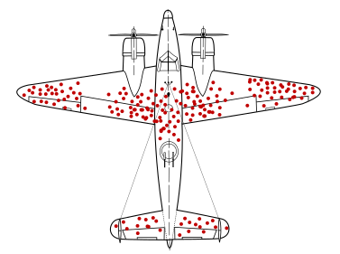
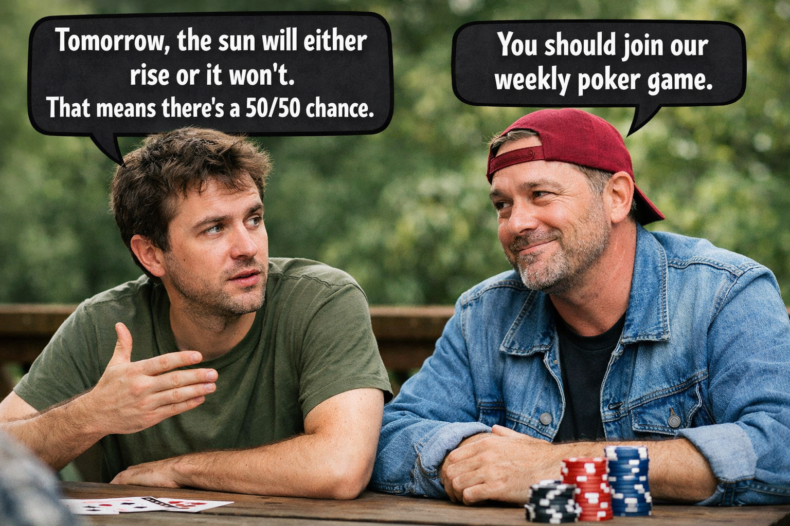

---
format:
  revealjs:
    self-contained: false
    include-in-header:
      - text: |
          <script src="js/dagitty.js"></script>
          <script src="js/graph.js" type="module"></script>
          <script src="https://cdn.jsdelivr.net/npm/jspreadsheet-ce@5/dist/index.js"></script>
          <link rel="stylesheet" href="https://cdn.jsdelivr.net/npm/jspreadsheet-ce@5/dist/jspreadsheet.css">
          <script src="https://cdn.jsdelivr.net/npm/jsuites@5/dist/jsuites.js"></script>
          <link rel="stylesheet" href="https://cdn.jsdelivr.net/npm/jsuites@5/dist/jsuites.css">
---


# Removed slides {.center}

Slides cut from the main decks, kept here for reference and possible reuse.

# From Week 1 (cut 2026-10-18) {.center}

The "Bayes 2" section (distributions come in Week 2, model assumptions in Week 3), and
the long version of "Most studies are wrong. Is that a problem?" with the "Hard data?"
slides on objectivity.

## Every number rests on assumptions

::: {.fragment}
| The number | The assumption behind it |
|---|---|
| 31% chance of rain | This year will be like the last five |
| 3.2% after a positive test | The person was tested at random |
| 14% of discoveries are true | About 1 in 100 tested ideas is true |
:::

::: {.fragment}
Once the assumptions are made, the number follows.
[The assumptions are the part that needs work.]{.red}
:::

::: {.notes}
- Go back through three numbers from today and name the assumption each one needed.
- The 31% chance of rain is a count of past days. Using it as a prediction assumes this year will be like the last five.
- The 3.2% assumes the person was tested at random from the whole population. Among people who come to a clinic with symptoms, the chance is very different.
- The 14% assumes about 1 in 100 tested ideas is true. Nobody can measure that directly.
- The arithmetic in each case is objective: same assumptions, same number, for anyone. The assumptions are where the judgment is, and where the work is.
:::

## Updating improves our assumptions

::: {.incremental}
- A [**prior**]{.red} is an assumption, written down where others can see it and argue
  with it.
- New [**data**]{.blue} test it: does what we saw fit what we assumed?
- The [**posterior**]{.green} is a better assumption, and the starting point next time.
:::

::: {.fragment}
::: {.big-statement}
Assume, look, update. Repeat.
:::
:::

::: {.notes}
- This is the core of the week, and it isn't technical.
- A prior is an assumption we write down, so others can see it and argue with it. That's a strength, not a weakness: assumptions we hide can't be checked.
- New data test the assumption. If what we saw fits what we assumed, our confidence grows. If it doesn't, the assumption moves.
- The posterior is our improved assumption, and tomorrow it's the prior. No single step has to be right. The process gets better.
- "Assume, look, update. Repeat." is the whole method, and it's what good researchers in any field already do. Bayesian statistics just makes it explicit and careful.
:::

## Most studies are wrong. Is that a problem?

_Most studies are wrong._ [...and that's okay.]{.fragment .blue}

::: {.fragment}
- A study was never supposed to be the answer.
- We interpret each study as part of a **larger scientific process**: replication, critique,
  competing explanations, theory, more data.
- That process is what gets things right. Not any single study.
:::

::: {.fragment}
Science doesn't work because individual studies are right. It works because
the field [keeps looking]{.green}.
:::

::: {.notes}
- Back to the capybara: most published research is wrong, and that's okay.
- It's okay because nobody (should) read a study as a verdict. A study is a contribution to an ongoing conversation.
- The process around the study is what does the work: other labs try it again, critics poke holes, someone proposes a better explanation, theory says whether it even makes sense.
- Each study joins an existing body of knowledge. It nudges what we believe, a little or a lot. It doesn't define it.
- Science works really well. It just doesn't work one study at a time.
:::

## Statistics is observation, not answers

::: {.fragment}
- The real problem isn't that studies are wrong. It's that we [expect them to be right]{.red}.
- The HIV scare, the false discoveries, p-hacking: they all come from believing
  statistics is [more powerful than it is]{.red}.
:::

::: {.fragment}
- In ethnography, everyone knows **one interview isn't the answer**. It's one observation,
  weighed against others and argued over.
- We just need to treat a statistical result the same way.
:::

::: {.fragment}
::: {.big-statement}
The science always comes first.
:::
:::

::: {.notes}
- So where do the problems come from? Not from statistics being wrong. The math is fine.
- They come from expecting too much of it. We treat a p-value as an answer to "is this true?" It isn't. It's an observation.
- Go back through today: the person terrified by one positive HIV screen, the 86% of "discoveries" that are false, the analyst trying forks until p < 0.05. Every one of those is someone believing statistics is more powerful than it is.
- Ethnographers already know how to handle this. Nobody writes an ethnography from one interview, or treats one informant as the truth. One interview is an observation. You weigh it against others, think about context, argue about what it means.
- We just need to do the same thing with statistics. A regression, a survey, a significant result: one observation, to be weighed and argued about.
- The science always comes first. The question, the theory, the knowledge of the context. Statistics serves that. It never replaces it.
:::

## Hard data?

> _"Ethnography is subjective. Statistics is objective. It's hard data."_

You've probably heard this. Maybe you've said it.

::: {.fragment}
Let's test it against what we've seen today.
:::

::: {.notes}
- Put the claim up plainly, and don't mock it. Many students have heard it from supervisors, reviewers or funders, and some believe it.
- Ask for a show of hands: who has heard this? Who has said it? It's a fair question to test, and we now have the tools to test it.
:::

## What's true about it

- **The arithmetic is objective.** Same data, same model: same number, every time, for
  anyone.
- **Numbers are easy to share and check.** Anyone can recompute them.
- **Large samples average out some kinds of noise.** Not all of them.

::: {.fragment}
But the arithmetic is the [smallest part of the work]{.red}.
:::

::: {.notes}
- Be fair to the claim first. The arithmetic really is objective: give two people the same data and the same model, and they get the same number.
- Numbers are also easy to share and recompute, which is a real strength.
- The catch: the arithmetic is the last and smallest step. Everything before it (what to measure, who to ask, which model) involves judgment.
:::

## Every number today rested on a choice {.smaller}

| The number | The choice behind it |
|---|---|
| P( rain ) = 31% | Which station, which years, what counts as "rain" (≥ 1 mm), and how to fill gaps in the record |
| P( HIV+ \| test+ ) = 3.2% | Who gets tested. Among people who come to a clinic with symptoms, it's very different. |
| p &lt; 0.05 | Why 5%? A convention. Plus which test, which controls, when to stop collecting data. |
| 14% of "discoveries" are true | A base rate that nobody can measure directly |
| The mayor at about 45% | Who we surveyed, who answered, and the prior we drew |

::: {.fragment}
Once the choices are made, the number is objective. [The choices aren't.]{.red}
:::

::: {.notes}
- Walk down the table. Every number came from earlier in today's lecture, and each one moved when a choice changed.
- Rain: a different station, a different decade or a 0.1 mm threshold gives a different number.
- HIV: the 3.2% is for a random person from the general population. For people tested at a clinic because they have symptoms, the base rate is far higher, and so is the answer.
- p < 0.05: the 5% is a convention from the 1920s, not a law of nature. Choosing the test, the controls and the stopping point are all researcher decisions.
- 14%: depends on a base rate nobody can observe.
- The mayor: depends on who we reached, who answered and what prior we drew.
- None of these choices is wrong. The point is that they are choices, made by people, just like an ethnographer's choices about whom to interview and how to read what they said.
:::

## Objective and subjective

_Statistics and ethnography have the same structure._

::: {.fragment}

|                 | Observation                    | Interesting inferences assume…                     |
|-----------------|--------------------------------|----------------------------------------------------|
| **Ethnography** | interviews, field notes        | what people meant; whose voices stand for others   |
| **Statistics**  | surveys, measurements, records | what causes what; how the data were generated      |

:::

::: {.fragment}
Call the observation "objective" if you like. But interesting inferences rest on [strong assumptions]{.red}, and choosing assumptions is [subjective]{.red}, in both.
:::

::: {.notes}
Updating is the foundation of our statistics: We believed something, we saw something, and we now believe something slightliy or significantly different from what we believed before.

What does that mean?

It's why it's okay that most published research is false.

Observation is messy. We love the mess. We live in the mess. Observation doesn't give us simple answers, but it continuously challenges and reshapes our assumptions.

Science is not the experiments we do. Rather, it's the debates we have about the experiments we do. Over time, we can become less, and less, and less, and less, and less, and less wrong.

This is why I'm always confused when people say statistics is "objective" or "more concrete", and ethnography is "subjective". I don't know what that means. Both have an observational part and an inferential part. We can call the observation part "objective" if we want: the survey responses are what they are, just like the interview transcript is what it is. Inference isn't necessarily subjective. Some inferences are almost mechanical. But the interesting ones, the ones that say something about causes, about people we didn't observe, about what would happen if, are always built on strong assumptions. What causes what, how the data were generated, which priors are reasonable: those assumptions are subjective, just like the ethnographer's assumptions about what people meant are subjective. The difference isn't between objective and subjective fields. The job in both is to state our assumptions openly so others can challenge them.
:::

## The same standard for both

- Both have an **observational** part and an **inferential** part. Neither is "hard" or
  "soft" by nature.
- Trust is **earned** the same way in both: show how the observation was made, state
  your assumptions, let others challenge them, and look again.
- Ethnographers have long practice at this: reflexivity, positionality, thick
  description. Statistics can learn from it.

::: {.fragment}
"Hard data" isn't a property of numbers. It's a claim about how much to trust them.
:::

::: {.fragment}
[Treating it as a property of the numbers is how so much published research ends up
wrong while looking right.]{.red}
:::

::: {.notes}
- The useful distinction isn't objective vs. subjective fields. It's transparent vs. hidden choices.
- Ethnography has spent decades building habits for this: reflexivity (how did I shape what I saw?), positionality (who am I to the people I studied?), thick description (show enough that readers can judge for themselves). Statistics talks less about these habits, and is worse for it.
- Tie it back to Ioannidis: "hard data" is exactly the belief that lets a single significant result pass as truth. Drop the belief, and the problem of most research being wrong becomes manageable. That's the next section.
:::

## Observations add up

_Back to where we started: a study is one observation._

::: {.incremental}
- Bayesian updating is how observations add up: each one moves what we believe, a little or a lot.
- No single study defines what we know. Each one joins an existing body of knowledge and
  nudges it.
- Ethnography works the same way. Understanding comes from many observations, debated over time.
:::

## Doing science

_So what does it mean to put the science first?_

::: {.fragment}
- [**Question every observation.**]{.blue} How was it made? Who's missing? What else could
  have produced it? A positive test, a significant result and an interview can all
  mislead.
:::

::: {.fragment}
- [**Look from different perspectives.**]{.blue} Other methods, other places, other
  people's readings. Surveys, experiments, ethnography and history each see what the
  others miss. When they agree, believe more. When they disagree, look closer.
:::

::: {.fragment}
- [**Think in likelihood, not proof.**]{.blue} Nothing is ever proved. Ask: _how likely is
  what I saw if this were true, compared with if it weren't?_ Beliefs move by degrees,
  and never quite reach 100%.
:::

::: {.fragment}
Statistics doesn't replace any of this. At its best, it's a careful way of doing the
third one. That question is the [likelihood]{.blue}, and updating is how we use it.
:::

::: {.notes}
- "Science first" can sound like a slogan. Make it concrete: these are three habits, and none of them needs math.
- Question every observation. We've already done this today: a positive HIV test turned out to be wrong most of the time, and so did a significant result. Ask how the observation was made and what else could explain it. That's what an ethnographer does with an interview, too.
- Look from different perspectives. No method sees everything. A survey sees breadth, an interview sees meaning, an experiment sees cause in one place, history sees change over time. Agreement across perspectives is strong evidence; disagreement tells you where to look next.
- Think in likelihood, not proof. Science never proves anything for good. We hold beliefs with more or less confidence and move them as evidence comes in. One study nudges a belief; it doesn't settle it.
- That last habit is exactly what Bayesian updating formalizes, which is where we're heading.
:::

## Summary

1. [**Probability is counting.**]{.blue} Count the ways the world could be.
2. [**Direction matters.**]{.blue} P( A | B ) ≠ P( B | A ). A p-value asks about the data in a
   world where nothing is going on. When true hypotheses are rare, most significant
   findings are false.
3. [**That's okay.**]{.blue} A study is one observation, not an answer. It joins what we
   already know and nudges it, but doesn't define it.
4. [**Bayesian updating is one rule**]{.blue} for learning from observation:
   prior × likelihood → posterior.
5. [**Numbers aren't "hard data."**]{.blue} Statistics rests on choices, just like
   ethnography. Trust comes from stating them, not from the numbers.

::: {.fragment}
::: {.big-statement}
The science always comes first.
:::
:::

::: {.notes}
- Four ideas, one per part of the lecture. Read them out slowly.
- If students remember one line, it's the last one: the science always comes first.
- Check for questions here, before the course preview and the appendix.
:::

## Bayesian Updating: Why one rule helps {.mechanics}

::: {.incremental}
- **One rule for everything.** Prior × likelihood → posterior. No flowchart of tests to choose from.
- **No fixed sample size.** Look at the data whenever you like and stop when you've learned enough. The posterior means the same thing either way.\
  [_A p-value depends on the stopping rule you planned in advance. Unplanned peeking breaks it._]{.fragment .blue}
- **Today's posterior is tomorrow's prior.** Updating survey by survey gives the same answer as analyzing all the surveys at once.
- **You build the model to fit your data.** Counts, proportions, skewed incomes: describe the data as they are, instead of picking whichever test's assumptions come closest.
- **Small samples are still valid.** No large-sample approximations. Fewer data mean more uncertainty, and the prior carries more of the weight.
- **It answers the question we actually ask:** P( [hypothesis]{.red} \| [data]{.blue} ).
:::

::: {.notes}
The nice thing about having one process is that a lot of the rules you may have learned for tests simply go away.

Tests need a stopping rule fixed in advance: if you peek at the data and stop when p dips below 0.05, your false positive rate quietly balloons. (Sequential designs can plan for interim looks, but the looks have to be planned and paid for.) Bayesian updating doesn't care when you stop. The posterior is just what you believe given what you've seen so far.

Updating is also cumulative. Last week's posterior becomes this week's prior, and you end up in the same place as if you'd analyzed everything at once.

We still make assumptions, but we choose them to fit the data and we write them down, instead of inheriting them from whichever test we picked. (This is really a contrast between picking tests and building models; frequentist GLMs build models too.) And small samples don't break anything; they leave us more uncertain, and the prior matters more, so it deserves more scrutiny.

Most importantly, it answers the question we actually care about: how plausible is the hypothesis, given the data?
:::

## Isn't the prior subjective?

_Yes. That's a feature, not a bug._

- Every analysis makes assumptions. A p-value hides them: which test, which controls,
  when to stop collecting data.
- A prior puts an assumption **on the table**, written down where anyone can see it and
  argue with it.
- With enough data, people who start from different reasonable priors end up in nearly
  the same place.
- When they don't, the data are weak. That's worth knowing too.

::: {.fragment}
Subjective doesn't mean arbitrary. It means someone made a choice, and has to
[defend it]{.blue}.
:::

::: {.notes}
- Someone will ask. Better to raise it ourselves.
- Yes, priors are a choice. But every method makes choices: which test, which variables to control for, when to stop collecting data, which outcome to report. Frequentist methods make those choices too; they're just less visible.
- A prior is visible. It's written down, so it can be criticized, and we can check how much the answer depends on it (sensitivity analysis, later in the course).
- With plenty of data, reasonable priors converge. With few data, the prior matters, and that is honest: the data alone can't tell us much.
- Lead into the next slide: this isn't special to statistics. Every field that learns from observation makes assumptions.
:::

## You've already done this {.smaller}

|  | [Prior]{.red} | [Likelihood]{.blue} | [Posterior]{.green} |
|---|---|---|---|
| **Means** | What I believed before | How likely what I saw is, under each possibility | What I believe now |
| **Asks** | _"What did I think?"_ | _"If this were true, how likely is what I saw?"_ | _"What do I think now?"_ |
| **Written** | P( belief ) | P( data \| belief ) | P( belief \| data ) |
| **HIV test** | 0.1% of people have HIV | A positive test: 99% likely if HIV+, 3% if HIV– | After a positive test: **3.2%** |
| **Published research** | 1% of tested hypotheses are true | Significant: 80% likely if true, 5% if false | After a significant result: **14%** |
| **Mayor poll** | About 60%, from the last election | 6 of 20 for the mayor: likely if support is ~30%, unlikely if 60% | About **45%** |

::: {.fragment}
The likelihood alone runs the same direction as a p-value: P( data \| belief ). Bayes
doesn't stop there. It combines the likelihood with the prior to answer the question
we actually care about: P( belief \| data ).
:::

::: {.notes}
- Read the definitions row first, then go down the examples. The point: the HIV test and the published-research table were Bayesian updates all along. We just didn't use the names.
- In the HIV row, the prior is prevalence, the likelihood is sensitivity and the false-positive rate, and the posterior is P(HIV+ | test+).
- In the research row, the prior is the base rate, the likelihood is power and α, and the posterior is P(true | significant).
- The mayor poll is the same thing with many possible answers (every vote share from 0 to 100%) instead of two. We'll do it live in the demonstration.
- Address the obvious question head on: "Isn't the likelihood backwards too, like a p-value?" Yes. On its own, it's P(data | belief). A p-value stops there, and only for one imagined world. Bayes computes it for every possibility and combines it with the prior, which turns it around into P(belief | data).
:::

## From two possibilities to many

_The HIV test and published research had **two** possibilities: true or false._

::: {.fragment}
Most questions have many:

- How many of 9 stones in a bag are blue? **10** possibilities, 0 to 9.
- What share of voters support the mayor? **Every** value from 0% to 100%.
:::

::: {.fragment}
Same rule, done once for each possibility:

- [**Prior**]{.red}: how plausible was each possibility before?
- [**Likelihood**]{.blue}: if this possibility were true, how likely is what we saw? For the
  bag, just count the ways it could happen. _(Counting ways)_
- [**Posterior**]{.green}: multiply the two, and compare across possibilities.
:::

::: {.fragment}
The answer is a **distribution**: a plausibility for every possible answer, not a single
yes or no. Let's try it with the bag.
:::

::: {.notes}
- This is the bridge from the HIV and research examples to real models. Those had two possibilities. Most questions have many.
- Nothing about the rule changes. We just do it once for each possibility and compare.
- For the bag of stones, the likelihood is literally counting: for a bag with 3 blue stones, how many ways could we draw blue, black, blue? Compare with a bag with 6 blue. This is the "Counting ways" slide again.
- The output is a distribution, which is why the bag app shows a bar chart rather than a single number. Everything from Week 2 on is about distributions like this.
:::

# From Week 2 (cut 2026-10-03) {.center}

Bayes theorem, priors/posteriors and likelihood: now covered by Week 1.

# Airplanes return from battle
<!-- TODO: turn this into an animation of some sort -->
:::{.r-stack}
{width="80%" style="text-align:center;"}
:::

# Goals this week
- Get more specific about "beliefs"
  - Concept: Parameters
  - Concept: Probability Distributions
- Learn how to use Bayes Theorem
  - Concept: Priors and posteriors
  - Concept: Likelihood
- Design a real analysis


# Parameters: What is a "belief"?

- Beliefs _about what?_
  - "parameters": unknown numerical quantities in the world
  - "estimand": what we want to find out (often a parameter)

- Refined Definition:
  - P(belief): P(belief about the possible values of a parameter)
  - Shorthand: P(params) or P(Θ)


# Parameters: Examples

A parameter is a numerical fact about the world that we don't know (but want to find out)

- The average height of adults in Pokhara
- The number of cars driven in Kathmandu on a typical Saturday
- The average exam results in a particular school
- The difference between men's and women's salaries
- The effect of socioeconomic status on college admissions
- The effect of education level on moral judgments


# Practical: Who will win the election?
- Last election: the current candidate got 60% of the votes.
- We have the resources to conduct a survey.
- (Many non-statistical problems to solve when we design a survey.)
- What do we need to provide a meaningful statistical answer?

# Practical: Bayes Theorem

$$
\color{green}{P(\text{belief} \mid \text{data})}
=
\frac{
\color{#1b91ff}{P(\text{data} \mid \text{belief})}
\;\color{#ff2c2d}{P(\text{belief})}
}{
\color{#999}{P(\text{data})}
}
$$

:::{.nonincremental}
- [**P(belief)**]{.red}: prior 
- [**P(belief | data)**]{.green}: posterior
- [**P(data | belief)**]{.blue}: likelihood
- [**P(data)**]{.gray}: marginal likelihood (not interesting)
:::

prior ⨉ likelihood → posterior


# Priors and Posteriors: Updating
P(belief) → P(belief | data)

::: {.columns}

::: {.column}
::: {.r-stack}
::: {.fragment}
```{r}
curve(
  dnorm(x, mean = 60, sd = 10),
  from = 0,
  to = 100,
  ylim = c(0, 0.1),
  col = "red",
  xlab = "",
  lwd = 2,
  ylab = ""
)
legend(
  "topright",
  legend = c("Prior", "Posterior"),
  col = c("red", "blue"),
  lwd = 2
)
```
:::
::: {.fragment}
```{r}
# plot(y ~ rnorm(0, 1))
curve(
  dnorm(x, mean = 60, sd = 10),
  from = 0,
  to = 100,
  ylim = c(0, 0.1),
  col = "red",
  lwd = 2,
  xlab = "",
  ylab = ""
)
curve(
  dnorm(x, mean = 40, sd = 10),
  from = 0,
  to = 100,
  col = "blue",
  lwd = 2,
  add = TRUE
)
legend(
  "topright",
  legend = c("Prior", "Posterior"),
  col = c("red", "blue"),
  lwd = 2
)
```
:::
:::
:::

::: {.column}
::: {.r-stack}
::: {.fragment}
```{r}
curve(
  dnorm(x, mean = 40, sd = 10),
  from = 0,
  to = 100,
  ylim = c(0, 0.1),
  col = "red",
  xlab = "",
  ylab = "",
  lwd = 2
)
legend(
  "topright",
  legend = c("Prior", "Posterior"),
  col = c("red", "blue"),
  lwd = 2
)
```
:::
::: {.fragment}
```{r}
# plot(y ~ rnorm(0, 1))
curve(
  dnorm(x, mean = 40, sd = 10),
  from = 0,
  to = 100,
  ylim = c(0, 0.1),
  col = "red",
  lwd = 2,
  xlab = "",
  ylab = ""
)
curve(
  dnorm(x, mean = 40, sd = 5),
  from = 0,
  to = 100,
  col = "blue",
  lwd = 2,
  add = TRUE
)
legend(
  "topright",
  legend = c("Prior", "Posterior"),
  col = c("red", "blue"),
  lwd = 2
)
```
:::
:::
:::
:::


::: {.columns}
::: {.column}
::: {.r-stack}
::: {.fragment}
```{r}
curve(
  dnorm(x, mean = 40, sd = 5),
  from = 0,
  to = 100,
  ylim = c(0, 0.1),
  col = "red",
  lwd = 2,
  xlab = "",
  ylab = ""
)
legend(
  "topright",
  legend = c("Prior", "Posterior"),
  col = c("red", "blue"),
  lwd = 2
)
```
:::
::: {.fragment}
```{r}
# plot(y ~ rnorm(0, 1))
curve(
  dnorm(x, mean = 40, sd = 5),
  from = 0,
  to = 100,
  ylim = c(0, 0.1),
  col = "red",
  lwd = 2,
  xlab = "",
  ylab = ""
)
curve(
  dnorm(x, mean = 35, sd = 4),
  from = 0,
  to = 100,
  col = "blue",
  lwd = 2,
  add = TRUE
)
legend(
  "topright",
  legend = c("Prior", "Posterior"),
  col = c("red", "blue"),
  lwd = 2
)
```
:::
:::
:::

::: {.column}
::: {.r-stack}
::: {.fragment}
```{r}
curve(
  dnorm(x, mean = 35, sd = 4),
  from = 0,
  to = 100,
  ylim = c(0, 0.1),
  col = "red",
  lwd = 2,
  xlab = "",
  ylab = ""
)
legend(
  "topright",
  legend = c("Prior", "Posterior"),
  col = c("red", "blue"),
  lwd = 2
)
```
:::
::: {.fragment}
```{r}
# plot(y ~ rnorm(0, 1))
curve(
  dnorm(x, mean = 35, sd = 4),
  from = 0,
  to = 100,
  ylim = c(0, 0.1),
  col = "red",
  lwd = 2,
  xlab = "",
  ylab = ""
)
curve(
  dnorm(x, mean = 50, sd = 10),
  from = 0,
  to = 100,
  col = "blue",
  lwd = 2,
  add = TRUE
)
legend(
  "topright",
  legend = c("Prior", "Posterior"),
  col = c("red", "blue"),
  lwd = 2
)
```
:::
:::
:::
:::


# Priors and Posteriors: DIY Prior

<style>
  .prior-layout{
    display: flex;
    gap: 16px;
    align-items: flex-start;
    width: 100%;
  }
  #graph-wrapper{
    flex: 0 0 70%;
    aspect-ratio: 3/2;
  }
  #sheet-wrapper{
    flex: 1 1 auto;
    min-width: 260px;
    font-size: 16pt;
  }
  .sheet-controls{
    margin-top: 8px;
    text-align: right;
  }
  #sheet-reset{
    font-size: 12pt;
    padding: 6px 10px;
  }
  .jss_about {
    display: none;
  }
  .jss_textarea{
    position: absolute !important;
    left: -10000px !important;
    top: 0 !important;
    width: 1px !important;
    height: 1px !important;
    opacity: 0 !important;
    pointer-events: none !important;
  }
</style>

```{=html}
<div class="prior-layout">
  <div id="graph-wrapper"></div>
  <div>
    <div id="sheet-wrapper"></div>
    <div class="sheet-controls">
      <button id="sheet-reset" type="button">Reset</button>
    </div>
  </div>
</div>
```

<script type="module">
  import { LineGraphWidget } from './js/graph.js';

  const graphEl = document.getElementById('graph-wrapper');
  const sheetEl = document.getElementById('sheet-wrapper');
  const resetBtn = document.getElementById('sheet-reset');
  const STORAGE_KEY = 'diy-prior-values-v1';

  if (!graphEl || !sheetEl) {
    console.warn('DIY Prior: missing graph or sheet container.');
  } else if (!graphEl.dataset.initialized) {
    graphEl.dataset.initialized = 'true';

    let widget = null;
    let ws = null;

    function loadStoredValues() {
      try {
        const raw = localStorage.getItem(STORAGE_KEY);
        if (!raw) return null;
        const parsed = JSON.parse(raw);
        if (!Array.isArray(parsed)) return null;
        return parsed.map((v) => Number(v));
      } catch {
        return null;
      }
    }

    function saveStoredValues(values) {
      try {
        localStorage.setItem(STORAGE_KEY, JSON.stringify(values));
      } catch {
        // ignore storage errors
      }
    }

    function pointsToTable(points) {
      const ys = points.map(p => Number(p.y) || 0);
      const sum = ys.reduce((a, b) => a + b, 0);
      return ys.map((v,i) => [i*0.05, v, sum > 0 ? v / sum : 0]);
    }

    function getWorksheetHandle(obj) {
      if (!obj) return null;

      if (typeof obj.setData === 'function' ||
          typeof obj.loadData === 'function' ||
          typeof obj.setValueFromCoords === 'function' ||
          typeof obj.setValue === 'function') {
        return obj;
      }

      if (Array.isArray(obj)) return getWorksheetHandle(obj[0]);
      if (Array.isArray(obj.worksheets)) return getWorksheetHandle(obj.worksheets[0]);
      if (typeof obj.getWorksheet === 'function') return getWorksheetHandle(obj.getWorksheet(0));

      return null;
    }

    function updateSheet(points) {
      if (!ws) return;
      const data = pointsToTable(points);

      if (typeof ws.setData === 'function') {
        ws.setData(data);
        return;
      }
      if (typeof ws.loadData === 'function') {
        ws.loadData(data, true);
        return;
      }
      if (typeof ws.setValueFromCoords === 'function') {
        for (let r = 0; r < 21; r++) {
          ws.setValueFromCoords(0, r, data[r][0], true);
          ws.setValueFromCoords(1, r, data[r][1], true);
        }
        return;
      }
      if (typeof ws.setValue === 'function') {
        for (let r = 0; r < 21; r++) {
          ws.setValue(`A${r + 1}`, data[r][0], true);
          ws.setValue(`B${r + 1}`, data[r][1], true);
        }
      }
    }

    function ensureReadyThenInit() {
      const rect = graphEl.getBoundingClientRect();
      const visible = rect.width > 0 && rect.height > 0;
      if (!visible) return false;

      if (window.Reveal?.getCurrentSlide) {
        const cur = window.Reveal.getCurrentSlide();
        if (!cur?.querySelector('#graph-wrapper')) return false;
      }

      if (!widget) {
        graphEl.innerHTML = '';
        sheetEl.innerHTML = '';

        const stored = loadStoredValues();
        const initialValues = Array.isArray(stored) && stored.length === 21
          ? stored
          : Array.from({ length: 21 }, () => 50);

        widget = new LineGraphWidget({
          container: graphEl,
          yValues: initialValues,
          onChange: (points) => {
            updateSheet(points);
            saveStoredValues(points.map((p) => p.y));
          },
        });

        const initData = pointsToTable(widget.getPoints());
        const created = window.jspreadsheet(sheetEl, {
          tabs: false,
          worksheets: [{
            data: initData,
            editable: false,
            minDimensions: [2, 21],
            rowHeaders: (rowIndex) => (rowIndex * 0.05).toFixed(2),
            allowInsertRow: false,
            allowDeleteRow: false,
            allowInsertColumn: false,
            allowDeleteColumn: false,
            columnSorting: false,
            columns: [
              { type: 'numeric', title: 'Voters', width: 90, mask: '0%' },
              { type: 'numeric', title: 'Score', width: 90, mask:'0.00' },
              { type: 'numeric', title: 'Probability', width: 120, mask: '0.0000' },
            ],
            selectionCopy: true,   // enables copying selected range
            selection: true,       // ensures range selection is on (harmless if default)
          }],
        });

        Promise.resolve(created).then((spreadsheet) => {
          ws = getWorksheetHandle(spreadsheet);
          if (!ws) {
            console.log('jspreadsheet return value:', spreadsheet);
            throw new Error('Could not find a worksheet handle. See console log for returned object.');
          }
          updateSheet(widget.getPoints());
        });

        if (resetBtn) {
          resetBtn.addEventListener('click', () => {
            const resetValues = Array.from({ length: 21 }, () => 50);
            widget.setYValues(resetValues);
            saveStoredValues(resetValues);
          });
        }
      }

      return true;
    }

    const observer = new ResizeObserver(() => {
      if (ensureReadyThenInit()) observer.disconnect();
    });
    observer.observe(graphEl);

    const runWhenReady = () => {
      if (!ensureReadyThenInit()) requestAnimationFrame(runWhenReady);
    };

    if (window.Reveal?.on) {
      Reveal.on('ready', runWhenReady);
      Reveal.on('slidechanged', runWhenReady);
    } else {
      window.addEventListener('load', runWhenReady);
      runWhenReady();
    }
  }
</script>


# Likelihood: Probability in the World
:::{.r-stack}

:::{.fragment .fade-in-then-out}
{width="900px"}
:::

:::{.fragment}
{width="900px"}
:::

:::

::: {.fragment}
Probability isn't just in our heads. Sometimes, it's generated by a process in the world.
:::


# Likelihood: Building Models
- From Bayes theorem, we know that likelihood is: P( data | parameters )
- But what does this mean?

::: {.fragment .callout-tip}
## Instead of starting with our beliefs, likelihood starts with what we *saw*.
We surveyed 15 people and 4 said that they will vote for the current mayor.
:::

- Now, we need to ask, "How consistent is this observation with different possible values of our parameter?"
- Given a particular parameter value, how likely are the data we saw?
  - If our parameter is _actually_ 50%, what are the chances of seeing 4 out of 15?
  - If our parameter is _actually_ 30%, what are the chances of seeing 4 out of 15?
  - If our parameter is _actually_ 80%, what are the chances of seeing 4 out of 15?

::: {.fragment}
These are questions that any calculator can answer.
:::

# Likelihood: So what it is
<!-- TODO: Expand this to include a better comparison -->
- For priors and posteriors, randomness is about our uncertainty (a subjective experience).
- For likelihood, randomness is generated by specific processes in the world.
- Our job is to describe how patterns of variation (including randomness) occur.

# Grid approximation worksheet
<!-- TODO: Implement worksheet -->

<div id="sheet1" style="width:100%; font-size: 14pt;"></div>

<script>
(() => {
  const el = document.getElementById("sheet1");

  const rows = 21, cols = 8;
  const data = Array.from({ length: rows }, () => Array(cols).fill(0));

  const columns = Array.from({ length: cols }, (_, i) => ({
    type: "numeric",
    title: `Col ${i + 1}`,
    width: 150
  }));

  // Newer API: worksheets is required
  window.sheet1 = jspreadsheet(el, {
    plugins: [
      // clipboard plugin is typically exposed as `jspreadsheet.plugins.clipboard`
      // jspreadsheet.plugins.clipboard
    ],
    worksheets: [{
      data,
      columns,
      minDimensions: [cols, rows]
    }],
    tableOverflow: true,
    tableWidth: "100%",
    tableHeight: "420px"
  });
})();
</script>

# From Week 2 (cut 2026-10-25) {.center}

The old opening (the three kinds as data, belief and relationships), the admissions
framing of "Randomness has patterns" (now a Galton board), and the spurious-correlation
section (ice cream and temperature; confounding now waits for Weeks 3 and 4). The
pure-noise slides stayed in the deck. Card classes were renamed since: .kind-data,
.kind-belief and .kind-relationship are now .kind-population, .kind-certainty and
.kind-correlative.

# Think in distributions

_"The average !Kung adult is `r fmt(h_mean, 0)` cm tall."_

::: {.fragment}
True. But that one number hides three things.
:::

::: {.kinds}
::: {.kind .kind-data .fragment}
[A population]{.kind-title}

Not everyone is `r fmt(h_mean, 0)` cm. The adults range from `r fmt(min(howell$height), 0)`
to `r fmt(max(howell$height), 0)` cm.

How do heights **vary across people**? That's a **distribution of data**.
:::

::: {.kind .kind-belief .fragment}
[Uncertainty]{.kind-title}

We measured `r nrow(howell)` adults, not every one. The true average could be a little
higher or lower.

How **sure** are we about the average? That's a **distribution of belief**.
:::

::: {.kind .kind-relationship .fragment}
[A relationship]{.kind-title}

Height doesn't vary on its own. Taller adults tend to be heavier, but not always.

How do height and weight **vary together**? That's a **distribution of a
relationship**.
:::
:::

::: {.fragment}
::: {.big-statement}
This week: think in distributions, not single numbers.
:::
:::

::: {.notes}
- Read the sentence. It's true, and it's the kind of number a report would print.
- Then ask what it leaves out. Let students find answers before the cards appear.
- First, a population: real adults differ, from about 137 to 179 cm. "Average" describes the middle of a spread, not a person. How the heights vary is a distribution of data.
- Second, uncertainty: we measured 352 people. A different 352 would give a slightly different average. How sure we are about the true average is a distribution of belief.
- Third, a relationship: height doesn't vary on its own. Taller people tend to be heavier, but with plenty of exceptions. How the two vary together is the third kind.
- These are the three parts of today, in order. The big statement is the week in one line.
:::


# Last week → this week

- Last week: a number is one observation, read through what we already assume.
  This week: a single number also hides how much things vary, and how sure we are.
- Last week, our answer to "will the mayor win?" was not a number.
- It was a **distribution**: a whole curve of more and less plausible values.
- That's this week's key word. A distribution describes a number by **every value it
  could take**, and how common or plausible each one is.
- We'll meet three kinds: distributions of [data]{.blue} (how values vary across
  cases), of [belief]{.green} (how sure we are about something we don't know), and of
  [relationships]{.orange} (how two variables vary together).

::: {.notes}
- Start from Week 1's thesis: a study is one observation, and a number means nothing without the assumptions we read it through. This week adds that a single number also hides variation and uncertainty, which is what the opening slide showed.
- The bridge from Week 1: the mayor's answer wasn't a number, it was a curve. Students already drew one when they made their prior.
- Name the key word and give the plain definition: every value a number could take, and how common or plausible each one is.
- Then name the three kinds, one per part. Distributions of data come first. Belief, the kind they met with the mayor, is second. Relationships are third.
:::


# Goals this week: three kinds of distribution



Appendix: What makes a house expensive? All three kinds at work on real data, with the
TA in our second session.

::: {.notes}
- Three parts, one per card. Parts 1 and 2 are the two basic kinds: data and belief. Part 3 puts two variables together and uses both: the pattern is in the data, and β gets a distribution of belief. Part 3 ends with how relationships mislead.
- These cards come back at every part break, with the current part highlighted.
- The house-price exercise is the appendix. They'll do it with the TA in the second session, using all three kinds.
:::


# Randomness has patterns

Problem: we want to understand how the admissions process works at a university. 

::: {.fragment .callout-note title="Population: This isn't about one individual case but rather a group of cases"}
- "Applications to this university last year"
- "Applications to this university in the last ten years"
- "Applications to all state-run universities in this country last year"
:::

::: {.fragment .callout-tip title="Variation: These cases are different from each other in ways that interest us"}
- "Exam results"
- "Family wealth"
- "Gender"
- "Department"
:::

::: {.fragment .callout-important title="Randomness: Reality is messy, and we'll never predict admission perfectly. But, randomness has patterns. We can describe how it was generated."}
- If I flip a coin 1 time, I can't say what will happen. 
- If I flip a coin 1000 times, I can say a lot more. 
- Random individuals → Predictable populations
:::

::: {.notes}
- The admissions example is a framing device, not a dataset we'll analyze. It names three ideas every statistical question has.
- Population: we're never asking about one application. We're asking about a group, and we have to say which group.
- Variation: the cases differ in ways we care about. Without variation there's nothing to explain.
- Randomness: we will never predict one admission decision perfectly. But a coin flipped 1,000 times is very predictable in aggregate. Random individuals, predictable populations. That's why distributions work.
:::


# When patterns mislead: two headlines

```{r icecream-sim}
# Simulated beach town: hot days bring both ice cream sales and swimmers
set.seed(11)
beach <- tibble(day = 1:365) |>
  mutate(
    temp = 18 + 8 * sin(2 * pi * (day - 100) / 365) + rnorm(n(), 0, 2.5),
    ice_cream = 40 * temp + rnorm(n(), 0, 120),
    drownings = rpois(n(), exp(-3 + 0.13 * temp))
  )
r_ice <- cor(beach$ice_cream, beach$drownings)
```

```{r noise-sim}
# 50 made-up "indicators" for 20 made-up "countries", all pure random noise
set.seed(3)
n_vars <- 50
noise_small <- matrix(rnorm(20 * n_vars), nrow = 20)
r_small <- cor(noise_small)
r_small[lower.tri(r_small, diag = TRUE)] <- NA
best <- which(abs(r_small) == max(abs(r_small), na.rm = TRUE), arr.ind = TRUE)
r_best <- r_small[best]
```

::: {.fragment}
> _"Ice cream sales linked to drownings"_ (*r* = `r fmt(r_ice, 2)`, one year of daily data)
:::

::: {.fragment}
> _"Countries that spend more on [one thing] have `r if (r_best > 0) "more" else "less"` [another]"_ (*r* = `r fmt(r_best, 2)`,
> 20 countries)
:::

::: {.fragment .nonincremental}
- Both patterns are really there in the data.
- Neither one means what the headline says.
:::

::: {.fragment}
Let's see why, and how to tell the two apart.
:::

::: {.notes}
- Everything so far describes relationships accurately. That's exactly the danger: an accurate description can still be read the wrong way.
- Read both headlines out loud, like a news anchor. Ask: do you believe them? Would you act on them?
- Both numbers are real: they come straight from the data in the next few slides. Nobody made an arithmetic mistake.
- If someone already spots the ice cream answer (hot weather), great. Ask about the second one instead. Nobody will have an answer for that one yet.
- By the end of Part 3, students should be able to say exactly why each one misleads.
:::


## Spurious correlations

A **spurious correlation** is a real pattern in the data that does *not* mean one
variable affects the other. There are two common ways to get one:

::: {.columns}
::: {.column}
::: {.fragment .callout-important .nonincremental title="1. Confounding"}
A **third variable** drives both. The pattern is real and will show up again in new
data, but it isn't about the two variables themselves.
:::
:::

::: {.column}
::: {.fragment .callout-warning .nonincremental title="2. Chance"}
**Random noise** happens to line up. The pattern is a fluke of this particular sample
and will disappear in new data.
:::
:::
:::

::: {.notes}
- Definition: a real pattern in the data that does not mean one variable affects the other.
- Two ways to get one. Confounding: a third variable drives both. Chance: noise happens to line up.
- They behave very differently, and they have different fixes. That difference is the core of today.
:::


## Kind 1: Does ice cream cause drowning?

::: {.columns}
::: {.column width="55%"}
```{r icecream-scatter, fig.width = 7, fig.height = 6}
ggplot(beach, aes(ice_cream, drownings)) +
  geom_jitter(color = BLUE, alpha = 0.6, size = 2.5, width = 0, height = 0.15) +
  geom_smooth(method = "lm", se = FALSE, color = RED, linewidth = 1.5) +
  labs(x = "Ice cream sales (cones per day)", y = "Drownings per day")
```
:::

::: {.column width="45%"}
- One year of (simulated) daily data from a beach town.
- *r* = `r fmt(r_ice, 2)`: days with more ice cream sales have more drownings.
- Should the town ban ice cream?
:::
:::

::: {.notes}
- First headline. One year of simulated daily data. More ice cream sales go with more drownings.
- Ask: should the town ban ice cream? Let them laugh, then ask what's really going on.
:::


## The confounder: temperature

```{r icecream-strata, fig.height = 5}
# "The confounder: temperature": ice cream and drownings within temperature bands
icecream_strata_plot <- function(beach) {
  beach_bands <- beach |>
    mutate(
      band = cut(
        temp,
        c(-Inf, 14, 22, Inf),
        labels = c(
          "Cool days (< 14°C)",
          "Mild days (14–22°C)",
          "Hot days (> 22°C)"
        )
      )
    ) |>
    group_by(band) |>
    mutate(band = paste0(band, ":  r = ", fmt(cor(ice_cream, drownings), 2))) |>
    ungroup() |>
    arrange(temp) |>
    mutate(band = fct_inorder(band))

  ggplot(beach_bands, aes(ice_cream, drownings)) +
    geom_jitter(color = BLUE, alpha = 0.6, size = 2, width = 0, height = 0.15) +
    geom_smooth(method = "lm", se = FALSE, color = RED, linewidth = 1.5) +
    facet_wrap(~band, scales = "free_x") +
    labs(x = "Ice cream sales", y = "Drownings") +
    theme(strip.text = element_text(size = 18))
}
icecream_strata_plot(beach)
```

- [ice cream]{.blue} ← **temperature** → [drownings]{.blue}
- Compare days with **similar temperatures**, and the relationship mostly disappears.
- More data would not help: a million days would show the same strong *r*.
- A confounder can hide a relationship, invent one, or even flip its sign. You'll see
  a sign flip in the house-price exercise.

::: {.notes}
- Hot days bring both ice cream and swimmers. Temperature is the confounder.
- Split the days by temperature and the relationship mostly disappears. Comparing like with like is the basic move against confounding.
- The key line: more data would not help. A million days would show the same strong r. The pattern is stable; it's just not about ice cream.
- Mention that a confounder can also hide or flip a relationship. They'll see a flip in the house exercise.
:::


## Telling the two apart {.smaller}

| | Confounding | Chance |
|------|-------|-------|
| What's going on? | A third variable drives both | Noise happened to line up |
| Shows up in new data? | Yes | No |
| Would more data help? | **No** | **Yes** |
| What helps? | Thinking about causes; comparing like with like | Bigger samples; deciding what to test *before* looking; replication |

::: {.fragment}
- The posterior for β already protects us a little against chance: with 20 adults it
  was wide, saying "I'm not sure."
- Nothing in the data alone protects us against confounding. For that we need a
  **causal model**.
- Week 1 ended with more fundamental ways to question our assumptions. This is the
  first: more data won't save you from a confounder.
:::

::: {.notes}
- Walk the table row by row. The most important row: would more data help? For chance, yes. For confounding, no.
- What helps against chance: bigger samples, deciding what to test before looking, replication. All things from Week 1.
- What helps against confounding: thinking about causes. Nothing in the data alone can do it. That's why next week is about causal models.
- The last bullet picks up how Week 1 ended: there are more fundamental ways to question our assumptions than the base rate paradox. Chance is Week 1's problem, and more data helps. Confounding is the first of the deeper ones, and more data doesn't.
- Week 5 comes back to this hard: more data won't save you from a confounder.
:::

# From Week 3 (cut 2026-10-03) {.center}

Priors, likelihood and model-writing slides (now covered by Weeks 1–2), the original
weight models and the World Bank fertility walkthrough. The R code is kept for reference
but not run (`eval = FALSE`).

```{r week3-archive-setup, include=FALSE}
knitr::opts_chunk$set(eval = FALSE)
```

# Models impose order on randomness

```{=html}
<iframe
  id="dag-frame-1"
  data-external="1"
  style="width:100%; aspect-ratio: 2 / 1; border:1px solid black;"
  src="https://dagitty.net/dags.html"
></iframe>
<!-- <iframe
  id="dag-frame-1"
  data-external="1"
  style="width:100%; aspect-ratio: 2 / 1; border:1px solid black;"
  src="js/dag-embed.html"></iframe> -->

<!-- <script>
(() => {
  const dag = `dag {
    Admitted [outcome,pos="-0.619,0.077"]
    Department [exposure,pos="-0.858,0.192"]
    Sex [exposure,pos="-1.059,-0.272"]
    UNKNOWN [latent,pos="-0.414,0.077"]
    Department -> Admitted  
    Sex -> Admitted
    Sex -> Department
    UNKNOWN -> Admitted
  }`;

  const frame = document.getElementById("dag-frame-1");

  function send() {
    if (!frame?.contentWindow) return;
    frame.contentWindow.postMessage({ type: "dagitty", dag }, "*");
  }

  frame.addEventListener("load", send);

  // Optional: re-send when returning to the slide (Reveal may not exist in non-reveal contexts)
  window.addEventListener("load", () => {
    if (window.Reveal?.on) {
      Reveal.on("ready", send);
      Reveal.on("slidechanged", (e) => {
        if (e.currentSlide?.querySelector("#dag-frame-1")) send();
      });
    }
  });
})();
</script> -->
```


# What have we done so far?
- We chose a parameter.
- We stated our *prior* belief.
- We made observations.
- We calculated the *likelihood* of the things we observed.
- We combined our prior and likelihood to produce an updated *posterior* belief.

# Goals for this week
- Concept: models
- Model definition language
- Explore two types of models:
  - Parameter estimates
  - Regressions


# What is a model?

- Our **data** are the observations we made [(# of Surveys, # of Votes)]{.fragment .green}
- Our **model** is a theoretical description of how these data were generated, combining:
  - Our *prior* belief about our parameter(s) [(Popularity)]{.fragment .blue}
  - A method of calculating our *likelihood* from data

<!-- # What is "fitting"?

- We "fit" our model to our data using Bayes' Theorem.
- This updates our prior -> posterior.
- We can use different techniques for this process:
  - Stones in a bag: we counted all possibilities
  - Election polling: we used "grid approximation" to estimate the parameter every 5%
  - Going forward: we'll use software (Markov Chain Montey Carlo, or MCMC)
 -->


# Writing Priors
We need a way to *describe* our prior belief for all values of our parameter (Popularity)

::: {.columns}

::: {.column width="33%"}
::: {.fragment}

```{r prior1, echo=FALSE, warning=FALSE, message=FALSE}
x <- seq(0, 100, length.out = 1001)
y <- dunif(x, min = 0, max = 100)

plot(
  x,
  y,
  type = "l",
  lwd = 2,
  col = "red",
  xlim = c(0, 100),
  xlab = "Votes",
  ylab = "Density",
  main = "Popularity ~ Uniform(0,100)",
  cex.main = 3
)
```

:::

::: {.fragment}

```{r prior2, echo=FALSE, warning=FALSE, message=FALSE}
x <- seq(0, 100, length.out = 1001)
y <- dunif(x, min = 20, max = 80)

plot(
  x,
  y,
  type = "l",
  lwd = 2,
  col = "red",
  xlim = c(0, 100),
  xlab = "Votes",
  ylab = "Density",
  main = "Popularity ~ Uniform(20,80)",
  cex.main = 3
)
```

:::
:::

::: {.column width="33%"}
::: {.fragment}

```{r prior3, echo=FALSE, warning=FALSE, message=FALSE}
x <- seq(0, 100, length.out = 1001)
y <- dnorm(x, mean = 50, sd = 20)

plot(
  x,
  y,
  type = "l",
  lwd = 2,
  col = "red",
  xlim = c(0, 100),
  xlab = "Votes",
  ylab = "Density",
  main = "Popularity ~ Normal(50,20)",
  cex.main = 3
)
```

:::

::: {.fragment}

```{r prior4, echo=FALSE, warning=FALSE, message=FALSE}
x <- seq(0, 100, length.out = 1001)
y <- dnorm(x, mean = 40, sd = 5)

plot(
  x,
  y,
  type = "l",
  lwd = 2,
  col = "red",
  xlim = c(0, 100),
  xlab = "Votes",
  ylab = "Density",
  main = "Popularity ~ Normal(40,5)",
  cex.main = 3
)
```

:::
:::

::: {.column width="33%"}
::: {.fragment}

```{r prior5, echo=FALSE, warning=FALSE, message=FALSE}
x <- seq(0, 100, length.out = 1001)
y <- dnorm(x, mean = 60, sd = 15)
plot(
  x,
  y,
  type = "l",
  lwd = 2,
  col = "red",
  xlim = c(0, 100),
  xlab = "Votes",
  ylab = "Density",
  main = "Popularity ~ Normal(60,15)",
  cex.main = 3
)
```

:::

::: {.fragment}

```{r prior6, echo=FALSE, warning=FALSE, message=FALSE}
x <- seq(0, 100, length.out = 1001)
y <- dnorm(x, mean = 80, sd = 3)

plot(
  x,
  y,
  type = "l",
  lwd = 2,
  col = "red",
  xlim = c(0, 100),
  xlab = "Votes",
  ylab = "Density",
  main = "Popularity ~ Normal(80,3)",
  cex.main = 3
)
```

:::
:::

:::

# Distributions Demo {.no-title}

```{shinylive-r}
#| standalone: true

``` 


# Writing likelihood functions

We need a way to describe how our data got made, linking our parameter (Popularity) to our observed data (Surveys and Votes)

$$
{\color{green}{Votes}} \sim \mathrm{Binomial}({\color{green}{Surveys}}, {\color{blue}{Popularity}})
$$

[Observed Data]{.green}

[Parameter(s)]{.blue}

# Writing complete models

$$
\begin{align}
\color{green}{Votes} &\sim \color{green}{\mathrm{Binomial}(Surveys, Popularity)} \\
\color{red}{Popularity} &\sim \color{red}{\mathrm{Normal}(60\%, 15\%)}
\end{align}
$$

[Likelihood function]{.green}

[Prior Belief]{.red}

<!-- # Two major types of models:

- Understanding the distribution of variables (parameter estimation)
  - Based on limited survey data, who do we think will win an election?
  - Based on social network analysis, how many Nepali citizens currently live abroad?

- Understanding relationships between variables (regression)
  - Does yoga lead to longer, healthier lives?
  - Does education make people happy?
  - What interventions can change national birth rates? -->


<!-- # Cause is super weird
- it's always a theoretical attribution, simplifying arbitrary complexity
- in the social science, we tend to think about cause as sites of intervention -->

# Modeling individual weight

```{r weight, echo=FALSE, warning=FALSE, message=FALSE}
df_weight <- read_csv("datasets/kungsan.csv") |>
  filter(age >= 18) |>
  mutate(
    height_std = scale(height) |> as.numeric(),
    age_std = scale(age) |> as.numeric(),
    sex = ifelse((male == 0), "female", "male") |> as_factor()
  )

ggplot(df_weight, aes(x=weight)) +
  geom_histogram(bins=32, color="gray") + 
  geom_vline(
    xintercept = mean(df_weight$weight),
    color = "red",
    linetype = "dashed"
  )
```


# Model definition (Weight)

$$
\begin{align}
\text{weight}_i &\sim \text{Normal}(\mu, \sigma) \\
\mu &\sim \text{Normal}(50, 10) \\
\sigma &\sim \text{Normal}(0, 10), \quad \sigma > 0
\end{align}
$$

```{r model_weight1, message=FALSE, results="hide"}
model_weight1 <- cmdstan_model("models/weight1.stan", dir=".stancache")
fit_weight1 <- df_weight |>
  compose_data() |>
  model_weight1$sample()
```
```{r summary_weight1}
fit_weight1$summary()
```


# Vertical plot 
```{r weight_vert, echo=FALSE, warning=FALSE, message=FALSE}
ggplot(df_weight) +
  geom_jitter(
    data = df_weight,
    aes(x = 0, y = weight, color=sex),
    shape = "cross",
    color = "purple"
  ) +
  geom_hline(
    yintercept = mean(df_weight$weight),
    color = "red",
    linetype = "dashed"
  ) +
  xlim(-2, 2)
```

# Vertical plot (sex differentiated)

```{r weight_sex, echo=FALSE, warning=FALSE, message=FALSE}
ggplot(df_weight) +
  geom_jitter(
    data = df_weight,
    aes(x = ifelse(sex == "male", -1, 1), y = weight, color=sex),
    shape = "cross",
  ) +
  geom_hline(
    yintercept = mean((df_weight |> filter(sex == "male"))$weight),
    color = "red",
    linetype = "dashed"
  ) +
  geom_hline(
    yintercept = mean((df_weight |> filter(sex == "female"))$weight),
    color = "blue",
    linetype = "dashed"
  ) +
  xlim(-2, 2)
```


# Model (Weight ~ Sex)
$$
\begin{align}
\text{weight}_i &\sim \text{Normal}(\mu_i, \sigma) \\
\mu_i &= \alpha_{\text{sex}[i]} \\
\alpha_j &\sim \text{Normal}(50, 10) \\
\sigma &\sim \text{Normal}(0, 10), \quad \sigma > 0
\end{align}
$$

```{r model_weight2, message=FALSE, results="hide"}
model_weight2 <- cmdstan_model("models/weight_sex.stan", dir=".stancache")
fit_weight2 <- df_weight |>
  compose_data() |>
  model_weight2$sample()
```

```{r summary_weight2}
fit_weight2$summary() |>
  replace_indexes(df_weight, alpha[sex])
```


# Scatter plot (with height)

:::{.r-stack width="1605"}
:::{.fragment width="1605"}
```{r weight_height1, echo=FALSE, warning=FALSE, message=FALSE, out.width="1605"}
df_weight |>
  ggplot(aes(x = height, y = weight)) +
  geom_point(color = "purple", shape = "plus") +
  labs(x = "Height (cm)", y = "Weight (kg)")

```
:::

:::{.fragment width="1605"}
```{r weight_height2, echo=FALSE, warning=FALSE, message=FALSE, out.width="1605"}
df_weight |>
  ggplot(aes(x = height, y = weight)) +
  geom_point(color = "purple", shape = "plus") +
  geom_smooth(method="lm", se=FALSE) +
  labs(x = "Height (cm)", y = "Weight (kg)")

```
:::

:::{.fragment width="1605"}
```{r weight_height3, echo=FALSE, warning=FALSE, message=FALSE, out.width="1605"}
df_weight |>
  ggplot(aes(x = height / 2.56, y = weight)) +
  geom_point(color = "purple", shape = "plus") +
  geom_smooth(method="lm", se=FALSE) +
  labs(x = "Height (inches)", y = "Weight (kg)")

```
:::

:::{.fragment width="1605"}
```{r weight_height4, echo=FALSE, warning=FALSE, message=FALSE, out.width="1605"}
df_weight |>
  ggplot(aes(x = scale(height), y = weight)) +
  geom_point(color = "purple", shape = "plus") +
  geom_smooth(method="lm", se=FALSE) +
  labs(x = "Height (standardized)", y = "Weight (kg)")

```
:::

:::

# Model (Weight ~ Height)

$$
\begin{align}
\text{weight}_i &\sim \text{Normal}(\mu_i, \sigma) \\
\mu_i &= \alpha + \beta\times \text{height}_i \\
\alpha &\sim \text{Normal}(50, 10) \\
\beta &\sim \text{Normal}(0, 10) \\
\sigma &\sim \text{Normal}(0, 10), \quad \sigma > 0
\end{align}
$$

```{r model_weight3, message=FALSE, results="hide"}
model_weight3 <- cmdstan_model("models/weight3.stan", dir=".stancache")
fit_weight3 <- df_weight |>
  compose_data() |>
  model_weight3$sample()
```
```{r summary_weight3}
fit_weight3$summary()
```

# Models tell stories

```{=html}
<iframe
  id="dag-frame-1"
  data-external="1"
  style="width:100%; aspect-ratio: 2 / 1; border:1px solid black;"
  src="https://dagitty.net/dags.html"
></iframe>
```


# Model (Weight ~ Sex + Height)

$$
\begin{align}
\text{weight}_i &\sim \text{Normal}(\mu_i, \sigma) \\
\mu_i &= \alpha_{\text{sex}[i]} + \beta\times \text{height}_i \\
\alpha_j &\sim \text{Normal}(50, 10) \\
\beta &\sim \text{Normal}(0, 10) \\
\sigma &\sim \text{Normal}(0, 10), \quad \sigma > 0
\end{align}
$$

```{r model_weight4, message=FALSE, results="hide"}
model_weight4 <- cmdstan_model("models/weight_sex_height.stan", dir=".stancache")
fit_weight4 <- df_weight |>
  compose_data() |>
  model_weight4$sample()
```
```{r summary_weight4}
fit_weight4$summary() |>
  replace_indexes(df_weight, alpha[sex])
```


# Understanding global birth rates

```{r wb_setup, echo=FALSE, warning=FALSE, message=FALSE}
filename <- "datasets/wb2022.csv"

# build a variable label vector for better labelling of df
label_vec <- read_csv(filename) |>
  distinct(`Series Code`, `Series Name`) |>
  filter(!is.na(`Series Code`), !is.na(`Series Name`)) |>
  group_by(`Series Code`) |> # in case of duplicates
  summarise(label = first(`Series Name`), .groups = "drop") |>
  with(setNames(label, `Series Code`))

# compose dataframe
df <- read_csv(filename) |>
  select(-c(`Series Name`)) |>
  slice(1:(n() - 5)) |>
  pivot_longer(
    cols = matches("^\\d{4} \\[YR\\d{4}\\]$"),
    names_to = "year",
    values_to = "value",
    names_transform = list(year = ~ str_extract(.x, "^\\d{4}"))
  ) |>
  pivot_wider(names_from = `Series Code`, values_from = value) |>
  mutate(across(
    any_of(names(label_vec)),
    ~ {
      attr(.x, "label") <- unname(label_vec[cur_column()])
      .x
    }
  )) |>
  left_join(
    read_csv("datasets/wb_country.csv"),
    join_by(`Country Code` == Code)
  )

# build variable summary showing only eligible variables
label_df <- df |>
  summarise(across(everything(), ~ sum(is.na(.x)))) |>
  pivot_longer(everything(), names_to = "column", values_to = "n_NA") |>
  # filter(n_NA < 50) |>
  rowwise() |>
  filter(
    !any(is.na(df[df$`Country Name` == "Nepal", .data$column, drop = TRUE]))
  ) |>
  ungroup() |>
  transmute(
    `Series Code` = column,
    label = unname(label_vec[column])
  ) |>
  filter(!is.na(label))
```

:::{.r-stack }

:::{.fragment width="1605"}
```{r wb_fertility1, echo=FALSE, warning=FALSE, message=FALSE, out.width="1605"}
ggplot(df, aes(x = SP.DYN.TFRT.IN)) +
  geom_histogram(bins = 11, colour = "darkgray") +
  scale_fill_discrete(
    labels = scales::label_wrap(20)
  ) +
  theme(legend.key.spacing.y = unit(0.2, 'cm'), legend.key = element_blank())
```


:::

:::{.fragment width="1605"}
```{r wb_fertility2, echo=FALSE, warning=FALSE, message=FALSE, out.width="1605"}
ggplot(df, aes(x = SP.DYN.TFRT.IN, fill = Region)) +
  geom_histogram(bins = 11, colour = "darkgray", position = "stack") +
  scale_fill_discrete(
    labels = scales::label_wrap(20)
  ) +
  theme(legend.key.spacing.y = unit(0.2, 'cm'), legend.key = element_blank())
```
:::


:::


# Birthrate ~ Women's College Enrollment

```{r wb_college, echo=FALSE, warning=FALSE, message=FALSE}
ggplot(df, aes(x = SE.TER.ENRR.FE, y = SP.DYN.TFRT.IN)) +
  geom_point(aes(color = Region)) +
  stat_smooth(method = "lm") +
  scale_color_discrete(
    labels = scales::label_wrap(20)
  ) +
  theme(legend.key.spacing.y = unit(0.2, 'cm'), legend.key = element_blank())
```


# Birthrate ~ Infant Mortality

:::{.r-stack}

:::{.fragment width="1605"}
```{r wb_infant1, echo=FALSE, warning=FALSE, message=FALSE, out.width="1605"}
ggplot(df, aes(x = SP.DYN.IMRT.IN, y = SP.DYN.TFRT.IN)) +
  geom_point(aes(color = Region)) +
  stat_smooth(method = "lm") +
  scale_color_discrete(
    labels = scales::label_wrap(20)
  ) +
  scale_x_continuous(limits = c(0, 100)) +
  theme(legend.key.spacing.y = unit(0.2, 'cm'), legend.key = element_blank())

```

:::

:::{.fragment width="100%"}

```{r wb_infant2, echo=FALSE, warning=FALSE, message=FALSE, out.width="1605"}
ggplot(df, aes(x = log(SP.DYN.IMRT.IN), y = SP.DYN.TFRT.IN)) +
  geom_point(aes(color = Region)) +
  stat_smooth(method = "lm") +
  scale_color_discrete(
    labels = scales::label_wrap(20)
  ) +
  # scale_x_continuous(limits=c(0,100)) +
  theme(legend.key.spacing.y = unit(0.2, 'cm'), legend.key = element_blank())

```

:::
:::

# Data: no meaning without a story

```{=html}
<iframe
  id="dag-frame-1"
  data-external="1"
  style="width:100%; aspect-ratio: 2 / 1; border:1px solid black;"
  src="https://dagitty.net/dags.html"
></iframe>
```


# Model (Fertility ~ Women in College)
```{r model1a, message=FALSE, results="hide"}
model1a <- cmdstan_model("models/fertility_college.stan", dir=".stancache")
fit1a <- df |>
  transmute(
    fertility_rate = SP.DYN.TFRT.IN,
    women_in_college = scale(SE.TER.ENRR.FE) |> as.numeric()
  ) |>
  drop_na() |>
  compose_data() |>
  model1a$sample()
```

```{r model1a_output}
fit1a |>
  spread_draws(alpha, beta, sigma) |>
  ggplot(aes(x = beta)) +
  stat_halfeye()

fit1a$summary()
```


# Model (Fertility ~ Infant Mortality)
```{r model1b, message=FALSE, results="hide"}
model1b <- cmdstan_model("models/fertility1b.stan", dir=".stancache")
fit1b <- df |>
  transmute(
    fertility_rate = SP.DYN.TFRT.IN,
    infant_mortality = scale(SP.DYN.IMRT.IN) |> as.numeric()
  ) |>
  drop_na() |>
  compose_data() |>
  model1b$sample(chains=1)
```

```{r model1b_output}
fit1b |>
  spread_draws(alpha, beta, sigma) |>
  ggplot(aes(x = beta)) +
  stat_halfeye()

fit1b$summary()
```


# Model (Fertility ~ Women in College + Infant Mortality)
```{r model2, message=FALSE, results="hide"}
model2 <- cmdstan_model("models/fertility_college_mortality.stan", dir=".stancache")
fit2 <- df |>
  transmute(
    fertility_rate = SP.DYN.TFRT.IN,
    women_in_college = scale(SE.TER.ENRR.FE) |> as.numeric(),
    infant_mortality = scale(SP.DYN.IMRT.IN) |> as.numeric()
  ) |>
  drop_na() |>
  compose_data() |>
  model2$sample(chains=1)

```

:::{.columns}
:::{.column}

```{r model2_output1, message=FALSE, results="hide"}
fit2 |>
  spread_draws(alpha, beta_college, beta_mortality, sigma) |>
  ggplot() +
  stat_halfeye(aes(x = beta_college))
```


:::
:::{.column}

```{r model2_output2, message=FALSE, results="hide"}
fit2 |>
  spread_draws(alpha, beta_college, beta_mortality, sigma) |>
  ggplot() +
  stat_halfeye(aes(x = beta_mortality))
```

:::
:::


```{r model2_output3}
fit2$summary()
```

# From Week 2 (cut 2026-10-20) {.center}

The mid-deck recap, cut when the old Part 4 (spurious correlations) was folded into
Part 3. The three-card summary at the end covers it.

# Distributions so far

- A **distribution** describes a number by all the values it could take, not just one.
- **Distributions of data**: how values vary across a population. Center, spread,
  shape. A z-score says where one case sits.
- **Distributions of belief**: how plausible each value of an unknown is. Wide when we
  know little.
- **Correlation** (*r*) and **regression** (β) describe how two variables vary
  together. With standardized data and one predictor, β = *r*.
- β is unknown, so it has a distribution of belief too.

::: {.notes}
- Quick recap before Part 4. Check for questions.
- The thread: every tool so far either describes a distribution (center, spread, shape, r, β) or places a case in one (z-scores), and unknowns get distributions of belief.
- Pivot: these descriptions are real patterns. Next, how real patterns can still mislead.
:::
