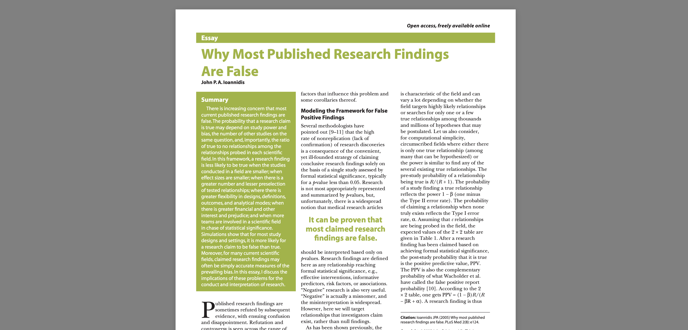
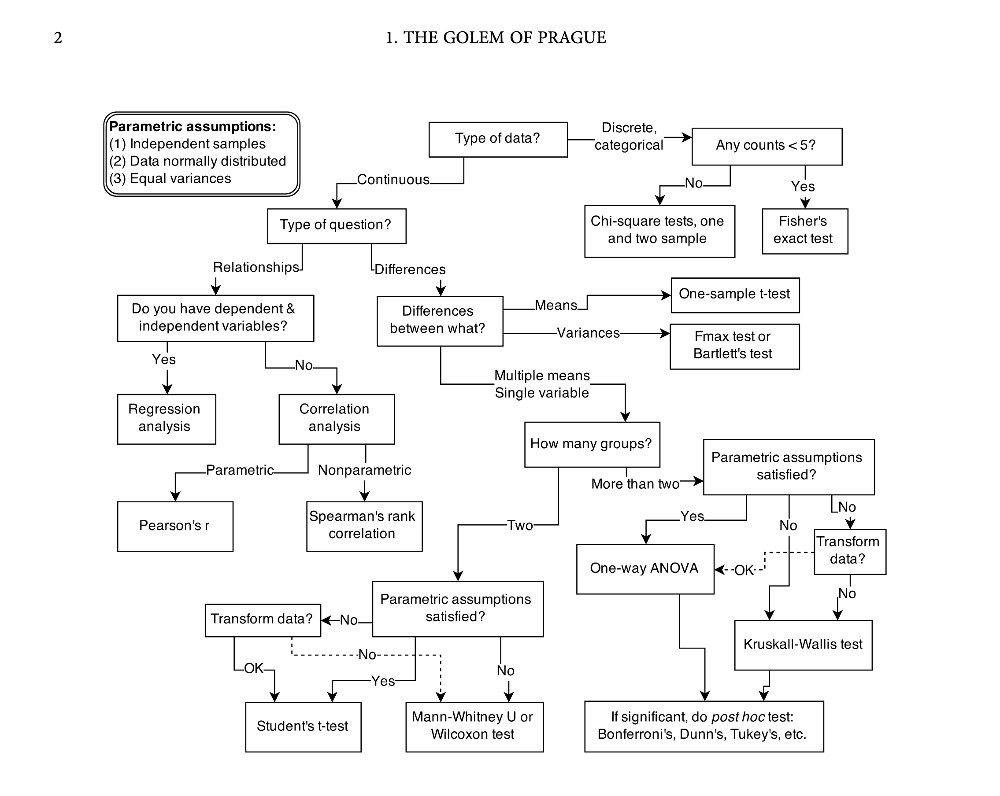

```{r setup, include=FALSE}
source("r/deck-setup.R")
source("r/week1.R")
check_stated_numbers() # the base-rate numbers typed into the slides below
```

# Most published research is false {notes="notes/week1_notes.md#published-research"}

::: {.ioannidis}


::: {.fragment .capybara}


::: {.big-statement}
...and that's okay.
:::
:::
:::

[https://journals.plos.org/plosmedicine/article?id=10.1371/journal.pmed.0020124](https://journals.plos.org/plosmedicine/article?id=10.1371/journal.pmed.0020124)

# This week's goals

::: {.incremental}
- Learn the three concepts behind Ioannidis's claim:
  - Probability
  - The base rate paradox
  - Statistical significance
- Understand why most research is wrong (and why that's okay)
- Discover updating, the one rule for all of statistics
- Work through an example: election polling
:::


# Statistical significance {notes="notes/week1_notes.md#statistical-significance"}

::: {.columns}

::: {.column width="80%"}
::: {.fragment fragment-index=1}
> A result is statistically significant if, assuming the null hypothesis is true and the model assumptions hold, the probability of obtaining data at least as extreme as those observed (the p-value) is less than or equal to the chosen significance level α. This leads to rejection of the null hypothesis while controlling the long-run Type I error rate at α. (ChatGPT, 2026)
:::
:::

::: {.column width="20%"}
::: {.fragment fragment-index=2}
{.absolute top=0 right=0 width="15%"}
:::
:::

:::

- [If this confuses you, you're not alone. It is deeply unintuitive.]{.fragment fragment-index=2}
- [We are going to scrap all of this complexity and start over to build something more intuitive.]{.fragment}


# You already understand probability {notes="notes/week1_notes.md#probability"}

_"Will it rain tomorrow?"_ [_"Probably not."_]{.fragment}

::: {.fragment}
That word, _probably_, is a probability. It's a way of talking about uncertainty.
:::

::: {.incremental}
- I don't know if it's going to rain tomorrow...
- ...but that doesn't mean I don't know anything.
- I know that rain works differently in July than in January.
:::

::: {.fragment}
But what does _"a 31% chance of rain"_ actually mean? 
:::

::: {.incremental}
- Tomorrow's weather isn't a lottery. Specific physical factors decide it.
- The day isn't random [...but _**we**_ are uncertain about it.]{.blue} 
- 31% describes how sure we are about an uncertain fact.
:::

## Probability is just counting {notes="notes/week1_notes.md#counting"}

_Count everything that could happen. Count the ones you care about. Compare._

::: {.fragment}
- **Probability of rolling a six on a die**:\
  6 sides could land face up. Only one of them is a six.\
  [→ **1 out of 6**]{.blue}
:::

::: {.fragment}
- **Probability of winning a raffle**:\
  500 tickets sold. You bought 10.\
  [→ **10 out of 500**]{.blue}
:::

::: {.fragment}
- **The probability that a random person in this class came by bus**:\
  25 of you are here. 15 of you came by bus.\
  [→ **15 out of 25**]{.blue}.
:::

::: {.fragment}
Every analysis in this course comes down to counting, exactly like this.
:::

## Counting the ways a thing could happen {notes="notes/week1_notes.md#counting-ways"}

_Flip a coin four times. How likely is exactly two heads?_

::: {.columns}
::: {.column width="58%"}
::: {.r-stack}
::: {.fragment .fade-out fragment-index=1}
```{r garden-all, opts.label = "garden"}
garden_plot(n = 4)
```
:::

::: {.fragment fragment-index=1}
```{r garden, opts.label = "garden"}
garden_plot(n = 4, target = 2)
```
:::
:::
:::

::: {.column width="42%"}
::: {.fragment}
Four events, two possibilities each:

- 2 × 2 × 2 × 2 = **16** ways in all
- Exactly two heads: [**6** out of 16]{.blue}
:::

::: {.fragment}

| Heads | 0 | 1 | [2]{.blue} | 3 | 4 |
|---|:-:|:-:|:-:|:-:|:-:|
| **Ways** | 1 | 4 | [**6**]{.blue} | 4 | 1 |
:::
:::
:::

::: {.fragment}
What we're doing is simple:\
[We list all the ways the world could be, and count them.]{.blue}
:::

## Writing it down: 0 to 1 {notes="notes/week1_notes.md#convention-1"}

_New notation, not new ideas: a number from 0 to 1, or a percentage._

::: {.fragment}
| Number | Percentage | Example |
|---|---|---|
| 0 | 0% | Something impossible |
| 0.02 | 2% | Winning the raffle: 10 ÷ 500 |
| 0.17 | 17% | Rolling a six: 1 ÷ 6 |
| 0.31 | 31% | Rain in Kathmandu: 113 ÷ 365 days[^rain-1] |
| 0.5 | 50% | A fair coin landing heads: 1 ÷ 2 |
| 1 | 100% | Something certain |

[^rain-1]: Kathmandu Airport weather station (NP000444540), NOAA GHCN-Daily, 2021–2025. A rainy day has at least 1 mm of rain. Days missing from the record are filled in at that month's average rate.
:::

## Writing it down: P(event) {notes="notes/week1_notes.md#convention-2"}

_We write the probability of an event as_ P( event ).

::: {.fragment}
| We write | We say | Value |
|---|---|---|
| P( rain tomorrow ) | "the probability of rain tomorrow" | 113 ÷ 365 ≈ 0.31 |
| P( getting heads ) | "the probability of getting heads" | 1 ÷ 2 = 0.5 |
| P( rolling a six ) | "the probability of rolling a six" | 1 ÷ 6 ≈ 0.17 |
| P( winning the raffle ) | "the probability of winning the raffle" | 10 ÷ 500 = 0.02 |
:::

## Writing it down: P(event | condition) {notes="notes/week1_notes.md#rain"}

_We make a probability more specific by adding a condition._

- P( rain | July ) means [_"the probability of rain, given that it's July."_]{.blue}
  You already think this way: you carry an umbrella in July, not in January.

::: {.fragment}
|  | Rainy days[^rain-3] | Days counted | Probability | % |
|---|--:|--:|--:|--:|
| P( rain ) | 565 | 1,825 | **0.31** | (31%) |
| P( rain \| Apr ) | 35 | 150 | **0.23** | (23%) |
| P( rain \| Jan ) | 3 | 155 | **0.02** | (2%) |
| P( rain \| Jul ) | 126 | 155 | **0.81** | (81%) |
| P( rain \| Feb ) | 8 | 140 | **0.06** | (6%) |

[^rain-3]: Kathmandu Airport weather station (NP000444540), NOAA GHCN-Daily, 2021–2025. A rainy day has at least 1 mm of rain. Days missing from the record are filled in at that month's average rate.
:::


## Conditional risk {notes="notes/week1_notes.md#conditional-risk"}

{fig-align="center" height="800px"}

[xkcd 795, "Conditional Risk," by Randall Munroe (CC BY-NC 2.5)]{.source}

## Probability lets us ask questions {notes="notes/week1_notes.md#lets-count"}

_Hands up if you had tea this morning._



::: {.incremental}
- That's not really a probability yet. It's just a fact about this group.
- It becomes a **probability** when we use it to say something we _don't_ know:
  - _"If we pick one student at random, how likely is it they had tea?"_\
  [(You just worked it out: []{.count-k-out} in []{.count-n-out})]{.blue}
  - _"If we poll a random person on the street, how likely is it that they had tea?"_\
  [(Possibly similar, if we're willing to make a few assumptions.)]{.blue}
:::

::: {.fragment}
Every prediction makes assumptions.<br />[(Interesting predictions make big assumptions.) {.reaction}]{.blue .fragment}
:::

# Probability for Decision Making {notes="notes/week1_notes.md#applied-probability"}

::: {.fragment}
In Nepal, HIV has a prevalence of about 0.1%. We can write that as:
:::

::: {.incremental}
- P( HIV+ ) = 0.001 (0.1%)
:::

::: {.fragment}
With statistical tests and predictions, we talk about two kinds of accuracy:
:::

::: {.incremental}
- **Sensitivity**: of the people who **have** HIV, the share who test positive.
  - P( test+ | HIV+ ) = **0.99** (true positive)
- **Specificity**: of the people who **don't have** HIV, the share who test negative.
  - P( test– | HIV– ) = **0.97** (true negative)
:::

## Prediction for Decision Making {notes="notes/week1_notes.md#base-rate"}

- Sensitivity P( test+ | HIV+ ): 99%
- Specificity P( test– | HIV– ): 97%

::: {.fragment fragment-index=0}
But there's something strange here...[they assume exactly what we want to know.]{.fragment fragment-index=1 .blue}
:::

::: {.fragment fragment-index=2}
The real question is usually P( HIV+ | test+): [🚨👉 3.2% 👈🚨]{.fragment fragment-index=3 .red}
:::

::: {.fragment fragment-index=4}

|[(pop: 100,000)]{.fragment fragment-index=5 .blue}           | Test+                                                            | Test–                                                             |
|----------|------------------------------------------------------------------|-------------------------------------------------------------------|
| **HIV+**<br>[(0.1%&nbsp;=&nbsp;100)]{.fragment fragment-index=5 .blue}| P( Test+ \| HIV+ ): **99%**<br>_Sensitivity (True Positive)_<br>[(99)]{.fragment fragment-index=6 .blue}| P( Test– \| HIV+ ): **1%**<br>_Type II Error (False Negative)_<br>[(1)]{.fragment fragment-index=6 .blue}|
| **HIV–**<br>[(99.9%&nbsp;=&nbsp;99,900)]{.fragment fragment-index=5 .blue} | P( Test+ \| HIV– ): **3%**<br>_Type I Error (False Positive)_<br>[(2,997)]{.fragment fragment-index=6 .blue}| P( Test– \| HIV– ): **97%**<br>_Specificity (True Negative)_<br>[(96,903)]{.fragment fragment-index=6 .blue}|
:::

::: {.fragment fragment-index=7}
[Historical figures for older screening tests. Modern tests reach about 99.8% specificity, which still gives P( HIV+ | test+ ) of only about 33%. In practice, a positive screen is always confirmed with further tests, and the people who get tested aren't randomly selected.]{.source}
:::

## Direction of conditions {notes="notes/week1_notes.md#direction"}

_Your intuitions about probability are good. They slip in one place: which way the
condition runs._ P(A|B) is not the same as P(B|A).




# The base rate paradox {notes="notes/week1_notes.md#base-rate-paradox"}

_If something is rare, most positive results are false, even from an "accurate" test._

::: {.columns}
::: {.column width="58%"}
::: {.r-stack}
::: {.fragment .fade-out fragment-index=1}
```{r hiv-all, opts.label = "base_rate"}
base_rate_plot(n_true = 1, true_positives = 1, false_positives = 30)
```
:::

::: {.fragment fragment-index=1}
```{r hiv-tested, opts.label = "base_rate"}
base_rate_plot(
  n_true = 1,
  true_positives = 1,
  false_positives = 30,
  results = TRUE
)
```
:::
:::
:::

::: {.column width="42%"}
1,000 people get tested at random. Only [1 person has HIV]{.blue}. The test identifies them. 

::: {.fragment fragment-index=1}
It also flags [30 people who don't have HIV]{.red}.
:::

::: {.fragment fragment-index=2}
::: {.big-statement}
31 positives.\
Only 1 is real.
:::
:::
:::
:::

## Base Rate Paradox Demo {.no-title}
```{shinylive-r}
#| standalone: true

```


# Statistical significance (revisited) {notes="notes/week1_notes.md#statistical-significance-revisited"}

Let's look at that quote again:

> A result is statistically significant if, [assuming the null hypothesis is true]{.fragment fragment-index=1 .highlight-red} and the model assumptions hold, [the probability of obtaining data at least as extreme as those observed]{.fragment fragment-index=2 .highlight-blue} (the p-value) is less than or equal to the chosen significance level α. This leads to rejection of the null hypothesis while controlling the long-run Type I error rate at α.




## The problem with p-values {notes="notes/week1_notes.md#pvalue-direction"}

If statistics has ever made you feel dumb or intimidated, [it's not you]{.blue}. Significance testing imagines the world [backwards]{.red} from our intuitions.

::: {.fragment fragment-index=1}

|  | Starts from | Asks |
|---|---|---|
| [**How&nbsp;we&nbsp;observe**]{.fragment fragment-index=2} | [what we [saw]{.blue}]{.fragment fragment-index=2} | [_"What does this tell me about the [world]{.green}?"_]{.fragment fragment-index=2} |
| [**A&nbsp;significance&nbsp;test**]{.fragment fragment-index=3} | [an [imagined world]{.red} with nothing going on]{.fragment fragment-index=3} | [_"How surprising would my [data]{.blue} be there?"_]{.fragment fragment-index=3} |
:::

::: {.incremental}
- A p-value doesn't tell you if a hypothesis is true. It tells you how unlikely this data would be if the null hypothesis were true.
- Those aren't the same thing. P(A|B) ≠ P(B|A)
:::

::: {.fragment .blue}
Statistical significance works the opposite way that our intuitions do.
:::


# Bayesian Updating

## Bayesian Updating: What it is not
{fig-align="center" width="100%"}

## Bayesian Updating: What it is {notes="notes/week1_notes.md#bayesian-updating"}

Instead of a flowchart of tests, updating is [**one rule for all of statistics**]{.blue}:

[**Prior**]{.red} × [**Likelihood**]{.blue} → [**Posterior**]{.green}

::: {.incremental}
- [**Prior**]{.red}: what we believed _before_ the new data
- [**Likelihood**]{.blue}: for _each_ possible answer, how expected were the data we saw?
- [**Posterior**]{.green}: what we believe _now_, with the new data taken into account
:::

::: {.fragment .callout-tip title="Example (made up): will the mayor win?"}
::: {.incremental}
- [**Prior**]{.red}: _"The mayor got 60% last time, so I think about 60% will vote for
  the mayor again."_
- [**Likelihood**]{.blue}: _"Only 20% of my small survey said they'll vote for the mayor. That would be surprising if the mayor's true support were 60%, but quite likely if it were around 20–30%."_
- [**Posterior**]{.green}: _"I now think about 45% of people will vote for the mayor."_
:::
::: {.fragment }
Our posterior then becomes our prior for future observations.
:::
:::


## Bayesian Updating Example {.no-title}
```{shinylive-r}
#| standalone: true

```


## Bayes' theorem {.mechanics notes="notes/week1_notes.md#bayes-theorem"}

_All of statistics in one formula._



- [[**P( belief )**]{.red}: the **prior**. What we believed before.]{.fragment fragment-index=2}
- [[**P( data | belief )**]{.blue}: the **likelihood**. How likely the data are, if the belief is true.]{.fragment fragment-index=3}
- [[**P( belief | data )**]{.green}: the **posterior**. What we believe now.]{.fragment fragment-index=4}
- [[**P( data )**]{.gray}: Rescales total possibilities to 100%. (Usually not interesting)]{.fragment fragment-index=5}

::: {.fragment fragment-index=6}
Conceptually:
[**Prior**]{.red} × [**Likelihood**]{.blue} → [**Posterior**]{.green}
:::


# So why is most published research wrong? {notes="notes/week1_notes.md#why-research-wrong"}

_It's the HIV test again._

::: {.columns}
::: {.column width="58%"}
::: {.r-stack}
::: {.fragment .fade-out fragment-index=1}
```{r ideas-all, opts.label = "base_rate"}
base_rate_plot(n_true = 10, true_positives = 8, false_positives = 50)
```
:::

::: {.fragment fragment-index=1}
```{r ideas-significant, opts.label = "base_rate"}
base_rate_plot(
  n_true = 10,
  true_positives = 8,
  false_positives = 50,
  results = TRUE
)
```
:::
:::
:::

::: {.column width="42%"}
1,000 ideas get tested. Most are wrong: only [10 are true]{.blue}.

::: {.fragment fragment-index=1}
Good studies find [8]{.blue} of the true ones.

They also "find" [50]{.red} false ones, by chance.
:::

::: {.fragment fragment-index=2}
::: {.big-statement}
58 discoveries.\
Only 8 are real.
:::
:::
:::
:::

## How far can we trust data? {.mechanics .smaller notes="notes/week1_notes.md#research-math"}

_**Sensitivity**: if the idea is true, what is the chance of getting a significant result._\
_**Specificity**: if the idea is false, what is the chance of getting a non-significant result._

| Type of study | Base Rate | Sensitivity | Specificity | Chance a discovery is true |
|--------------------------------|:--------:|:-----:|:-----:|:------------:|
| Large trial of a treatment with strong earlier evidence | 50% | 80% | 95% | 94% |
| Small trial of a treatment with strong earlier evidence | 50% | 20% | 95% | 80% |
| Large study of a plausible new idea | 10% | 80% | 95% | 64% |
| Small study of a plausible new idea | 10% | 20% | 95% | [31%]{.red} |
| Large search for surprising new effects | 1% | 80% | 95% | [14%]{.red} |
| Small search for surprising new effects | 1% | 20% | 95% | [4%]{.red} |
| Small search, re-analysed until something is significant (p-hacked) | 1% | 20% | 80% | [1%]{.red} |

::: {.source}
In technical terms: sensitivity is **statistical power**, $1 - \beta$. Specificity is
$1 - \alpha$, where $\alpha$ is the **significance level** (often 5%).
:::


# Most studies are wrong... {notes="notes/week1_notes.md#is-that-a-problem"}

::: {.fragment .callout-note title="...and that's okay" icon=false}
::: {.incremental}
- A study was never supposed to be the answer. It's one observation of the world. 
- What makes science work is [groups of scientists arguing]{.blue} about how contradictory observations fit together.
:::
:::

::: {.incremental}
- [**Assume**]{.red} a prior belief, written down where others can argue with it.
- [**Look**]{.blue} at new data to challenge those prior assumptions.
- [**Update**]{.green} our beliefs to incorporate the new information, and use this posterior as the starting point next time.
:::

::: {.fragment}
That's [prior]{.red} × [likelihood]{.blue} → [posterior]{.green}, done by people
instead of a formula.
:::

::: {.fragment}
::: {.big-statement}
Science isn't the experiments we do.\
It's the debates we have about them.
:::
:::

## Numbers don't speak for themselves {notes="notes/week1_notes.md#objective-subjective"}

> _"Qualitative research is subjective. Statistics is objective."_

::: {.meme-anchor}
::: {.fragment .fade-in-then-out}

:::
:::

::: {.fragment}
|                 | Observation                    | Interpretation assumes…                          |
|-----------------|--------------------------------|--------------------------------------------------|
| **Qualitative** | interviews, field notes        | what people meant; where we chose to look; whose voices stand for others |
| **Quantitative**  | surveys, records, measurements | that the pattern isn't just chance; what causes what; how the data came to be |
:::

::: {.incremental}
- The observation can be objective. The interpretation never is.
- Key choices come before the data: what to ask, who to observe, how to assume that the data is generated.
- Math won't tell us how to make these choices. Instead, we have to do science.
:::

## The science comes first {notes="notes/week1_notes.md#science-first"}

Statistics weighs [new observations]{.blue} against what we [already assume we know]{.red}.

::: {.incremental}
- Leave out the assumptions and numbers mislead: that's the base rate paradox.
- Every interesting model assumes things about the world: _who responded, what causes
  what, how the data came to be._
- Those are claims about the world, not math, and anyone who knows something about the world can question them.
:::

::: {.fragment}
::: {.big-statement}
[Math is the least interesting part of statistics.]{.blue}\
In this five-week course, we'll look at everything else.
:::
:::

# What's ahead {notes="notes/week1_notes.md#whats-ahead"}

| Week | Topic | Punchline |
|:-:|---|---|
| **1** | Updating | Do science, not statistics. |
| **2** | Distributions | Change how you think about numbers. |
| **3** | Models | Draw your assumptions and make them explicit. |
| **4** | Confounders | Look behind every pattern. |
| **5** | Interpretation | Ask what's missing and what's hidden. |

# Practical work: Election polling {notes="notes/week1_notes.md#poll-demo"}

_Appendix: we'll work through this together with the TA in our second class._

Let's walk through the simplest possible version of the Bayesian workflow.

- **What we want to know**: θ (theta), the share of voters in a made-up city who will vote for the current mayor.
- **Background**: in the last election, the mayor got 60% of the vote.
- **Data**: we survey *n* voters at random, and *k* of them say they will vote for the mayor.

::: {.callout-note title="A deliberately simple model"}
Each respondent is like a coin flip that comes up "mayor" with probability θ. No weighting,
no turnout, no non-response, no post-stratification. We'll add those later.
:::

## Reading these graphs {notes="notes/week1_notes.md#poll-graphs"}

_Not one answer: every possible answer, side by side._

::: {.columns}
::: {.column width="55%"}
```{r reading, opts.label = "half"}
reading_plot()
```
:::

::: {.column width="45%"}
- **Along the bottom:** the values θ could take, from 0% to 100% in steps of 5.
- **Up the side:** how plausible each value is, _compared with the others_. The height
  has no units. Only the comparisons matter.
- Here, [40%]{.blue} is about `r fmt(reading_ratio(0.4, 0.2), 0)` times as plausible as
  [20%]{.blue}, and about `r fmt(reading_ratio(0.4, 0.7), 0)` times as plausible as
  [70%]{.blue}.
- The [prior]{.red}, the [likelihood]{.blue} and the [posterior]{.green} are all maps
  like this one.
:::
:::

::: {.source}
Like the bag of stones, with 21 possible answers instead of 10. Next week: much more on
this.
:::

## Step 1: The prior {notes="notes/week1_notes.md#poll-prior"}

_Before any survey, what do you believe about θ? Drag the points, or draw._



## Step 2: The likelihood {notes="notes/week1_notes.md#poll-likelihood"}

_Set the survey. How likely is that result, for each possible value of θ?_



The likelihood is **not** a belief. It's what our model of the survey (each answer like a coin flip) says about our data, one candidate value of θ at a time.

## Step 3: Prior × likelihood → posterior {notes="notes/week1_notes.md#poll-posterior"}



## Answering the question {notes="notes/week1_notes.md#poll-answer"}



## What to try {notes="notes/week1_notes.md#poll-try"}

_Three questions to explore. The next three slides are a tool for each, in this order._

- **A different prior.** What if we'd started somewhere else, or been more or less sure?
  How far does the posterior move?
- **More (or fewer) people.** Keep the result at 20% but ask 5 people, or 1,000. What
  happens to the prior's influence?
- **A different result.** Same number of people, different answers. How much does what
  they said change the answer?

*How much does the result depend on the assumptions we can change? (And, what assumptions remain hidden?)*

## What if I'd started from a different prior? {notes="notes/week1_notes.md#whatif-prior"}

_Same survey. Move your prior, or make it more or less sure._



## What if I'd asked more (or fewer) people? {notes="notes/week1_notes.md#whatif-size"}

_Same prior, same share saying "mayor". Change how many people we asked._



## What if the survey had been different? {notes="notes/week1_notes.md#whatif-result"}

_Same prior, same number of people. Change what they said._



## The model, written formally {.mechanics .smaller notes="notes/week1_notes.md#poll-model"}

$$
\begin{aligned}
k &\sim \text{Binomial}(n,\ \theta) && \class{blue}{\text{likelihood}} \\
\theta &\sim \text{[our prior curve]} && \class{red}{\text{prior}}
\end{aligned}
$$

| Symbol | Read it as | In our survey |
|---|---|---|
| $n$ | the number of people surveyed | data, known (e.g., 20) |
| $k$ | how many of them said "mayor" | data, known (e.g., 4) |
| $\theta$ | the mayor's share among all voters | what we want to learn, unknown |
| $\sim$ | "is drawn from" | |

- We've talked about how priors and posteriors are made, but what about [likelihoods]{.blue}?
- The math behind likelihoods can get technical beyond what we need for these 5 weeks.
- Briefly: likelihood comes from [line 1]{.blue}. The binomial counts coin flips: if each of the $n$ people surveyed has a $\theta$ chance of saying "mayor", independently of the others, Binomial($n$, $\theta$) gives the chance of every possible $k$. Work that out at each value of $\theta$ and you get the likelihood curve from Step 2.

# More resources {notes="notes/week1_notes.md#more-resources"}

This course draws heavily on the work of Richard McElreath, a statistician working out of the Max Planck Institute. If you want a deeper dive into statistical mechanics, consider the resources below.

- **The book:** Richard McElreath,
  [*Statistical Rethinking: A Bayesian Course with Examples in R and Stan*](https://xcelab.net/rm/)
  (2nd edition, 2020). This course follows its approach.
- **The lectures:** McElreath's
  [Statistical Rethinking 2026](https://github.com/rmcelreath/stat_rethinking_2026)
  series on YouTube. Twenty free lectures that follow the book.

## The Bayesian workflow {.smaller .mechanics}


