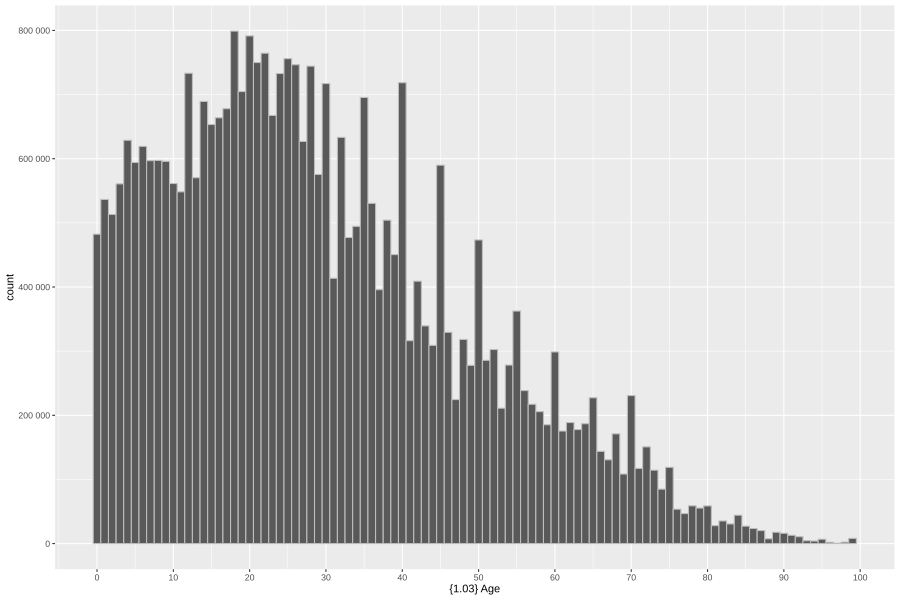

```{r setup, include=FALSE}
source("r/deck-setup.R")
source("r/week2.R")

# !Kung San adults (Howell): our running example
howell <- load_howell() |>
  mutate(
    sex = if_else(male == 1, "male", "female"),
    z_height = standardize(height),
    z_weight = standardize(weight)
  )

h_mean <- mean(howell$height)
h_sd <- sd(howell$height)
w_mean <- mean(howell$weight)
w_sd <- sd(howell$weight)
r_hw <- cor(howell$height, howell$weight)

houses <- load_houses() |>
  mutate(z_price = standardize(price), z_area = standardize(area_m2))
```

# Think in distributions {notes="notes/week2_notes.md#think-in-distributions"}

_"The average !Kung adult is `r fmt(h_mean, 0)` cm tall."_

::: {.fragment}
True. But that one number hides three things.
:::

::: {.kinds}
::: {.kind .kind-data .fragment}
[A population]{.kind-title}

Not everyone is `r fmt(h_mean, 0)` cm. The adults range from `r fmt(min(howell$height), 0)`
to `r fmt(max(howell$height), 0)` cm.

How do heights **vary across people**? That's a **distribution of data**.
:::

::: {.kind .kind-belief .fragment}
[Uncertainty]{.kind-title}

We measured `r nrow(howell)` adults, not every one. The true average could be a little
higher or lower.

How **sure** are we about the average? That's a **distribution of belief**.
:::

::: {.kind .kind-relationship .fragment}
[A relationship]{.kind-title}

Height doesn't vary on its own. Taller adults tend to be heavier, but not always.

How do height and weight **vary together**? That's a **distribution of a
relationship**.
:::
:::

::: {.fragment}
::: {.big-statement}
This week: think in distributions, not single numbers.
:::
:::


# Last week → this week {notes="notes/week2_notes.md#last-week"}

- Last week: a number is one observation, read through what we already assume.
  This week: a single number also hides how much things vary, and how sure we are.
- Last week, our answer to "will the mayor win?" was not a number.
- It was a **distribution**: a whole curve of more and less plausible values.
- That's this week's key word. A distribution describes a number by **every value it
  could take**, and how common or plausible each one is.
- We'll meet three kinds: distributions of [data]{.blue} (how values vary across
  cases), of [belief]{.green} (how sure we are about something we don't know), and of
  [relationships]{.orange} (how two variables vary together).


# Goals this week: three kinds of distribution {notes="notes/week2_notes.md#goals"}



Appendix: What makes a house expensive? All three kinds at work on real data, with the
TA in our second session.


# Part 1: Distributions of data {.center .part-1 notes="notes/week2_notes.md#part1"}




# Randomness has patterns {notes="notes/week2_notes.md#randomness"}

Problem: we want to understand how the admissions process works at a university. 

::: {.fragment .callout-note title="Population: This isn't about one individual case but rather a group of cases"}
- "Applications to this university last year"
- "Applications to this university in the last ten years"
- "Applications to all state-run universities in this country last year"
:::

::: {.fragment .callout-tip title="Variation: These cases are different from each other in ways that interest us"}
- "Exam results"
- "Family wealth"
- "Gender"
- "Department"
:::

::: {.fragment .callout-important title="Randomness: Reality is messy, and we'll never predict admission perfectly. But, randomness has patterns. We can describe how it was generated."}
- If I flip a coin 1 time, I can't say what will happen. 
- If I flip a coin 1000 times, I can say a lot more. 
- Random individuals → Predictable populations
:::


# A distribution of data: Nepal's population {notes="notes/week2_notes.md#nepal-population"}
<!-- TODO: Add NLSS age data. Why the bumps? -->
{width="80%" fig-align="center"}


# Our running example: the !Kung San {notes="notes/week2_notes.md#kung"}

::: {.columns}
::: {.column width="45%"}
- Census data collected by anthropologist **Nancy Howell** in the late 1960s among
  the !Kung San of the Kalahari.
- `r nrow(howell)` adults (18+).
- Height (cm), weight (kg), age, sex.
- The same data McElreath uses in *Statistical Rethinking*.
:::

::: {.column width="55%"}
```{r howell-table}
howell |>
  select(height, weight, age, sex) |>
  head(6) |>
  knitr::kable(digits = 1)
```
:::
:::


# Describing a distribution {notes="notes/week2_notes.md#describing"}

```{r height-hist}
height_hist_plot(howell)
```

- [**Center**]{.red}: where is a typical value? (mean)
- [**Spread**]{.blue}: how far is a typical case from the center? (standard deviation)
- **Shape**: one hump or two? Symmetric, or a long tail?


# The Normal distribution {notes="notes/week2_notes.md#normal"}

::: {.columns}
::: {.column width="60%"}
```{r normal-overlay}
normal_overlay_plot(howell)
```
:::

::: {.column width="40%"}
- The blue curve is a Normal distribution with
  - mean = `r fmt(h_mean)`
  - SD = `r fmt(h_sd)`
- **Two numbers** describe the whole shape.
- Real data are never perfectly Normal, but many things are close.
:::
:::

::: {.fragment}
$$
\text{height} \sim \text{Normal}(\mu = `r fmt(h_mean)`,\ \sigma = `r fmt(h_sd)`)
$$
:::


# The 68–95–99.7 rule {notes="notes/week2_notes.md#rule-68-95"}

```{r normal-rule}
normal_rule_plot()
```

- For a Normal distribution, about **68%** of cases fall within 1 SD of the mean,
  **95%** within 2 SD.
- Check: `r fmt(100 * mean(abs(howell$z_height) < 1), 0)`% of !Kung adults are within 1 SD
  of the average height, and `r fmt(100 * mean(abs(howell$z_height) < 2), 0)`% within 2 SD.


# Distributions Demo {.no-title notes="notes/week2_notes.md#dist-demo"}

```{shinylive-r}
#| standalone: true

```


# Standardized values (z-scores) {notes="notes/week2_notes.md#z-scores"}

```{r z-example}
ex_h <- 165
ex_w <- 58
ex_zh <- (ex_h - h_mean) / h_sd
ex_zw <- (ex_w - w_mean) / w_sd
```

A !Kung man is **`r ex_h` cm** tall and weighs **`r ex_w` kg**.
Is he more unusually *tall* or more unusually *heavy*?

- We can't compare centimeters to kilograms.
- But we can ask of each: **how many standard deviations from average is this?**

::: {.fragment}
$$
z = \frac{x - \text{mean}}{\text{SD}}
$$
:::

::: {.fragment .nonincremental}
- Height: (`r ex_h` − `r fmt(h_mean)`) / `r fmt(h_sd)` = [**`r fmt(ex_zh, 2)`**]{.blue}
- Weight: (`r ex_w` − `r fmt(w_mean)`) / `r fmt(w_sd)` = [**`r fmt(ex_zw, 2)`**]{.red}
- He is more unusually heavy than he is tall.
:::


## Same data, new ruler {notes="notes/week2_notes.md#new-ruler"}

::: {.columns}
::: {.column}
```{r hist-cm, opts.label = "half_short"}
height_ruler_plot(howell)
```
:::

::: {.column}
```{r hist-z, opts.label = "half_short"}
height_ruler_plot(howell, z = TRUE)
```
:::
:::

- The **shape** doesn't change at all. Only the labels on the axis.
- The mean becomes **0**. The standard deviation becomes **1**.
- The units disappear: a z-score is measured in "standard deviations".


## Reading z-scores {notes="notes/week2_notes.md#reading-z"}

::: {.columns}
::: {.column width="45%"}
| z      | Meaning                          |
|--------|----------------------------------|
| 0      | exactly average                  |
| ±1     | ordinary                         |
| ±2     | unusual (about 1 in 20)          |
| ±3     | rare (about 1 in 370)            |
:::

::: {.column width="55%"}
In R:

```{r z-code, echo = TRUE, eval = FALSE}
howell |>
  mutate(
    z_height = (height - mean(height)) / sd(height),
    z_weight = (weight - mean(weight)) / sd(weight)
  )
```
:::
:::

- z-scores let us compare things measured on completely different scales:
  exam marks out of 50 vs. out of 100, rupees vs. dollars, cm vs. kg.


# Part 2: Distributions of belief {.center .part-2 notes="notes/week2_notes.md#part2"}




# How old is he? A distribution of belief {notes="notes/week2_notes.md#belief-distributions"}

::: {.fragment .callout-note .nonincremental}
- We talk about probability distributions all the time: "He's probably about 40, but he could be quite a bit older". 
- Here, we're just visualizing that kind of description over the range of all possible values.
:::

::: {.columns}

::: {.column width="30%"}
::: {.fragment}
::: {.small-caption}
**Uninformed** I have no idea. He could be between 0 and 100 and I don't think any possibility is more likely than any other.
:::
```{r belief-uninformed, opts.label = "belief"}
belief_plot(function(x) dunif(x, 0, 100))
```

:::

::: {.fragment}
::: {.small-caption}
**Weakly informed** He seems like he's about 40, but I could be very wrong about that. Anything between 20 and 60 seems plausible and even more extreme values are possible.
:::
```{r belief-weak, opts.label = "belief"}
belief_plot(function(x) dnorm(x, 40, 15), ymax = 0.1)
```
:::
:::

::: {.column width="40%"}
::: {.fragment fragment-index=1}
{height="550px" fig-align="center"}
:::
:::

::: {.column width="30%"}
::: {.fragment }
::: {.small-caption}
**Strongly informed** I'm quite certain that he's forty or relatively close to it.
:::
```{r belief-strong, opts.label = "belief"}
belief_plot(function(x) dnorm(x, 40, 1))
```
:::

::: {.fragment}
::: {.small-caption}
**Domain-specific distributions** I'm relatively certain he's between 30 and 50, but I have really no idea where in that range he lands. Older or younger than that seems unlikely, though.
:::

```{r belief-domain, opts.label = "belief"}
belief_plot(plateau_density(center = 40, plateau = 20, taper = 15), ymax = 0.05)
```

:::
:::

:::


# Data or belief? {notes="notes/week2_notes.md#two-kinds"}

::: {.kinds .nonincremental}
::: {.kind .kind-data}
[Distributions of data]{.kind-title}

How a quantity **varies across cases**. Many cases, each with its own value.

- Heights of the adults in a village
- Prices of houses sold last year
- Ages of everyone in Nepal
:::

::: {.kind .kind-belief}
[Distributions of belief]{.kind-title}

How **plausible** each value of an unknown is. One true value; we're unsure which.

- The mayor's share of the vote
- The age of the man in the photo
- The average height of all !Kung adults
:::
:::

::: {.fragment}
Same shapes, same vocabulary, same math. Part 3 needs both: a pattern in the data,
and how sure we are about it.
:::


# Part 3: Distributions of relationships {.center .part-3 notes="notes/week2_notes.md#part3"}




# Two variables at once {notes="notes/week2_notes.md#correlation"}

```{r scatter-raw}
ggplot(howell, aes(height, weight)) +
  geom_point(color = BLUE, alpha = 0.6, size = 2.5) +
  labs(x = "Height (cm)", y = "Weight (kg)")
```

- Height and weight each have their own [distribution of data]{.blue}, from Part 1.
  The scatterplot shows the two **together**: each dot is one adult.
- Taller people tend to be heavier. But **how strongly** do they go together?


## Standardize both variables {notes="notes/week2_notes.md#standardize-both"}

```{r scatter-z}
agreement_plot(howell)
```


## Correlation is average agreement {.mechanics notes="notes/week2_notes.md#average-agreement"}

::: {.columns}
::: {.column width="55%"}
$$
r = \frac{1}{n-1} \sum_{i=1}^{n} z_{\text{height},i} \times z_{\text{weight},i}
$$

- Each person "votes":
  - [Same side of average on both → **positive** vote]{.blue}
  - [Opposite sides → **negative** vote]{.red}
- *r* is the average vote.
:::

::: {.column width="45%"}
::: {.fragment}
```{r cor-code, echo = TRUE}
cor(howell$height, howell$weight)
```
:::

- *r* is always between **−1** and **+1**.
- *r* has no units.
- Standardizing changes nothing: *r* in cm/kg = *r* in z-scores.
:::
:::


## What does *r* look like? {notes="notes/week2_notes.md#r-gallery"}

```{r cor-gallery, fig.height = 3.6}
cor_gallery_plot()
```

- Our height and weight: *r* = `r fmt(r_hw, 2)`. A strong relationship, but far from perfect.


## What correlation misses {notes="notes/week2_notes.md#cor-misses"}

```{r cor-misses, fig.height = 5.5}
cor_misses_plot()
```

- *r* only measures **straight-line** agreement.
- **Always plot your data** before trusting a single number.


# Regression: our first coefficient {notes="notes/week2_notes.md#regression"}

::: {.columns}
::: {.column width="55%"}
```{r candidate-lines, fig.width = 7, fig.height = 6.5}
candidate_lines_plot(howell, r_hw)
```
:::

::: {.column width="45%"}
In z-space, both variables have mean 0, so a line through the middle of the cloud
needs only **one parameter**: its slope, β.

$$
z_{\text{weight}} = \beta \times z_{\text{height}}
$$

- Which line describes the data best?
:::
:::


## The best line {notes="notes/week2_notes.md#best-line"}

::: {.columns}
::: {.column width="55%"}
```{r residuals, fig.width = 7, fig.height = 6.5}
residuals_plot(howell, r_hw)
```
:::

::: {.column width="45%"}
- The [red lines]{.red} are the **errors**: how far each person is from the line.
- The best line makes the errors as small as possible overall.
- With standardized data and one predictor, the best β is exactly the correlation:
  **β = r = `r fmt(r_hw, 2)`**.
:::
:::


## Reading the coefficient {.mechanics notes="notes/week2_notes.md#reading-coef"}

```{r slope-units}
slope_kg_cm <- r_hw * w_sd / h_sd
```

::: {.columns}
::: {.column width="45%"}
- In z-scores: **β = `r fmt(r_hw, 2)`**
  - "An adult 1 SD taller than average is, on average, `r fmt(r_hw, 2)` SD heavier."
- Back in real units: β × SD~weight~ / SD~height~
  - `r fmt(r_hw, 2)` × `r fmt(w_sd)` / `r fmt(h_sd)` = **`r fmt(slope_kg_cm, 2)` kg per cm**
  - "Each extra centimeter of height goes with about `r fmt(slope_kg_cm, 2)` kg more
    weight."
:::

::: {.column width="55%"}
```{r slope-plot, opts.label = "half"}
ggplot(howell, aes(height, weight)) +
  geom_point(color = GRAY, alpha = 0.6, size = 2) +
  geom_smooth(method = "lm", se = FALSE, color = BLUE, linewidth = 1.5) +
  labs(x = "Height (cm)", y = "Weight (kg)")
```

```{r lm-code, echo = TRUE}
coef(lm(weight ~ height, data = howell))
```
:::
:::


## How sure are we about β? {notes="notes/week2_notes.md#beta-posterior"}

```{r beta-posterior}
beta_posterior_plot(howell)
```

::: {.nonincremental}
- β is a number we don't know, so it gets a [distribution of belief]{.green}. Just
  like the mayor's popularity last week: **prior × likelihood → posterior**.
- With 20 people we're unsure about β. With `r nrow(howell)`, much less so.
:::


# When patterns mislead: two headlines {notes="notes/week2_notes.md#headlines"}

```{r icecream-sim}
# Simulated beach town: hot days bring both ice cream sales and swimmers
set.seed(11)
beach <- tibble(day = 1:365) |>
  mutate(
    temp = 18 + 8 * sin(2 * pi * (day - 100) / 365) + rnorm(n(), 0, 2.5),
    ice_cream = 40 * temp + rnorm(n(), 0, 120),
    drownings = rpois(n(), exp(-3 + 0.13 * temp))
  )
r_ice <- cor(beach$ice_cream, beach$drownings)
```

```{r noise-sim}
# 50 made-up "indicators" for 20 made-up "countries", all pure random noise
set.seed(3)
n_vars <- 50
noise_small <- matrix(rnorm(20 * n_vars), nrow = 20)
r_small <- cor(noise_small)
r_small[lower.tri(r_small, diag = TRUE)] <- NA
best <- which(abs(r_small) == max(abs(r_small), na.rm = TRUE), arr.ind = TRUE)
r_best <- r_small[best]
```

::: {.fragment}
> _"Ice cream sales linked to drownings"_ (*r* = `r fmt(r_ice, 2)`, one year of daily data)
:::

::: {.fragment}
> _"Countries that spend more on [one thing] have `r if (r_best > 0) "more" else "less"` [another]"_ (*r* = `r fmt(r_best, 2)`,
> 20 countries)
:::

::: {.fragment .nonincremental}
- Both patterns are really there in the data.
- Neither one means what the headline says.
:::

::: {.fragment}
Let's see why, and how to tell the two apart.
:::


## Spurious correlations {notes="notes/week2_notes.md#spurious"}

A **spurious correlation** is a real pattern in the data that does *not* mean one
variable affects the other. There are two common ways to get one:

::: {.columns}
::: {.column}
::: {.fragment .callout-important .nonincremental title="1. Confounding"}
A **third variable** drives both. The pattern is real and will show up again in new
data, but it isn't about the two variables themselves.
:::
:::

::: {.column}
::: {.fragment .callout-warning .nonincremental title="2. Chance"}
**Random noise** happens to line up. The pattern is a fluke of this particular sample
and will disappear in new data.
:::
:::
:::


## Kind 1: Does ice cream cause drowning? {notes="notes/week2_notes.md#ice-cream"}

::: {.columns}
::: {.column width="55%"}
```{r icecream-scatter, fig.width = 7, fig.height = 6}
ggplot(beach, aes(ice_cream, drownings)) +
  geom_jitter(color = BLUE, alpha = 0.6, size = 2.5, width = 0, height = 0.15) +
  geom_smooth(method = "lm", se = FALSE, color = RED, linewidth = 1.5) +
  labs(x = "Ice cream sales (cones per day)", y = "Drownings per day")
```
:::

::: {.column width="45%"}
- One year of (simulated) daily data from a beach town.
- *r* = `r fmt(r_ice, 2)`: days with more ice cream sales have more drownings.
- Should the town ban ice cream?
:::
:::


## The confounder: temperature {notes="notes/week2_notes.md#temperature"}

```{r icecream-strata, fig.height = 5}
icecream_strata_plot(beach)
```

- [ice cream]{.blue} ← **temperature** → [drownings]{.blue}
- Compare days with **similar temperatures**, and the relationship mostly disappears.
- More data would not help: a million days would show the same strong *r*.
- A confounder can hide a relationship, invent one, or even flip its sign. You'll see
  a sign flip in the house-price exercise.


## Kind 2: Correlations from pure noise {notes="notes/week2_notes.md#noise"}

::: {.columns}
::: {.column width="55%"}
```{r noise-best, fig.width = 7, fig.height = 6}
tibble(x = noise_small[, best[1]], y = noise_small[, best[2]]) |>
  ggplot(aes(x, y)) +
  geom_point(color = BLUE, size = 4) +
  geom_smooth(method = "lm", se = FALSE, color = RED, linewidth = 1.5) +
  labs(x = paste("Variable", best[1]), y = paste("Variable", best[2]))
```
:::

::: {.column width="45%"}
- I made up `r n_vars` variables for 20 "countries". Every value is drawn at
  random with `rnorm()`: nothing is related to anything.
- That's `r choose(n_vars, 2)` possible pairs.
- The strongest pair: *r* = `r fmt(r_best, 2)`.
- Give these two variables names, and it would make a convincing headline.
:::
:::


## Small samples and many comparisons {notes="notes/week2_notes.md#small-samples"}

```{r noise-dist, fig.height = 5}
noise_dist_plot(r_small, n_vars)
```

- Each histogram is a **distribution of *r***: how much a correlation varies by chance
  alone, when nothing is going on. With [20 cases]{.red}, chance alone produces values
  of ±0.5 and beyond. With [500 cases]{.blue}, they stay close to 0.
- Search through enough pairs and you're guaranteed to find something "interesting".
- This is Week 1's problem again: try enough comparisons and some will look
  "significant." The base rate of real relationships here is zero.


## Telling the two apart {.smaller notes="notes/week2_notes.md#telling-apart"}

| | Confounding | Chance |
|------|-------|-------|
| What's going on? | A third variable drives both | Noise happened to line up |
| Shows up in new data? | Yes | No |
| Would more data help? | **No** | **Yes** |
| What helps? | Thinking about causes; comparing like with like | Bigger samples; deciding what to test *before* looking; replication |

::: {.fragment}
- The posterior for β already protects us a little against chance: with 20 adults it
  was wide, saying "I'm not sure."
- Nothing in the data alone protects us against confounding. For that we need a
  **causal model**.
- Week 1 ended with more fundamental ways to question our assumptions. This is the
  first: more data won't save you from a confounder.
:::


# Summary: three kinds of distribution {notes="notes/week2_notes.md#summary"}

A **distribution** is a different way to think about a number: every value it could
take, and how common or plausible each one is.

::: {.kinds .nonincremental}
::: {.kind .kind-data}
[Data]{.kind-title}

How values vary across cases. Center, spread, shape. A z-score places one case.
:::

::: {.kind .kind-belief}
[Belief]{.kind-title}

How sure we are about an unknown. Wide when we know little, narrow when data are many.
:::

::: {.kind .kind-relationship}
[Relationships]{.kind-title}

How two variables vary together: *r* and β. A pattern is a description, not an
explanation: chance and confounding both mislead.
:::
:::

::: {.fragment}
::: {.big-statement}
Think in distributions, not single numbers.
:::
:::


# Next week {notes="notes/week2_notes.md#next-week"}

- Correlation and regression describe **how** things move together.
- They don't tell us **why**.
- To answer "would banning ice cream prevent drownings?", we need to say what we think
  causes what.
- Next week: **DAGs** and **causal models**.


# Practical work: What makes a house expensive? {.center notes="notes/week2_notes.md#houses"}

_Appendix: we'll work through this together with the TA in our second session._


## The data: house sales in Ames, Iowa {notes="notes/week2_notes.md#houses-data"}

- `r fmt(nrow(houses), 0)` houses sold 2006–2010 in Ames, a US college town
  (De Cock, 2011). Prices in US dollars; areas converted to m².

```{r houses-table}
houses |>
  select(price, area_m2, year_built, bedrooms, bathrooms, garage_cars) |>
  head(6) |>
  mutate(price = dollars(price)) |>
  knitr::kable(align = "r")
```


## Step 1: Look at the distribution {notes="notes/week2_notes.md#houses-step1"}

```{r price-hist, fig.height = 5.5}
price_hist_plot(houses)
```

- Not Normal: a **long right tail** of a few very expensive houses.
- The tail pulls the [mean]{.red} above the [median]{.blue}. Which is the "typical" price?


## Step 2: How unusual is this house? {notes="notes/week2_notes.md#houses-step2"}

```{r unusual-houses}
unusual <- bind_rows(
  houses |> slice_max(price, n = 1) |> mutate(house = "A: most expensive"),
  houses |> slice_max(area_m2, n = 1) |> mutate(house = "B: largest")
)
```

::: {.columns}
::: {.column width="45%"}
| | Mean | SD |
|-|------|----|
| Price | `r dollars(mean(houses$price))` | `r dollars(sd(houses$price))` |
| Living area | `r fmt(mean(houses$area_m2))` m² | `r fmt(sd(houses$area_m2))` m² |
:::

::: {.column width="55%"}
```{r unusual-table}
unusual |>
  transmute(house, price = dollars(price), `area (m²)` = area_m2) |>
  knitr::kable(align = "lrr")
```
:::
:::

**Your turn:** compute the z-scores for houses A and B. Which one is more unusual, and
in what way?

::: {.fragment}
```{r unusual-z}
unusual |>
  transmute(
    house,
    `z (price)` = fmt(z_price, 1),
    `z (area)` = fmt(z_area, 1)
  ) |>
  knitr::kable(align = "lrr")
```
:::


## Step 3: Price and living area {notes="notes/week2_notes.md#houses-step3"}

```{r price-area, fig.height = 6}
r_pa <- cor(houses$price, houses$area_m2)
price_area_plot(houses, unusual)
```

- *r* = `r fmt(r_pa, 2)`. Bigger houses sell for more, but with lots of scatter.
- House B is far off the pattern. What might be going on?


## Step 4: Guess first {notes="notes/week2_notes.md#houses-guess"}

Before we look: **rank these from strongest to weakest correlation with price.**

::: {.nonincremental}
- Number of bedrooms
- Number of bathrooms
- Living area
- Lot (land) area
- Garage size (cars)
- Year built
:::


## Step 4: The correlations {notes="notes/week2_notes.md#houses-correlations"}

```{r cor-bars, fig.height = 6}
price_cor_plot(houses)
```

- Because *r* has no units, we can compare m², cars, years, and rooms on one scale.


## Step 5: One coefficient {.mechanics notes="notes/week2_notes.md#houses-coef"}

```{r price-slope}
slope_usd_m2 <- r_pa * sd(houses$price) / sd(houses$area_m2)
```

::: {.columns}
::: {.column width="55%"}
$$
z_{\text{price}} = \beta \times z_{\text{area}}
$$

- In z-scores: **β = `r fmt(r_pa, 2)`**
  - "A house 1 SD larger than average sells, on average, for `r fmt(r_pa, 2)` SD more."
- In real units: `r fmt(r_pa, 2)` × `r dollars(sd(houses$price))` /
  `r fmt(sd(houses$area_m2))` m² ≈ **`r dollars(slope_usd_m2)` per m²**
  - "Each extra square meter of living space goes with about
    `r dollars(slope_usd_m2)` more in price."
:::

::: {.column width="45%"}
```{r price-z, fig.width = 6, fig.height = 6}
ggplot(houses, aes(z_area, z_price)) +
  geom_point(color = GRAY, alpha = 0.3, size = 1.5) +
  geom_abline(slope = r_pa, intercept = 0, color = BLUE, linewidth = 1.5) +
  coord_equal() +
  labs(x = "Living area (z)", y = "Price (z)")
```
:::
:::


## A puzzle: bedrooms {notes="notes/week2_notes.md#bedrooms-puzzle"}

```{r bedrooms-puzzle, fig.height = 5.5}
bedrooms_puzzle_plot(houses)
```

- Overall, more bedrooms go with a *higher* price (*r* = `r fmt(cor(houses$bedrooms, houses$price), 2)`).
- But among medium and large houses of **similar size**, more bedrooms go with a
  *lower* price.
- How can both be true?


## Solving the bedrooms puzzle {notes="notes/week2_notes.md#bedrooms-solved"}

- The **bedrooms puzzle**: across all houses, more bedrooms go with higher prices.
- It's a confounder, like temperature for ice cream and drownings.
- But [bedrooms]{.blue} ← **living area** → [price]{.blue}. Big houses have more
  bedrooms *and* sell for more.
- Compare houses of **similar size**, and extra bedrooms go with a *lower* price
  (less space per room).
- A confounder can hide a relationship, invent one, or even flip its sign.
- To answer "does adding a bedroom make a house more valuable?", we need to say what
  we think causes what. That's Week 3.
